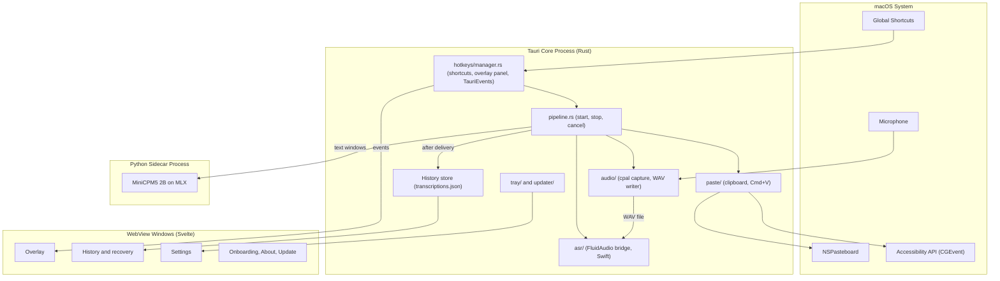
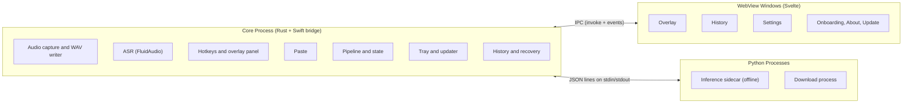
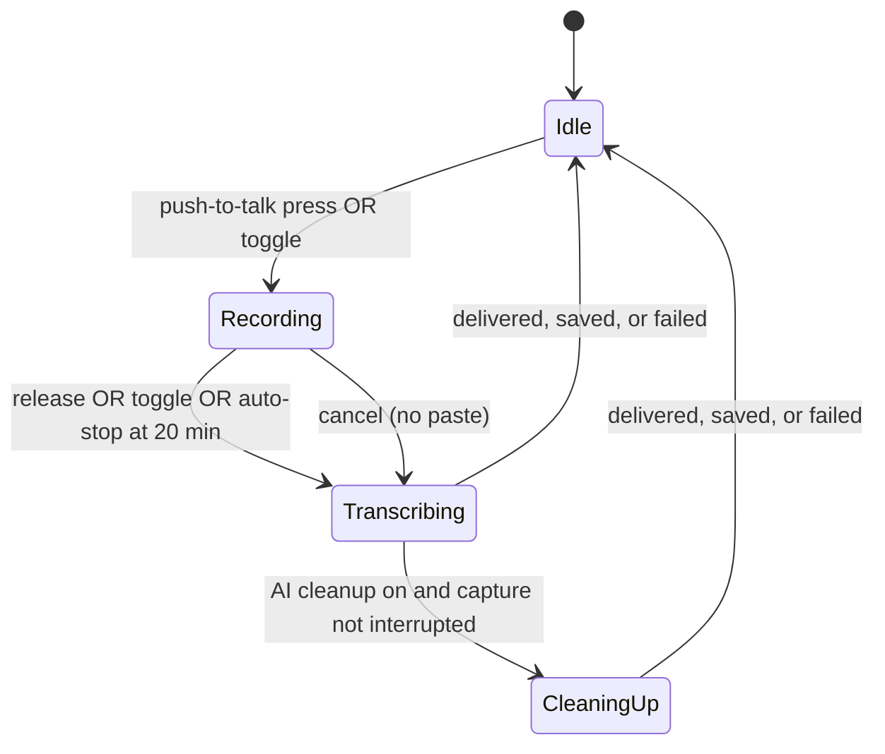
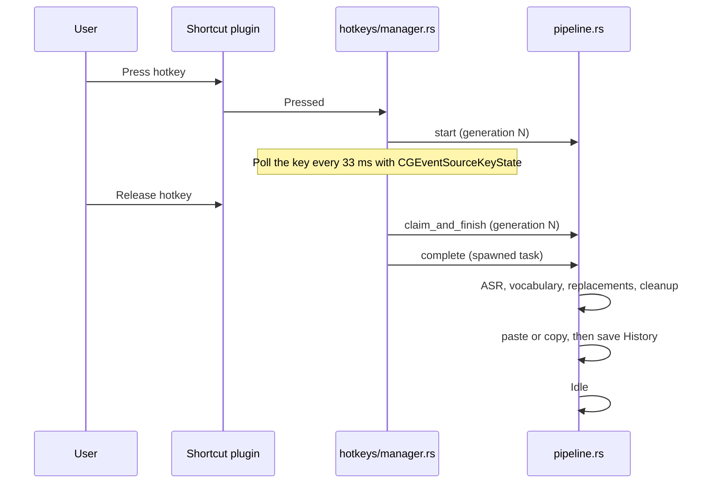
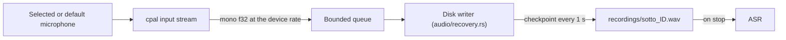

# SottoASR — Architecture & Design Document

- **Version:** 3.0
- **Date:** 2026-11-19
- **Status:** Implemented
- **Author:** juanqui + Claude

---

## Table of Contents

1. [Summary](#1-summary)
2. [Problem Statement](#2-problem-statement)
3. [Design Overview](#3-design-overview)
4. [Technology Stack & Rationale](#4-technology-stack--rationale)
5. [Architecture](#5-architecture)
6. [Detailed Design](#6-detailed-design)
7. [Hotkey System](#7-hotkey-system)
8. [Audio Capture Pipeline](#8-audio-capture-pipeline)
9. [ASR Engine Integration](#9-asr-engine-integration)
10. [Paste-at-Cursor Mechanism](#10-paste-at-cursor-mechanism)
11. [Floating Overlay Window](#11-floating-overlay-window)
12. [System Tray & Menu](#12-system-tray--menu)
13. [Transcription History](#13-transcription-history)
14. [Permissions Management](#14-permissions-management)
15. [Edge Cases & Error Handling](#15-edge-cases--error-handling)
16. [File Structure](#16-file-structure)
17. [Testing Strategy](#17-testing-strategy)
18. [Security Considerations](#18-security-considerations)
19. [Performance Targets](#19-performance-targets)
20. [Cross-Platform Support](#20-cross-platform-support)

---

## 1. Summary

SottoASR is a local, privacy-first automatic speech recognition (ASR) application for macOS. The user presses a system-wide hotkey, speaks, and SottoASR pastes the transcribed text at the cursor. The default backend runs Parakeet Ultra, moondream's post-training of NVIDIA Parakeet TDT v3, through FluidAudio on CoreML and the Apple Neural Engine. ONNX Runtime remains an optional backend. Audio and transcript text never leave the Mac.

The application lives only in the macOS menu bar (no Dock icon, no main window). It has two dictation modes: **press-and-hold** (hold the hotkey, speak, release to transcribe) and **toggle** (press once to start, press again to stop). A floating pill overlay with an audio waveform gives feedback during recording.

After Stop, the recording goes through ASR, optional acoustic vocabulary, exact replacements and optional AI cleanup. Then SottoASR pastes or copies the text, and only after that saves it in History. A private WAV file on disk holds each recording until History saves it, so an interrupted dictation can be recovered.

This version of the document describes the system after the [review remediation](../specs/2026-11-19-review-remediation.md) and the [change to Parakeet Ultra](../specs/2026-11-19-parakeet-ultra-default.md). The [September vocabulary/settings specification](../specs/2026-09-08-vocabulary-settings-performance.md) and the [batched stop-path specification](../specs/2026-09-13-batched-stop-path-correction.md) give the details of vocabulary and cleanup.

---

## 2. Problem Statement

### Design constraints

Dictation products differ in local/cloud execution, vocabulary mechanisms, history,
customization and cost. Sotto's requirements are local speech processing, explicit model setup, predictable
cursor delivery, recoverable history and a menu-bar interface. Current competitor
vocabulary mechanisms and Apple's supported contextual APIs are documented with
primary sources in the [ASR research](../research/2026-09-08-vocabulary-asr.md).

### Goals

1. **Privacy-first**: All audio processing happens locally on the user's machine
2. **Low latency**: Transcription completes within 1-2 seconds of speech ending
3. **Two dictation modes**: Press-and-hold for quick dictation, toggle for longer sessions
4. **Invisible when idle**: Menu bar icon only, no Dock presence, no windows unless recording
5. **Paste anywhere**: Transcribed text appears at the cursor position in any application
6. **Transcription history**: Transcriptions stay available until the user deletes them or sets a retention period
7. **Polished UX**: Floating pill overlay with waveform animation during recording
8. **Performant**: <50 MB memory when idle, <200 MB during transcription

### Non-Goals

- Real-time streaming transcription (words appearing as spoken) — future enhancement
- Cloud-based ASR fallback — strictly local
- Audio file transcription (file import) — future enhancement
- Speaker diarization — future enhancement
- Translation — future enhancement
- Mobile platforms — future enhancement (macOS first)

---

## 3. Design Overview

### High-Level Architecture



### Key Design Decisions

| Decision | Choice | Rationale |
|----------|--------|-----------|
| Desktop framework | Tauri v2 (2.11) | Rust backend for audio/ASR performance, small bundle compared with Electron. Source: [Tauri docs](https://v2.tauri.app/) |
| Frontend framework | Svelte 5 | Small runtime, compiled reactivity. Source: [Svelte docs](https://svelte.dev/) |
| ASR engine (macOS) | FluidAudio 0.18.3 via the vendored bridge `src-tauri/vendor/fluidaudio-rs` | CoreML/Apple Neural Engine, Parakeet Ultra (600M parameters, 25 languages). Models are pinned to fixed commits and verified by SHA-256. |
| ASR engine (cross-platform) | parakeet-rs 0.3 (optional) | ONNX Runtime CPU fallback via the `asr-parakeet` feature flag |
| Audio capture | cpal 0.16 | Audio input in Rust. Version 0.16 holds a stream weakly in its disconnect listener. With 0.15.3, a microphone opened from the device list continued to run after its stream was dropped. |
| Recording storage | Private WAV file per recording | A crash or a failed transcription keeps the audio for recovery |
| One stop path | `pipeline.rs` | Hotkeys, IPC and tests drive the same functions. Tauri effects go through the `PipelineEvents` trait. |
| Delivery order | Paste or copy, then save History | A slow history write does not delay the text |
| Paste mechanism | `NSPasteboard` + CGEvent `Cmd+V` | Works in all apps. The transcript is written as transient, concealed and local-only. The previous clipboard is restored in full. |
| Storage | JSON files with atomic, owner-only writes (`persistence.rs`) | Settings and history survive a crash during a write |
| Hotkeys | tauri-plugin-global-shortcut | System-wide shortcuts. Push-to-talk release is polled with `CGEventSourceKeyState`. |
| Overlay | tauri-nspanel | A non-activating NSPanel does not take focus from the target app |
| AI cleanup | Python sidecar with mlx-lm, stock `openbmb/MiniCPM5-2B-MLX` | Runs on the GPU through MLX. Rust validates every proposed edit. |
| App type | Menu bar only (LSUIElement) | Standard pattern for dictation apps |

### Alternatives Considered and Rejected

| Alternative | Rejected Because |
|-------------|-----------------|
| **FluidAudio / fluidaudio-rs** | ~~Initially rejected~~ → **Adopted as primary macOS backend.** CoreML/ANE is much faster than ONNX on the CPU. Apple-only is acceptable because macOS is the primary target. parakeet-rs stays as a cross-platform fallback via a feature flag. |
| **whisper-rs** | Parakeet TDT v3 has better accuracy (6.34% avg WER on Open ASR Leaderboard) and faster inference. |
| **React + Vite** | Larger runtime, no advantage for this minimal UI. |
| **Next.js** | Must use static export mode, losing all SSR benefits. Adds unnecessary complexity for a desktop app. |
| **Electron** | 150-200 MB bundle, 300-500 MB memory. Antithetical to a lightweight, performant dictation tool. |
| **AXUIElement paste** | Only works in a few apps (TextEdit, Xcode). Clipboard + Cmd+V works universally. |
| **In-process cleanup with mlx-swift-lm** | Measured in a [spike](../research/2026-11-19-in-process-cleanup-spike.md). Its recommendation: not viable as a drop-in replacement today. |

---

## 4. Technology Stack & Rationale

### Runtime Dependencies

| Component | Package | Version | Purpose |
|-----------|---------|---------|---------|
| Desktop framework | `tauri` | 2.11 | Desktop app with Rust backend |
| Frontend | `svelte` | 5.x | Reactive UI with minimal runtime |
| Build tool | `vite` | 8.x | Multi-page frontend bundling |
| ASR (default) | `fluidaudio-rs` (vendored) | FluidAudio 0.18.3 | Swift bridge to FluidAudio on CoreML |
| ASR (optional) | `parakeet-rs` | 0.3 | Parakeet TDT inference via ONNX Runtime (`asr-parakeet`) |
| Audio capture | `cpal` | 0.16 | Microphone input |
| Resampling | `rubato` | 0.16 | Resample to 16 kHz, `asr-parakeet` only |
| Audio encoding | `hound` | 3.5 | WAV file read/write |
| Global shortcuts | `tauri-plugin-global-shortcut` | 2.x | System-wide hotkey registration |
| Clipboard (History window) | `tauri-plugin-clipboard-manager` | 2.x | Copy from the History window |
| Logging | `tauri-plugin-log` | 2.x | Log file and frontend log forwarding |
| Updates | `tauri-plugin-updater` | 2.x | Signed app updates from GitHub Releases |
| Login item | `tauri-plugin-autostart` | 2.x | Launch at login |
| Overlay panel | `tauri-nspanel` | branch `v2.1` | Non-activating NSPanel |
| macOS interop | `core-graphics` + `core-foundation` | 0.24 / 0.10 | CGEvent for paste simulation |
| Clipboard (paste) | `arboard` | 3 | Plain clipboard writes |
| Language detection | `whatlang` | 0.18.0 | Skips cleanup for reliable non-English detections |
| Date/time | `chrono` | 0.4 | Timestamps |
| IDs | `uuid` | 1 | Recording and transcription identifiers |
| Async runtime | `tokio` | 1 | Async tasks and timeouts |
| User dirs | `dirs` | 6 | Platform data directories |

The cleanup sidecar runs `mlx` 0.32.2, `mlx-lm` 0.31.3, `transformers` 5.3.0 and `huggingface-hub` 1.7.2. `src-tauri/sidecar/requirements.lock` pins these and all of their dependencies with SHA-256 hashes.

### macOS System Requirements

- macOS 14 Sonoma or later (`minimumSystemVersion` 14.0)
- Apple Silicon (M1 or later)
- About 632 MB of disk for the speech model, about 103 MB for the optional vocabulary model, and about 1.4 GB for the optional cleanup model. An installation that upgraded from Parakeet TDT v3 also keeps that model (483 MB) until the user deletes it.
- Microphone permission (TCC — Transparency, Consent, and Control, Apple's privacy permissions framework)
- Accessibility permission (TCC) for paste-at-cursor

### Glossary

| Term | Definition |
|------|-----------|
| TCC | Transparency, Consent, and Control — Apple's privacy permissions framework for macOS |
| WER | Word Error Rate — percentage of incorrectly transcribed words |
| RTF | Real-Time Factor — ratio of processing time to audio duration. 20x RTF means 1 second of audio processes in 50ms |
| LSUIElement | An Info.plist key that hides the app from the macOS Dock, making it a background/agent app |
| NSPanel | A macOS window type designed for auxiliary/floating panels that do not take focus |
| Template image | A macOS menu bar image that automatically adapts to light/dark appearance |
| Sidecar | The Python process that runs the cleanup model. Rust starts it and talks to it through stdin and stdout. |
| Manifest | `model-manifest.json`, the SHA-256 and size of each speech and vocabulary model file |
| Generation | A counter for each recording. A late key release or timer cannot stop a newer recording. |

---

## 5. Architecture

### Process Model



**Core process (Rust)** handles all sensitive and performance-critical operations:
- Audio capture and the private WAV file
- ASR model inference through the Swift bridge, which is linked into the process
- Clipboard writes, the clipboard snapshot and the restore
- CGEvent posting (simulated paste)
- Global hotkey registration and the key listener of the shortcut recorder
- Tray icon, menu and update checks
- History, retention and recording recovery

**WebView windows (Svelte)** handle UI only. Components call the typed wrappers in `src/lib/utils/tauri.ts`, which is the only module that calls `invoke`. All UI state comes from commands and from events that Rust emits.

**Python processes** run the cleanup model. The inference sidecar starts with `HF_HUB_OFFLINE=1` and never uses the network. The model download runs in a separate process with the same script. Both start with `python -I`, a cleared environment, `PATH=/usr/bin:/bin` and a fixed `HF_HUB_CACHE`.

### Startup

1. Start the recovery session (`recordings/session.state`) and set the activation policy to Accessory.
2. Check Accessibility without a prompt.
3. Start the key capture thread for the shortcut recorder.
4. Register the shortcuts one by one. If one fails, open Settings with the title "SottoASR — Review Keyboard Shortcuts".
5. Create the hidden overlay panel.
6. If neither the current nor the previous speech model is on disk, open onboarding. Otherwise load ASR in the background. If only the previous model is on disk, the current one then downloads in the background ([section 9](#9-asr-engine-integration)).
7. If AI cleanup is on, prepare and warm the sidecar in the background. An inconclusive runtime check is tried again after about 16, 30 and 60 seconds.
8. Start the update checker and the retention timer (now, then every 6 hours).
9. Sync the login item, but only if the settings file loaded.
10. When the event loop is ready, create the tray icon and open History if recordings wait for recovery.

### State Machine



**States** (`AppStateEnum` in `models.rs`):

| State | Description | Overlay |
|-------|-------------|---------|
| `Idle` | No dictation active | Hidden, or an error card |
| `Recording` | Capturing audio from the microphone | Pill with waveform, timer, Stop and Cancel |
| `Transcribing` | ASR, vocabulary, replacements, paste and history save | "Transcribing..." |
| `CleaningUp` | AI cleanup runs | "Cleaning up..." |
| `Pasting` | Defined in the enum and the overlay. The pipeline does not set it. | "Pasting..." |

A start request while the state is `Transcribing`, `CleaningUp` or `Pasting` does not start a recording. The pipeline emits `hotkey-busy`, and the overlay shows "Still working. Try again in a moment." for 1.5 s. Recovery reprocessing holds the app in `Transcribing`, so a dictation cannot start during it.

`set_state` and `get_state` recover a poisoned lock. The settings that hot paths read (`show_overlay`, `sound_cues`, `input_device`) have atomic mirrors in `AppState`. `update_settings` updates the mirrors after a successful save.

---

## 6. Detailed Design

### 6.1 IPC Commands (Frontend → Rust)

`lib.rs` registers these commands in `generate_handler!`:

| Group | Commands |
|---|---|
| Recording | `start_recording`, `stop_recording`, `cancel_recording` |
| History | `get_transcriptions`, `delete_transcription`, `clear_transcriptions`, `export_transcriptions_csv_file`, `reveal_csv_export` |
| Recovery | `get_recoverable_recordings`, `recover_recording`, `reveal_recovery_recording`, `delete_recovery_recording`, `get_recovery_notice` |
| Settings | `get_settings`, `update_settings`, `apply_shortcuts`, `reset_settings`, `get_settings_load_error`, `list_input_devices` |
| Permissions | `request_accessibility_permission`, `request_microphone_permission`, `check_all_permissions`, `open_accessibility_settings`, `fix_accessibility_permission`, `open_input_monitoring_settings`, `open_microphone_settings`, `open_url` |
| Key capture | `start_key_capture`, `stop_key_capture` |
| Speech model | `get_asr_backend`, `get_model_status`, `init_asr`, `redownload_speech_model`, `delete_previous_speech_model`, `download_model`, `complete_setup` |
| Vocabulary | `get_vocabulary_status`, `prepare_vocabulary_model` |
| AI cleanup | `get_llm_status`, `prepare_llm_model`, `repair_llm_runtime`, `delete_llm_model` |
| Updates | `check_app_update`, `perform_app_update`, `get_update_status` |
| Overlay and shell | `overlay_start_drag`, `dismiss_overlay_error`, `get_overlay_snapshot`, `restart_app`, `reveal_recording_audio`, `open_transcription_history` |

`stop_recording` and `cancel_recording` return after the recording is claimed and its WAV is finalized. The rest of the stop path runs in a spawned task and reports through events.

`apply_shortcuts`, `fix_accessibility_permission` and `open_input_monitoring_settings` have no frontend caller. The contract test lists them as known exceptions.

### 6.2 Tauri Events (Rust → Frontend)

| Event | Emitted when |
|-------|-------------|
| `state-changed`, `overlay-state` | The state or the overlay snapshot changes |
| `recording-started`, `recording-stopped`, `recording-cancelled` | A recording starts, stops or is cancelled |
| `recording-time-warning` | One minute before the 20-minute limit |
| `audio-level` | About 30 times a second during a recording |
| `hotkey-busy` | A start request arrives while a dictation is still processed |
| `recording-error`, `transcription-error`, `paste-error`, `history-save-error` | The pipeline reports a `Failure` of that kind |
| `llm-cleanup-status` | The cleanup outcome of a dictation is known |
| `paste-complete` | The text was pasted or copied |
| `transcription-complete`, `history-error` | History saved the entry, or the save failed |
| `history-changed` | Retention removed entries |
| `recovery-recordings-changed` | The list of recordings that wait for recovery changed |
| `asr-init-started`, `asr-init-complete`, `asr-init-error`, `setup-progress` | Speech model preparation and onboarding progress |
| `model-download-progress` | Every 500 ms during a speech model download |
| `llm-download-progress` | Every 2 s during the cleanup model download |
| `llm-preparation-changed` | Cleanup preparation starts or ends |
| `vocabulary-status` | The vocabulary model status changes |
| `update-available`, `update-up-to-date`, `update-check-error`, `update-download-progress`, `update-installed` | App update checks and installs |
| `key-captured`, `key-modifier` | The shortcut recorder receives keys from the native key listener |

### 6.3 Data Models

**`Settings`** (`models.rs`). `Settings::normalize` trims text fields and drops replacement rows that are empty on both sides. `Settings::validate` runs on every save.

| Field | Default | Meaning |
|---|---|---|
| `push_to_talk_shortcut` | `CommandOrControl+Shift+Space` | Hold to record |
| `toggle_shortcut` | `CommandOrControl+Shift+D` | Press to start and stop |
| `cancel_shortcut` | `Escape` | Registered only while recording |
| `open_settings_shortcut` | `CommandOrControl+Shift+Comma` | Opens Settings |
| `*_shortcut_alt` | none | Alternates for push to talk, toggle and cancel |
| `show_overlay` | `true` | Show the recording pill |
| `auto_paste` | `true` | Paste, or only copy when off |
| `restore_clipboard` | `true` | Restore the previous clipboard after a paste |
| `restore_focus_before_paste` | `true` | Paste into the app that was in front at the start |
| `launch_at_login` | `false` | Login item |
| `llm_cleanup_enabled` | `false` | AI cleanup |
| `llm_cleanup_mode` | `retype` | `retype`, or the experimental `replace` |
| `dictionary` | empty | Exact replacements, up to 200 rows |
| `vocabulary` | empty | Words for acoustic vocabulary, up to 100 |
| `auto_check_updates` | `true` | Periodic update checks |
| `input_device` | none | cpal device name. None follows the system default. |
| `sound_cues` | `false` | System sounds for start, stop, cancel, busy and error |
| `history_retention_days` | `0` | Delete history older than N days. 0 keeps it. |
| `audio_retention_days` | `0` | Delete kept recordings older than N days. 0 keeps them. |

`validate` rejects empty required shortcuts, shortcuts that do not parse, duplicate shortcuts (alternates and Open Settings included), a push-to-talk key that the release poller cannot watch, retention values above 3,650 days, and a microphone name with control characters or more than 256 characters. It also validates the dictionary and the vocabulary.

The model no longer has `model_path`, `language` or `max_history`. `persist_settings` still writes them with the fixed values `""`, `"auto"` and `500`, because earlier builds require these keys to parse the file. Without them, a rollback registers no hotkeys.

**`Transcription`** (`models.rs`):

| Field | Meaning |
|---|---|
| `id` | Recording ID (UUID). The WAV file is `sotto_<id>.wav`. |
| `text` | Delivered text: ASR with vocabulary, replacements and accepted cleanup |
| `raw_text` | Original ASR text, present when post-processing changed the text |
| `duration_ms`, `word_count`, `created_at` | Recording facts |
| `saved_at` | Time of the first history save. Retention measures age from here. |
| `cancelled` | The user cancelled the recording |
| `capture_error` | The capture was interrupted. The text covers only the captured part. |
| `llm_cleanup_status` | Cleanup outcome (`Applied`, `Rejected`, `TimedOut`, `Unavailable` and more) |
| `cleanup_suggestion`, `llm_applied` | Fields of earlier versions, still read |

**`ModelStatus`** has `initializing`, `error`, `downloaded`, `loaded`, `path`, `name`, `size_bytes`, `integrity_warning`, `notice` and `previous_model`. The warning is set when a speech model file that was already on disk differs from the manifest. `name` is "Parakeet Ultra (CoreML)" or "Parakeet TDT v3 (CoreML)", and `path` is the folder of the loaded model. `notice` is set while Parakeet Ultra is prepared in the background, and after a fallback to Parakeet TDT v3. `previous_model` (`name`, `size_bytes`) is set while Parakeet TDT v3 is still on disk and Parakeet Ultra is loaded with no file mismatch; the model dashboard then offers to delete it.

---

## 7. Hotkey System

### Registration

`tauri-plugin-global-shortcut` registers the shortcuts. At launch, `setup_hotkeys` registers each shortcut from the in-memory settings on its own. A shortcut that is empty, does not parse, is a duplicate, or cannot be registered is skipped and reported. The other shortcuts stay registered. If the settings file cannot be read, the default shortcuts register.

A settings save that changes shortcuts requires the Idle state. If the new shortcuts cannot be registered, the previous ones return.

### Press-and-Hold Mode



The push-to-talk handler polls the key state with `CGEventSourceKeyState` every 33 ms, starting 100 ms after the press. When the key is up, the recording stops. `Settings::validate` refuses a push-to-talk key that the poller cannot watch. At the 20-minute limit the recording stops even if the key is still held.

### Toggle Mode

The toggle shortcut stops the recording when the state is Recording. Otherwise it starts one. The same `pipeline::start`, `claim_and_finish` and `complete` functions run as in press-and-hold mode.

### Cancel Mechanism

The cancel shortcut (default `Escape`) is registered when a recording starts and unregistered when it stops or is cancelled. Thus `Escape` works normally in other apps.

Cancel pastes nothing. The pipeline still transcribes the recording and saves it in History as cancelled. A cancelled recording that is too short to transcribe leaves an empty cancelled entry.

### Generations

Each recording has a generation number. `claim_recording_end(generation)` ends only that recording. A late key release, an auto-stop timer or a device error from an older recording cannot stop a newer one. The completion step compares both the job ID and the generation before it delivers text.

### Shortcut Recorder

The shortcut recorder in Settings uses a native CGEventTap. The tap is enabled only while a shortcut is recorded. Capture starts only in the Idle state. While it runs, the global shortcuts are unregistered and a recording cannot start. The callback enables the tap again when macOS disables it for a timeout or for user input. If the native tap cannot start, the recorder uses the keyboard events of the Settings window.

---

## 8. Audio Capture Pipeline

### Flow



### Device Selection

`start_recording_capture_with_errors` passes `state.input_device` to the cpal backend. The backend always opens a device from `input_devices()`: the named one, or the entry whose name equals the name of the default device. Names are compared after trimming. These devices get the disconnect listener of cpal. cpal 0.16 holds the stream weakly in that listener. With 0.15.3, a microphone opened from the device list continued to run after its stream was dropped. If more than one device has the name of the default device, the backend uses `default_input_device()`, so that it cannot open the wrong one. At stop, the backend pauses the stream before it drops it.

A selected device that is absent is an error: `The microphone "<name>" is not connected. Connect it, or choose another microphone in Settings.` There is no silent fallback to another microphone. `list_input_devices` gives Settings the device names, without duplicates, and marks the default.

### Checks at Start

- If `microphone_authorization()` is `Denied` or `Restricted`, the start fails with an error that names the Microphone pane of System Settings. If it is `NotDetermined`, opening the device makes macOS show its prompt.
- If no device is available, the error is "No microphone is available. Connect a microphone, then try again."
- If the recordings folder is unusable, recording is disabled until the problem is resolved.

### The WAV File

The disk writer is the only code that touches the disk. Audio callbacks only put chunks in the queue. The queue holds up to 10 s of audio at the sample rate of the stream. If more audio waits, the recording stops with "Recording storage could not keep up" instead of dropping speech.

| Point | Action |
|---|---|
| Start | Write the WAV header, `sync_all` the file and the folder |
| Every 1 s | Update the header and `fsync` the data |
| Stop | Append 750 ms of silence, finalize the header, `sync_all` |

Files are mono 32-bit float at the device sample rate. The folder has mode 0700 and each file 0600, opened with `O_NOFOLLOW`. A symlinked folder is refused.

### Stall Watchdog

For a live device, the writer reports a capture error once when no chunk arrives for 5 s before the first chunk, or for 2 s after it. The watchdog uses a monotonic clock that does not advance while the Mac sleeps. Mock backends in tests have no watchdog. A capture error marks the dictation as interrupted: the WAV is kept and nothing is pasted.

### Digital Silence

The writer records whether any sample was not zero. If a recording has at least 4,000 samples and all of them are exactly zero, `finish_recording_capture` deletes the WAV and reports: "The microphone sent only silence. Turn on Microphone access for SottoASR in System Settings > Privacy & Security > Microphone, and check that the microphone is not muted." Recordings with fewer than 4,000 samples are too short to transcribe and are deleted. Errors from `finish_recording_capture` are microphone or storage errors, so the pipeline reports them as recording failures.

### Audio Level Metering

The capture callback computes an input level and the overlay receives it about 30 times a second as `audio-level`. The overlay draws the waveform on a canvas with a ring buffer and rolling-window normalization.

### Sound Cues

When `sound_cues` is on, `audio/cue.rs` plays a system sound from `/System/Library/Sounds` through `NSSound`: Tink (start), Pop (stop), Bottle (cancel), Funk (busy) and Basso (error). It never blocks the caller.

### Recording Limit

A recording stops automatically after 20 minutes. The overlay shows a countdown during the last minute.

---

## 9. ASR Engine Integration

### FluidAudio Bridge

`src-tauri/vendor/fluidaudio-rs` is a small, ASR-only Swift bridge with a synchronous C interface. It uses FluidAudio 0.18.3, which SwiftPM fetches at a pinned commit. `build.rs` applies two checksum-guarded patches to the SDK, `model-registry-revision.patch` and `tree-lister-revision.patch`. They make model downloads read the pinned commits instead of `main`. The two earlier patches for vocabulary alignment and CTC tensor access are upstream in 0.18.3 (FluidAudio #961 and #1039). [The bridge README](../../src-tauri/vendor/fluidaudio-rs/README.md) is the reference for the bridge.

FluidAudio 0.18.3 has its own `ModelRegistry.revisionOverrides`, but the bridge does not use it. With a revision other than `main`, the SDK's `ModelCache` deletes local files that the remote listing does not contain, and whole bundles with one mismatching file. That would delete `.sotto-integrity.json` and the copies that a re-download keeps.

| Manifest entry | Model | Repository | Folder | Files |
|---|---|---|---|---|
| `speech` | Parakeet Ultra | `FluidInference/parakeet-ultra-coreml` | `parakeet-ultra` | 18 files, 632 MB |
| `previous_speech` | Parakeet TDT v3 (INT8), kept only for existing installations | `FluidInference/parakeet-tdt-0.6b-v3-coreml` | `parakeet-tdt-0.6b-v3` | 21 files, 483 MB |
| `vocabulary` | CTC 110M | `FluidInference/parakeet-ctc-110m-coreml` | `parakeet-ctc-110m-coreml` | 12 files, 103 MB |

The models are cached in `~/Library/Application Support/FluidAudio/Models/`. The bridge takes the model version from the folder name: `parakeet-ultra` loads as Parakeet Ultra and `parakeet-tdt-0.6b-v3` as Parakeet TDT v3. Both use the same four bundles and the same compute units.

### Model Download and Verification

`model-manifest.json` lists the SHA-256 and size of each file that the bridge loads. `asr/integrity.rs` checks the speech and the vocabulary model with the same policy before CoreML loads anything. A record in `.sotto-integrity.json` keeps the verdict of each file by size, modification time and inode. Thus a file is hashed again only after it changes. This includes a file with a known mismatch, so its warning stays without a new hash at each launch.

- A file is fresh when the current preparation wrote it, that is, it was absent or different when the preparation started. The record saves the files that are present before the first download starts. The model folder is created first for this, and a preparation that cannot save the snapshot stops before it downloads. Thus a preparation that stops early (a quit, a lost network, a read error) is judged against its real start the next time. When the pinned commit changes, every file is judged again, but the rejections and the saved start stay.
- A fresh file that fails the check stops the load and stays on disk. It was never in use, so the next preparation that can download deletes it and fetches it again.
- A file that was already on disk and fails the check still loads, because blocking it gives no protection for a file that is already in use. `ModelStatus.integrity_warning` is set, and Settings offers **Re-download speech model**. Only this confirmed re-download replaces the file.
- `redownload_speech_model` requires the Idle state at its start. It moves the failing files of the speech model, and of the vocabulary model if it was prepared, aside. Then it downloads them at the pinned commit, verifies them, and deletes the moved copies. If the download fails, it moves the copies back and removes `.partial` leftovers. Then it reloads the engine. Dictation continues with the loaded model while the files download. A dictation that starts while the vocabulary files are replaced runs without the vocabulary boost (`model::VOCABULARY_FILES`). The model dashboard shows the progress.
- If the app quits during a re-download, the next preparation moves back every file whose place is empty.

Download and verification run outside the engine lock. The lock covers only loading and compilation. During preparation, `init_asr` emits `model-download-progress` every 500 ms. The progress is the size of the cache folder against the manifest total.

### Speech Model Selection and Upgrade

Earlier versions used Parakeet TDT v3. `asr/model.rs` decides which verified speech model to load, and `FluidAudioEngine::load` reads the selected folder. A model is loadable when the manifest check finds no missing file and no fresh mismatch. Steps 1 and 2 use no network:

1. Parakeet Ultra is loadable: load it.
2. Otherwise Parakeet TDT v3 (`previous_speech`) is loadable: load it, and mark an upgrade as pending.
3. Otherwise download and verify Parakeet Ultra with progress, as on a new installation, and load it.

`is_model_available` is true when the files of either model are present, so an existing installation does not see onboarding again. The app never downloads Parakeet TDT v3 again. It only verifies and loads it.

With an upgrade pending, `init_asr` starts the upgrade in the background and returns. The upgrade downloads and verifies Parakeet Ultra without progress events. Then it waits until the app is Idle, checking twice a second for at most 10 minutes, and reloads the engine with Parakeet Ultra. During the reload, a dictation that stops gets the "still loading" message and keeps its recording. While Parakeet TDT v3 serves, Settings shows "Ready" and the `notice`.

`parakeet-tdt-0.6b-v3/` and the older `parakeet-tdt-0.6b-v3-coreml/` stay on disk until the user deletes them. The first is the fallback when CoreML cannot load Parakeet Ultra; nothing reads the second. An older app version still loads its `parakeet-tdt-0.6b-v3/` folder and ignores `parakeet-ultra/`. During the change the cache holds both speech models (483 MB and 632 MB), and peak resident memory rises by about 157 MiB (487 to 644 MiB in the LibriSpeech run).

`delete_previous_speech_model` deletes those two folders after a confirmation in the model dashboard, and returns the bytes freed. It deletes only when all of these hold: Parakeet Ultra is the selected model, the engine has a model loaded, and Parakeet Ultra's files pass the manifest check with no missing file and no mismatch. Thus the next start loads Parakeet Ultra without the fallback. The command holds the preparation claim, so `init_asr`, the background upgrade and a re-download cannot select Parakeet TDT v3 during the deletion. It does not take the engine lock. Symbolic links are removed and not followed. The [specification](../specs/2026-11-19-delete-previous-speech-model.md) lists the cases.

### Transcription Flow

`pipeline::transcribe_with_deadline` runs every transcription, including recovery reprocessing:

1. If the model is loading, fail at once with "Speech model is still loading; your recording was kept." If loading finished with an error, fail with that error and "Your recording was kept."
2. If an earlier call missed its deadline and still holds the engine, fail at once with a message to quit and reopen SottoASR.
3. Otherwise call the engine with a deadline of 60 s plus half the recording length.
4. If the deadline passes, set `asr_stuck` and fail. The blocking call cannot be stopped. It clears `asr_stuck` when it returns.

In every case the audio is kept and the state returns to Idle.

### Vocabulary

With vocabulary words saved, the bridge also runs the CTC 110M model and returns candidate scores and exact ranges beside the untouched TDT text. The Rust policy in `asr/vocabulary.rs` decides which substitutions are safe. For a recording of 30 s or less, the bridge decodes the audio once and gives the same samples to both models. Longer recordings keep the file path, because the SDK streams them from disk.

Saving a changed, non-empty vocabulary prepares the vocabulary model. Dictation itself never downloads a model.

### Performance Expectations

On 2026-11-19, on an M2 Pro with 32 GB and CoreML CPU + Neural Engine, Parakeet Ultra had a median time per clip of 59.1 ms and 56.6 ms on the two sets of synthetic clips (Parakeet TDT v3: 58.4 ms and 55.1 ms). On LibriSpeech test-other, its peak resident memory was 644 MiB (Parakeet TDT v3: 487 MiB), and its total decode time was 254 s (Parakeet TDT v3: 225 s). On 2026-09-08, on an M4 with 32 GiB, Parakeet TDT v3 with CPU+ANE had a 62.70 ms warm median on short synthetic clips. The [Parakeet Ultra research](../research/2026-11-19-parakeet-ultra.md) and the [model measurements](../../benchmarks/asr/README.md) give the method and the limits.

---

## 10. Paste-at-Cursor Mechanism

### Delivery Order

`pipeline::deliver` runs after ASR:

1. Apply exact replacements, unless the capture was interrupted.
2. Run AI cleanup, if it is on and the capture was not interrupted.
3. Set `last_transcription`.
4. Paste or copy the text, if the capture was not interrupted and the text is not empty.
5. Save the entry in History.
6. Delete the WAV, if the capture was not interrupted and the save succeeded.

If the paste succeeds but the history save fails, the overlay shows `history-save-error` with the path of the kept audio.

### Target Selection

If `restore_focus_before_paste` is on, the target is the app that was in front at the start. If the user switched to another app during the recording, the target is that app. If `restore_focus_before_paste` is off, the paste goes to the app in front.

The pipeline decides at delivery which app is to receive the paste: the target app, or the app in front when there is no target. If that app is SottoASR itself, the pipeline copies the text instead and reports "SottoASR was the active app, so the text was copied instead of pasted."

If `auto_paste` is off, the pipeline only copies the text. If a paste fails, the pipeline copies the text as a fallback and the error card says "Text is on the clipboard".

### Paste Steps (`paste/macos.rs`)

1. Make sure that Accessibility is trusted (`AXIsProcessTrusted`).
2. Write the transcript to the clipboard (see the next section).
3. Wait 30 ms.
4. If the target app is not in front, activate it with `activateWithOptions:` (option 2, without all windows) and wait for it. The fallback is `/usr/bin/osascript`. If the target is already in front, skip this step.
5. Post `Cmd+V` through CGEvent. If the first attempt fails, try once more after 50 ms.
6. Schedule the clipboard restore.

### Clipboard Write and Restore

If `restore_clipboard` is on, `paste/pasteboard.rs` works with `NSPasteboard` directly:

- **Snapshot.** Read every pasteboard item as `(type, bytes)` pairs, one type at a time. If the running total passes 64 MB, abandon the snapshot. One large representation can still be read in full before the limit applies.
- **Transient write.** Write the transcript with `prepareForNewContentsWithOptions:` and `NSPasteboardContentsCurrentHostOnly`, so it does not go to Universal Clipboard. Add the markers `org.nspasteboard.TransientType`, `org.nspasteboard.ConcealedType` and `org.nspasteboard.AutoGeneratedType`, so that clipboard managers skip it.
- **Restore.** After 500 ms, write all items back with their original types, but only if the change count of the pasteboard is still the one after our write. If the user copied something in the meantime, the restore is skipped.
- **No snapshot.** If the snapshot was abandoned, the transcript is written as a normal copy and stays on the clipboard.

If `restore_clipboard` is off, or in copy-only mode, the transcript is a normal copy. A paste that starts while a restore is pending takes that restore over, so the clipboard that the user had before the first paste returns. A paste counts as in flight from its snapshot until its restore is scheduled. At exit, `paste::wait_for_pending_restore` waits up to 800 ms for pastes in flight and for scheduled restores. One lock serializes the pasteboard calls of the module, and the new contents are built before the pasteboard is cleared.

### Requirements

- **Accessibility permission** must be granted in System Settings → Privacy & Security → Accessibility.
- `AXIsProcessTrusted()` can return true before the permission works. At launch, SottoASR also does a functional check with an `AXUIElement` query and logs the result.

---

## 11. Floating Overlay Window

### Design

The overlay is a borderless, transparent, always-on-top pill. `precreate_overlay` creates it hidden at startup (300 × 110 points), so that the first recording does not take focus. `tauri-nspanel` converts it to an NSPanel with the `NonactivatingPanel` style mask and the floating level. A click on the pill or on its error card does not activate SottoASR. An error card does not take keyboard focus when it appears, so typing continues to go to the app of the user. The overlay window accepts the first click, so a click on a button works at once. A click on the card can give it keyboard focus. The user can drag the pill. SottoASR saves its position in `overlay_positions.json`.

### States

| Phase | Content |
|---|---|
| Recording | Waveform, timer, Stop button and Cancel button. A banner shows "Recording stops in M:SS" during the last minute. |
| Transcribing | "Transcribing..." |
| Cleaning up | "Cleaning up...". After 5 s it says that cleanup takes longer than usual. |
| Cleanup result | A badge: "Cleaned", "Original kept", "Cleanup unavailable", "Cleanup failed", "Cleanup timed out" and more. It stays 800 ms for an applied result and 2,000 ms for a failure. |
| Busy | "Still working. Try again in a moment." for 1.5 s |
| Error | A card with a title ("Recording unavailable", "Transcription failed", "Paste failed", "History not saved"), the error, and **Show audio**, **History** or **Dismiss** |

The error card stays until the user dismisses it or starts a new recording. It shows even when `show_overlay` is off. `show_overlay` reads the atomic mirror in `AppState`, so a busy settings lock cannot hide the pill.

The overlay pill keeps its own dark palette, because it floats over arbitrary content. The other windows follow the system appearance through `prefers-color-scheme`.

---

## 12. System Tray & Menu

### Tray Icon

The tray icon is a template image. It is created at `RunEvent::Ready`, after the event loop is ready, to prevent duplicate icons ([tauri#9480](https://github.com/tauri-apps/tauri/issues/9480)). The menu opens on a left click.

### Menu

| Item | Behavior |
|---|---|
| Copy Last Transcription | Copies the last transcript of this session |
| View Transcription History | Opens the History window |
| Settings... | Opens the Settings window |
| Check for Updates... / Update Available — `<version>` / Restart to Update | Opens the update window or restarts into the installed update |
| Copy Diagnostics | Copies the app version, the macOS version and the last 100 log lines, with the home folder shown as `~` |
| About SottoASR | Opens the About window |
| Quit SottoASR | Exits the app |

`setup_tray_menu` registers `on_menu_event` once. A refresh only rebuilds the menu, so each click runs its action once.

### Quit During a Dictation

If the state is not Idle, `begin_exit` refuses the exit and a dialog "Finish dictation before quitting" offers **Keep SottoASR Open** and **Quit Anyway**. Quit Anyway sets `force_exit`. If a recording runs, it claims the end of the recording first and finalizes the WAV. If a stop already holds the recording, Quit Anyway waits up to 2 s for that stop to finish the file. The next launch offers the WAV for recovery.

### Updates

The update checker runs 15 s after launch and then every 4 hours, if `auto_check_updates` is on and the settings file loaded. Each check has a 30 s timeout. The update window ignores check events unless it is checking itself, and it moves to the ready state on `update-installed`.

**Restart.** "Restart Now" calls `restart_app`. On macOS it starts a small shell helper in its own process group and then exits the app in the normal way. The helper waits until the app's process has ended (at most 60 s), then starts the bundle with `/usr/bin/open -n` (`relaunch.rs`). Thus LaunchServices starts the new copy as Finder does. Tauri's own restart starts the executable in the bundle as a child of the exiting process. After an update replaced the bundle, macOS refused that child on 2026-11-19 ("Security policy would not allow process" in the system log), so the app closed and did not come back. A child that does start has the old process as its responsible process, and then lacks its Accessibility and Input Monitoring grants. Tauri's restart remains only for a binary outside an `.app` bundle, such as a development build.

---

## 13. Transcription History

### Storage

History is `~/Library/Application Support/com.sottoasr.app/transcriptions.json`. `persistence.rs` writes it atomically with mode 0600. Entries are newest first. The store keeps at most 5,000 entries. An entry that the limit removes also loses its WAV and receipt, unless it is an interrupted entry. The store sets `saved_at` at the first save.

### Deletion and Retention

- `delete_transcription` and `clear_transcriptions` remove the entries and then their WAV files and receipts. The confirmation dialogs say that the kept audio is deleted. When a tombstone receipt is necessary, it is written before the audio is deleted. If the audio delete then fails, that tombstone is removed again, so the recording stays in the recovery list. While another SottoASR instance owns the recordings folder, a history delete removes the entries and leaves the audio.
- `enforce_retention` removes history entries older than `history_retention_days`, measured from `saved_at` (or from `created_at` for entries of earlier versions). It removes the audio of an entry only when the entry was not interrupted. The audio of an interrupted entry follows `audio_retention_days`.
- `enforce_retention` removes recordings older than `audio_retention_days`, by modification time. This includes recordings that wait for recovery.
- Retention runs at startup, every 6 hours, and when a retention setting changes. It runs only in the Idle state and skips silently until the next pass otherwise. It counts a value above 3,650 days as 3,650 days.
- Deletion and retention never touch the active recording, and act only when they get the recovery claim. Thus they cannot remove a file that a reprocess reads.

### Recording Recovery

`commands/recovery.rs` lists every `sotto_<id>.wav` in `recordings/` that has no completed history entry and no receipt. An interrupted entry does not count as completed. At launch, SottoASR opens History when recordings wait for recovery or when the previous session did not end cleanly.

- **Reprocess** transcribes the WAV with `transcribe_with_deadline`, runs cleanup if it is on, and saves the result in History. It never pastes. It keeps the WAV and writes a receipt, so the recording is not offered again.
- **Show in Finder** reveals the WAV.
- **Delete audio** deletes the WAV and its receipt.
- Older recordings in the system temporary folder are copied into `recordings/`. The originals are not changed. If a legacy copy still exists when a recording is deleted, a tombstone receipt stops the next scan from importing it again.

`recordings/session.state` holds `running` while the app runs and `clean` after a normal exit. A file lock stops a second instance from using the folder.

### History Window

The History window (680 × 760) shows 50 entries per page, newest first, with a search over all history and filters for cleanup results. Each entry can show the original text and the changes. **Export CSV** writes all entries to `~/Downloads/SottoASR-transcriptions-<date>-<uuid>.csv` with mode 0600 and offers **Show in Finder**. Cells that start with `=`, `+`, `-` or `@` get a leading `'`. Relative times refresh every minute.

---

## 14. Permissions Management

### Required Permissions

| Permission | Purpose | How SottoASR asks |
|------------|---------|----------------|
| Microphone | Audio capture | Onboarding **Grant Access**, or the macOS prompt at the first recording |
| Accessibility | Simulated `Cmd+V` | `AXIsProcessTrustedWithOptions` with the prompt option, from onboarding or Settings → Advanced |
| Input Monitoring | Native key listener of the shortcut recorder | Optional. Without it, the recorder uses the keyboard events of the Settings window. |

### Implementation

- `microphone_authorization()` reads the AVFoundation authorization status through the Objective-C runtime and never shows a prompt.
- `request_microphone_permission` returns at once if the status is known. If it is not determined, it opens the default input device to make macOS show the prompt.
- `check_all_permissions` reports Microphone, Accessibility (trusted, and the functional check) and Input Monitoring. "Restart needed" means trusted but not functional.
- `open_url` opens only `https` links whose host is exactly `huggingface.co`, `github.com` or `sottoasr.app`, without user information. It runs `/usr/bin/open`.
- System tools are started by their full path: `/usr/bin/open`, `/usr/bin/osascript`, `/usr/bin/tccutil`, `/usr/bin/curl`, `/usr/bin/shasum` and `/usr/bin/tar`.

---

## 15. Edge Cases & Error Handling

### Audio Issues

| Scenario | Handling |
|----------|----------|
| Microphone permission denied or restricted | Start fails with an error that names the Microphone pane of System Settings |
| No microphone available | Start fails: "No microphone is available. Connect a microphone, then try again." |
| Selected microphone not connected | Start fails with the device name. No fallback to another microphone. |
| Microphone disconnected or silent during recording | cpal error or watchdog. The dictation is interrupted, the WAV is kept, nothing is pasted. |
| Bluetooth microphone slow to deliver its first buffer | The first-chunk limit is 5 s |
| Input delivers only exact zeros | The WAV is deleted and the silence error names both causes |
| Very short recording (fewer than 4,000 samples) | Deleted. A cancelled short recording leaves an empty cancelled entry. |
| Recording reaches 20 minutes | Stops automatically. A countdown shows during the last minute. |
| Capture queue full | Recording stops with "Recording storage could not keep up" |

### ASR Issues

| Scenario | Handling |
|----------|----------|
| Model still loading | Fails at once. The recording is kept. |
| Transcription exceeds its deadline | Recording kept. Later dictations fail at once until the stuck call returns. |
| Freshly downloaded model file fails the manifest | Error. The files are kept and nothing loads. |
| Existing model file differs from the manifest | Loads with a warning. Settings offers a confirmed re-download. |
| Setup fails in onboarding | Onboarding shows the error text and **Try Again** retries in place |
| Background Parakeet Ultra download fails (for example offline) | Parakeet TDT v3 stays in use. No error is shown. The next launch tries again. |
| Background Parakeet Ultra file fails the manifest | Parakeet Ultra is not loadable, and Parakeet TDT v3 keeps serving. The next preparation fetches the file again. |
| Verified Parakeet Ultra files that CoreML cannot load | Parakeet TDT v3 loads if it is on disk, and Settings shows the `notice`. On a new installation the load error is shown. |
| App not Idle within 10 minutes after the background download | No reload. Parakeet Ultra loads at the next launch. |
| Re-download or `init_asr` while the background upgrade runs | Refused by the preparation claim. The model in use is unaffected. |
| Parakeet TDT v3 in use, and one of its files differs from the manifest | Loads with the warning. A confirmed re-download fetches Parakeet Ultra. |

### Paste Issues

| Scenario | Handling |
|----------|----------|
| Accessibility permission not granted | Paste fails, the text is copied, and the error card says so |
| The app that is to receive the paste is SottoASR | Text is copied instead of pasted |
| Paste succeeds, history save fails | Text is delivered. The overlay shows the save error and the audio path. |
| Clipboard holds more than 64 MB | Snapshot abandoned. The transcript stays on the clipboard. |
| User copies during the 500 ms restore window | Change count differs. The restore is skipped. |
| Quit right after a paste | The exit waits up to 800 ms for the restore |

### Hotkey and Settings Issues

| Scenario | Handling |
|----------|----------|
| A saved shortcut cannot be registered at launch | It is skipped. The others stay registered. Settings opens for review. |
| Invalid settings on save | Save is refused with the reason. Nothing is written. |
| Incomplete replacement row | Save is blocked with an inline message |
| Settings file cannot be read | Default shortcuts register. Settings offers **Back up and reset**, which renames the file to `settings.json.unreadable-<UTC timestamp>` and writes defaults. |
| Shortcut change while recording | Refused until the app is Idle |
| Key capture requested while recording or transcribing | Refused. Shortcuts stay registered. |
| Start request while a dictation is processed | `hotkey-busy`, busy cue, and the "Still working" notice |
| Quit during a dictation | Dialog with **Quit Anyway**. The WAV is finalized and offered at the next launch. |
| App crash during recording | The WAV up to the last checkpoint (about 1 s) is offered at the next launch |

### Cleanup Issues

| Scenario | Handling |
|----------|----------|
| Long dictation reaches the 60 s cleanup limit | No chunk is sent once less than 15 s (the response deadline of one request) is left of the 60 s. Thus cleanup ends within 60 s, and the budget never stops a healthy sidecar. Validated edits apply, the rest stays raw. |
| Sidecar unavailable or a request times out | Dispatch stops. The rest stays raw. |
| Runtime packages differ from the lock | Cleanup loads on the existing runtime, and the preparation returns. Then a separate background sync (at most one per launch, not shown as preparing) rebuilds the runtime from the lock with short pip network limits. The old runtime stays aside until the new one loads, and comes back if the new one does not load. If the sync fails, cleanup continues on the existing runtime. If cleanup does not load on the out-of-date runtime, the preparation rebuilds it at once with the normal pip settings. |
| Quit during setup or a repair | The next preparation removes the unfinished build in `llm-venv.staging` and moves back a runtime that was left aside. A preparation that finds the runtime Ready removes leftover aside copies. |
| Cleanup model download makes no progress for 120 s | The download stops with an error |
| No native arm64 Python 3.11 to 3.14 installed | A pinned standalone Python is downloaded and verified. A partial download that a quit left behind is removed. |

---

## 16. File Structure

[DEVELOPMENT.md](../../DEVELOPMENT.md) lists the project layout and every Rust module. The main parts:

```
sottoasr/
├── *.html                          # Vite page entries: index, overlay, history, settings,
│                                   # onboarding, about, update
├── src/                            # Svelte frontend: entry scripts and src/lib/
├── src-tauri/
│   ├── src/                        # Rust backend
│   │   ├── pipeline.rs             # The only dictation pipeline
│   │   ├── hotkeys/manager.rs      # Shortcuts, overlay panel, TauriEvents adapter
│   │   ├── audio/                  # Capture, WAV writer, cues, resampling
│   │   ├── asr/                    # Engines, model preparation, integrity
│   │   ├── paste/                  # Paste, pasteboard snapshot and restore
│   │   ├── llm/                    # Cleanup sidecar, download, planner, validation
│   │   ├── commands/               # IPC handlers
│   │   ├── tray/, updater/         # Menu bar and updates
│   │   └── state.rs, models.rs, persistence.rs, dictionary.rs, process.rs, relaunch.rs
│   ├── sidecar/                    # llm_cleanup.py, requirements.in, requirements.lock
│   ├── vendor/fluidaudio-rs/       # Swift bridge, patches, model-manifest.json
│   ├── capabilities/               # default.json, history.json, settings-close.json
│   └── .cargo/                     # config.toml (linker), audit.toml
├── scripts/                        # ci-checks.sh, pre-release-check.sh, probes, tests
└── docs/designs/architecture.md    # This document
```

---

## 17. Testing Strategy

### Rust Tests (`cargo test`)

| Area | Tests |
|--------|-------|
| Pipeline | The tests drive the production `pipeline.rs` through a collecting `PipelineEvents`. They cover a stale generation, paste before the history save, a history failure after a paste, the own-PID target, the ASR deadline (with a paused clock), busy starts, Quit Anyway and concurrent stop and cancel. |
| Capture | A live backend that stops sending triggers one interrupted capture. A mock backend never does. All-zero capture is an error and removes the WAV. A checkpoint survives an abrupt process exit. |
| ASR | A fresh mismatched file is an error and stays on disk. An existing mismatched file loads with a warning. The manifest and the revision patch agree. |
| Paste | Snapshot and restore of two items with several types on a unique pasteboard. The restore is skipped after a foreign change. An oversized snapshot is abandoned. The transient write carries the three markers. |
| Settings | Duplicate shortcuts and invalid replacement rows are refused. The written file still parses for a build that requires the legacy keys. Reset backs up the file and refuses unless Idle. `open_url` rejects other hosts. The tray handler is registered once. |
| History | Delete and clear remove audio and receipts. Retention removes only expired entries, measures from the save, keeps interrupted audio and never touches the active recording. A deleted legacy recording is not imported again. |
| Cleanup | The lock and the sidecar pins agree. Every lock entry has a hash, and the install requires hashes. A drifted runtime is stale. Repair replaces a runtime whose interpreter link is broken. A stalled download fails after the stall limit. Dispatch stops on a transport failure and on the budget. Repeated number words stay. |

### Other Tests

| Suite | Command | Covers |
|---|---|---|
| Frontend | `npm test` | Components and stores. `tauri.test.ts` checks every wrapper against `generate_handler!` and every plugin call against the capability files. |
| Sidecar | `python3 -m unittest discover -s src-tauri/sidecar -p 'test_*.py'` | Sidecar protocol and preparation, without a model or the network |
| Scripts | `python3 -m unittest discover -s scripts -p 'test_*.py'` | Workflow pins and secret scopes, the release target check |
| ONNX backend | `cargo test --no-default-features --features custom-protocol,asr-parakeet --lib audio::resample` | Resampler output length and tail at 48 kHz to 16 kHz |
| Swift bridge (manual) | `python3 scripts/check-asr-cache.py`, `python3 scripts/check-vocabulary-cache.py` | Loaders keep every file after a failed load or download; model URLs use the pinned commits |
| Configuration | `bash scripts/ci-checks.sh` | Versions, capabilities, command registration, changelog, website badge |

PR CI (`.github/workflows/ci.yml`) runs all of these except the Swift bridge probes, and also `cargo clippy --all-targets -- -D warnings`, `cargo audit` with the `zip` check, `npm audit --omit=dev`, and an unsigned bundle build. `scripts/pre-release-check.sh` runs the same steps locally.

### Manual Testing Checklist

- [ ] Press-and-hold hotkey activates recording, release transcribes and pastes
- [ ] Toggle hotkey starts recording on first press, stops on second press
- [ ] Escape cancels recording without pasting, and History shows a cancelled entry
- [ ] Overlay pill appears during recording with waveform animation
- [ ] Overlay does not steal focus from target application
- [ ] A selected microphone that is unplugged before start gives an error
- [ ] Unplugging the microphone during recording interrupts the dictation and keeps the audio
- [ ] "Copy Last Transcription" copies to clipboard
- [ ] Clipboard contents (text and an image) return after a paste
- [ ] History shows past transcriptions, and delete removes the kept audio
- [ ] Settings can be changed and persist across restart
- [ ] Microphone and Accessibility prompts appear in onboarding
- [ ] App does not appear in Dock (LSUIElement)
- [ ] Paste works in: Terminal, VS Code, Chrome, Safari, Slack, Notes

A development build shares the data folder and the global shortcuts of an installed SottoASR. Quit the installed app before manual tests.

---

## 18. Security Considerations

### Privacy

- **No audio or text over the network.** SottoASR never sends recordings or transcript text over the network. Speech recognition runs in the app process. The cleanup sidecar runs with the Hugging Face offline mode on.
- **Network requests.** The app connects to GitHub for update checks and downloads, and for the standalone Python when no Python 3.11 to 3.14 is installed. It connects to Hugging Face for the speech, vocabulary and cleanup models, and to PyPI for the cleanup runtime. [SECURITY.md](../../SECURITY.md) lists each request and when it happens.
- **Pinned downloads.** The speech and vocabulary models are pinned to fixed commits and verified against `model-manifest.json`. The cleanup model is pinned to one revision and each file is verified by SHA-256. The runtime installs only wheels whose SHA-256 matches `requirements.lock`. The standalone Python is pinned by URL and SHA-256, and extracted only after the hash matches. App updates are verified against the signing key in the app.
- **No telemetry.** No analytics, crash reporting or usage tracking.
- **Clipboard.** The transient transcript is excluded from clipboard history and from Universal Clipboard. Restored items keep their original types, including sensitivity markers.
- **Data on disk.** Settings, history, recordings and CSV exports are written with owner-only permissions. The recordings folder is 0700. History and recordings are not encrypted. Retention deletes data only after the user selects a period or confirms a delete dialog that names the audio.

### Webview Restrictions

- The content security policy allows connections only to the app itself (`connect-src 'self' ipc: tauri: asset: https://asset.localhost`).
- `capabilities/default.json` grants only `core:default`, `core:window:allow-close` and `log:default` to all windows. `history.json` adds clipboard text writes for the History window. `settings-close.json` adds `allow-destroy` for the Settings window.
- Application commands can be called from every window. All windows load first-party content under the same policy.

### Process Safety

- The cleanup runtime runs `python -I` with a cleared environment. Python is found only in fixed install locations (Homebrew, `/usr/local`, MacPorts, python.org, `~/.local/bin`) or in the provisioned folder, never on `PATH`. The probe accepts only a native arm64 Python 3.11 to 3.14.
- Child processes (sidecar, downloads, `curl`) are owned by the app, so a quit stops them.
- Unsafe code is used for FFI with macOS APIs (CGEvent, NSPasteboard, AVFoundation, Accessibility) and libc.

### Supply Chain

- Both workflows pin each action to a full commit SHA. Secrets are declared only in the steps that sign the app.
- `cargo audit` runs in CI. `src-tauri/.cargo/audit.toml` ignores six `zip` advisories, because `zip` is built only for Windows. CI fails if `cargo tree -i zip --target aarch64-apple-darwin` prints a dependency. The fixed `zip` needs Tauri 2.12, so Tauri stays on 2.11 for now.
- `npm audit --omit=dev` blocks both workflows.

---

## 19. Performance Targets

| Metric | Target | Measurement |
|--------|--------|-------------|
| Memory (idle) | <50 MB | Activity Monitor RSS |
| Memory (recording) | <150 MB | Activity Monitor RSS |
| Memory (transcribing) | <300 MB | Activity Monitor RSS, without the cleanup sidecar |
| CPU (idle) | <0.1% | Activity Monitor |
| Startup time | <1 second | Time from launch to tray icon visible |
| Recording latency | <50 ms | Time from hotkey press to audio capture start |
| Transcription latency | <1.5s for 10s audio | Time from recording stop to text pasted, without cleanup |
| Bundle size | <15 MB (without model) | Built .app size |
| Speech model size | 632 MB | Parakeet Ultra CoreML bundles (`model-manifest.json`) |

The paste path waits 30 ms after the clipboard write and 50 ms after `Cmd+V`. It waits for activation only when the target app is not in front.

---

## 20. Cross-Platform Support

The `asr-parakeet` feature replaces FluidAudio with parakeet-rs on ONNX Runtime. It downloads the ONNX model (`istupakov/parakeet-tdt-0.6b-v3-onnx`) from a pinned Hugging Face commit and checks the size and SHA-256 of each file. `transcribe_file` reads the WAV, resamples it to 16 kHz with rubato and reports the real duration. PR CI type-checks this feature and runs its resampler tests. The release build does not include it.

```bash
cargo tauri build --no-default-features --features custom-protocol,asr-parakeet
```

The rest of the app (capture, paste, the overlay, the tray and the cleanup sidecar) uses macOS APIs. A port to another platform needs new implementations of these parts.

---

## Review Notes

These notes record the review passes of the original design (version 1, March 2026). Later versions changed many of the designs that they discuss.

### Review Pass 1 — Assumption Validation
**Completed 2026-03-20.** Found 2 invalid, 5 partially validated, 7 validated assumptions. Key fixes applied:
- ❌ Fixed parakeet-rs API: `Recognizer` does not exist → use `ParakeetTDT::from_pretrained()` and `transcribe_samples()`
- ❌ Fixed overlay focus-stealing: Tauri's `focus: false` broken on macOS → must use NSPanel/native window manipulation
- ⚠️ Corrected WER (6.34% not 6.05%), model size (~670 MB not ~600 MB), RTF estimates (~20-30x CPU)
- ⚠️ Noted `cocoa`/`objc` crates deprecated → switched to `core-graphics`/`core-foundation`
- ⚠️ Noted rubato 1.0 and cpal 0.17 available; keeping 0.16/0.15 for ecosystem stability
- ⚠️ Added `skipTaskbar` has no macOS effect → use `ActivationPolicy::Accessory`
- Added parakeet-rs 4-5 minute model audio length limit documentation

### Review Pass 2 — Completeness & Consistency
**Completed 2026-03-20.** Found 17 missing elements, 7 contradictions, 10 undefined terms, 10 flow gaps. Key fixes applied:
- Added AppState struct definition and ModelStatus Rust struct
- Fixed `stop_recording` to return `()` (transcription is async via events)
- Added missing events: recording-cancelled, paste-complete/error, model download lifecycle
- Fixed overlay visibility contradiction: stays visible during Transcribing (spinner mode)
- Added glossary defining TCC, WER, RTF, LSUIElement, NSPanel, template image, FIFO
- Fixed "ring buffer" terminology to "pre-allocated Vec<f32> buffer"
- Added cross-mode hotkey conflict handling and Escape priority rules
- Clarified network access: only for model download, never for audio/text
- Clarified vanilla Svelte (not SvelteKit) with Vite multi-page entries
- Added model loading latency handling (what happens when model not yet loaded)

### Review Pass 3 — Clarity & Actionability
**Completed 2026-03-20.** Found 5 vague phrases, 10 implementability issues, 4 coherence issues, 8 missing files, 7 code sample issues. Key fixes applied:
- Fixed SvelteKit→vanilla Svelte project layout (removed routes/, added multi-page HTML entries)
- Fixed AppState to use tokio::sync::Mutex for async fields, crossbeam channel for audio
- Fixed WER inconsistency (6.05%→6.34% in all locations)
- Fixed Svelte 5 waveform code to use $state() rune
- Committed to direct NSWindow FFI approach (rejected tauri-nspanel as unnecessary dependency)
- Added TypeScript ModelStatus.loaded field
- Specified 14 waveform bars with documented design rationale

---

## Implementation Status

| Component | Status | Notes |
|-----------|--------|-------|
| Rust backend | ✅ Complete | One pipeline in `pipeline.rs`, Tauri adapter in `hotkeys/manager.rs` |
| Svelte frontend | ✅ Complete | Seven windows, components call the wrappers in `tauri.ts` |
| ASR — FluidAudio (macOS) | ✅ Complete | CoreML/ANE, pinned and verified models |
| ASR — parakeet-rs (cross-platform) | ✅ Complete | ONNX Runtime CPU, feature-flagged, pinned and verified model |
| Audio capture pipeline | ✅ Complete | Microphone selection, private WAV checkpoints, stall watchdog |
| Paste at cursor | ✅ Complete | CGEvent `Cmd+V`, full clipboard snapshot and restore |
| AI cleanup | ✅ Complete | Python sidecar, hash-locked runtime, pinned MiniCPM5 2B |
| System tray + menu | ✅ Complete | Copy Last, History, Settings, Updates, Diagnostics, About, Quit |
| Floating overlay | ✅ Complete | Canvas waveform, busy notice, error card, non-activating panel |
| Onboarding flow | ✅ Complete | Permissions, model download with progress, error and retry |
| Transcription history | ✅ Complete | JSON store, retention, recovery, CSV export |
| Settings | ✅ Complete | Four tabs, validation on save, Back up and reset |
| Production build | ✅ Complete | Signed and notarized `.app` and `.dmg` |

### Deviations from Original Design

| Area | Original Plan | Actual Implementation | Reason |
|------|--------------|----------------------|--------|
| ASR engine | parakeet-rs only | FluidAudio (default) + parakeet-rs (feature flag) | FluidAudio uses CoreML/ANE for vastly better performance on macOS |
| Waveform rendering | CSS DOM bars | Canvas 2D with ring buffer | DOM bars caused layout reflow; Canvas is 60fps smooth |
| Dynamic range | Fixed amplification | Rolling-window normalization with sqrt curve | Fixed gain caused clipping or invisible bars |
| Overlay | Direct NSWindow FFI | `tauri-nspanel` non-activating panel | Not recorded |
| Window management | All windows created at startup | On-demand creation with `ActivationPolicy` switching | Accessory policy hides windows; must switch to Regular temporarily |
| Routing | SvelteKit routes | Vite multi-page with root HTML entries | Vanilla Svelte + Vite simpler than SvelteKit for desktop app |
| Svelte stores | `.ts` files | `.svelte.ts` files | `$state()` runes only compiled in `.svelte` and `.svelte.ts` files |
| macOS interop | `cocoa` + `objc` crates | `core-graphics` + `core-foundation` | `cocoa`/`objc` are deprecated |
| Storage | `tauri-plugin-store` | JSON files with atomic writes (`persistence.rs`) | Crash-safe writes and owner-only permissions |
| Audio buffer | In-memory buffer | Private WAV file with checkpoints | Recovery after a crash or a failed transcription |
| Clipboard restore | Text only | Every item and type, through `NSPasteboard` | Images and files were lost after a paste |
