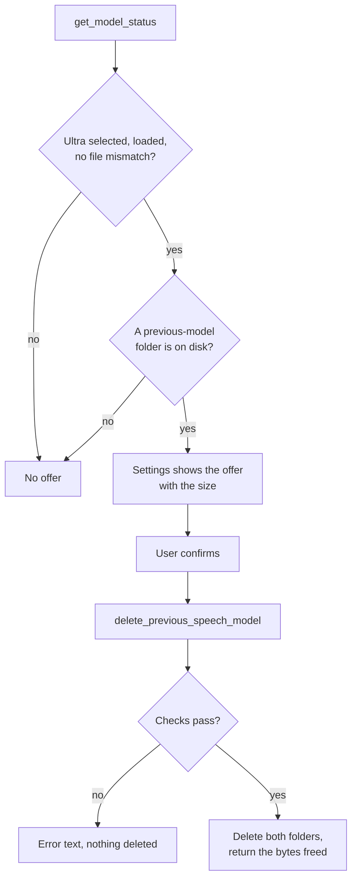

# Delete the Previous Speech Model

- **Version:** 1.1
- **Date:** 2026-11-19
- **Status:** Implemented

## Table of Contents

1. [Summary](#1-summary)
2. [Problem Statement](#2-problem-statement)
3. [Design Overview](#3-design-overview)
4. [Detailed Design](#4-detailed-design)
5. [Edge Cases](#5-edge-cases)
6. [File Changes](#6-file-changes)
7. [Testing Strategy](#7-testing-strategy)
8. [Migration Plan](#8-migration-plan)
9. [Security Considerations](#9-security-considerations)
10. [Cost Analysis](#10-cost-analysis)
11. [Implementation Tasks](#11-implementation-tasks)
12. [Implementation Status](#12-implementation-status)
13. [Review Log](#13-review-log)

## 1. Summary

Version 0.12.0 made Parakeet Ultra the speech model and kept Parakeet TDT v3
on disk ([Parakeet Ultra specification](2026-11-19-parakeet-ultra-default.md)).
This specification adds an offer in Settings to delete the Parakeet TDT v3
files. The offer appears only while Parakeet Ultra serves, and the deletion
needs a confirmation.

## 2. Problem Statement

After the upgrade, an installation holds up to two folders of the previous
model in `~/Library/Application Support/FluidAudio/Models/`:

| Folder | Use in 0.12.0 | Size on the maintainer's Mac |
| --- | --- | --- |
| `parakeet-tdt-0.6b-v3` | Fallback when CoreML cannot load Ultra | 483,260,283 bytes |
| `parakeet-tdt-0.6b-v3-coreml` | None. Cache of earlier app versions (created in March 2026 on this Mac) | 483,254,213 bytes |

Together they hold 967 MB next to the 632 MB of Ultra. The application never
deletes them, and the user must find the folder in Finder. Every installation
that upgraded from 0.11.1 or earlier is affected.

## 3. Design Overview

The backend decides. The interface only shows what `ModelStatus` reports, and
the command repeats every check, so a stale window cannot delete a model that
is in use.

## 4. Detailed Design

### 4.1 What is deleted

Exactly these two folders under `dirs::data_dir()/FluidAudio/Models`, and
nothing else:

- the `directory` of the bundled `previous_speech` manifest entry
  (`parakeet-tdt-0.6b-v3`);
- `parakeet-tdt-0.6b-v3-coreml`, a constant in `asr/model.rs`.

A folder is removed with `std::fs::remove_dir_all`. An entry that is not a
real folder (a file or a symbolic link) is removed with `remove_file`, so a
link is removed and its target is not touched.

The size is the sum of the file lengths under both folders. The walk reads
`DirEntry::metadata`, which does not follow symbolic links.

### 4.2 When the offer appears

`ModelStatus` gains `previous_model: Option<PreviousModel>` with `name`
("Parakeet TDT v3") and `size_bytes`. It is set when all of these hold:

1. The selected speech model is the current one. The selection is the
   previous model while it serves: before the background upgrade switches,
   and after a fallback.
2. The engine has a model loaded and is not loading (`is_model_loaded`, not
   `asr_initializing`, no preparation in progress).
3. No speech file mismatch is recorded. With a mismatch, Settings offers a
   re-download instead, and the previous model stays as the fallback.
4. At least one of the two folders is on disk.

Points 1, 3 and 4 are decided in `asr/model.rs`, point 2 in
`commands/setup.rs`, which owns the engine flags.

### 4.3 Command `delete_previous_speech_model`

Returns the bytes freed. In order:

1. Takes the preparation claim. `init_asr`, the background upgrade and the
   re-download hold the same claim, and only they can select the previous
   model. So nothing can start to use the previous model during the deletion.
   If the claim is taken, the command fails with the existing "already
   loading" text.
2. Sets `DELETING_PREVIOUS`, so `get_model_status` does not report
   `initializing` for this claim (the same treatment as `UPGRADING`).
3. Requires a loaded engine that is not loading.
4. On a blocking worker, `model::delete_previous_speech_model`:
   - requires that the current model is selected. It copies the selection
     and releases its lock, so status reads and the engine do not wait while
     files are hashed and deleted;
   - runs the manifest check on the current model's folder (the check that a
     start runs, with its cached verdicts) and requires a clean report: no
     missing file and no mismatch. Thus the next start loads Ultra without the
     previous model;
   - deletes the two folders and logs the bytes freed.

Errors are sentences for the user:

| Condition | Text |
| --- | --- |
| Previous model selected | "Parakeet TDT v3 is in use, so SottoASR cannot delete it." |
| Current model's check not clean | "Parakeet Ultra did not pass its file check, so Parakeet TDT v3 stays as the fallback. Re-download the speech model first." |
| Engine not loaded | "Speech recognition is not loaded. Load it, then delete the previous model." |
| A folder cannot be removed | "Could not delete (path): (system error)" |
| Other backends | "Only the CoreML speech model has a previous model." |

### 4.4 Interface

The speech card of the model dashboard (Settings) shows, under the status:

- "The previous speech model, Parakeet TDT v3 (967 MB), is still on this Mac.
  SottoASR keeps it only as a fallback."
- a button "Delete previous model".

The button opens the existing `ConfirmDialog`:

- Title: "Delete the previous speech model?"
- Message: "SottoASR deletes Parakeet TDT v3 (967 MB) from this Mac. The
  current speech model stays in use. After that, SottoASR cannot go back to
  Parakeet TDT v3 if the current model fails to load. Another app that uses
  Parakeet TDT v3 must download it again. You cannot undo this."
- Confirm: "Delete".

After success the card shows "Previous model deleted. 967 MB freed." After a
failure it shows "Could not delete the previous model: (error)". Sizes use
decimal megabytes, as the download progress does.

## 5. Edge Cases

| Case | Behaviour |
| --- | --- |
| New installation, or folders already deleted by hand | No folder on disk: no offer |
| Upgrade still downloading, or waiting for Idle | Previous model selected: no offer |
| Fallback after Ultra failed to load | Previous model selected: no offer, and the command refuses |
| Only the older `-coreml` folder exists | Offer with that folder's size |
| Window shows a stale offer (for example after a fallback) | The command repeats the checks and refuses |
| `init_asr` or a re-download starts during the deletion | It fails with "already loading"; the deletion holds the claim |
| Deletion starts during an upgrade, load or re-download | The command fails with "already loading" |
| First folder deleted, second fails | Error names the folder. The next status shows the offer with the remaining size |
| A folder is a symbolic link | The link is removed; its target is kept |
| Ultra files changed on disk after loading | The check is not clean: the command refuses |
| Dictation in progress | Not affected. The engine lock is not taken |
| Another FluidAudio application uses the same shared folder | It downloads the model again. The confirmation says so |
| An older SottoASR version is started later | It downloads Parakeet TDT v3 again through its own setup |
| `asr-parakeet` or no backend | No offer; the command returns an error |

## 6. File Changes

| File | Change |
| --- | --- |
| `src-tauri/src/models.rs` | `PreviousModel`; `ModelStatus.previous_model` |
| `src-tauri/src/asr/model.rs` | Folder list, size, offer in `get_model_status`, `delete_previous_speech_model`, tests |
| `src-tauri/src/commands/setup.rs` | Command, `DELETING_PREVIOUS`, engine condition in `get_model_status`, tests |
| `src-tauri/src/lib.rs` | Command registered |
| `src/lib/utils/tauri.ts` | `PreviousModel`, `previous_model`, `deletePreviousSpeechModel` |
| `src/lib/components/model-dashboard.svelte` (+ test) | Offer, confirmation, result |
| `README.md`, `DEVELOPMENT.md`, `docs/designs/architecture.md`, `src-tauri/vendor/fluidaudio-rs/README.md`, `CHANGELOG.md` | The old folders can be deleted from Settings |

## 7. Testing Strategy

| Area | Tests |
| --- | --- |
| Folder names | The two names from the bundled manifest and the constant; neither is the folder of the current or of the vocabulary model |
| Deletion | Only the two folders go; the current and vocabulary folders stay; a linked folder outside survives; the bytes freed equal the file lengths; a second call frees 0 |
| Refusals | Previous model selected; current model with a missing file; current model with a mismatch. Nothing is deleted in each case |
| Command | Needs a loaded engine; fails while another preparation holds the claim, without running the deletion; releases the claim |
| Dashboard | No button without `previous_model`; the command runs only after the confirmation; the result text appears |
| Real folders | In a scratch home with copies of the real Ultra, v3, older v3 and vocabulary folders: status reports the size, the deletion frees it, Ultra and the vocabulary folder are unchanged, and the next preparation selects Ultra. With only v3 present the command refuses |
| Suite | `cargo test --locked`, clippy, the `asr-parakeet` check, `npm run check`, `npm test`, `scripts/ci-checks.sh` |

## 8. Migration Plan

None. The offer appears on the first status read of an installation that
holds a previous-model folder while Ultra serves. Nothing is deleted without
the confirmation.

## 9. Security Considerations

- The paths are fixed at build time. No value from the interface, the
  settings or the network reaches the deletion.
- Symbolic links are not followed, for the size and for the removal.
- The command is an application command like `redownload_speech_model`: only
  the application's own windows can call it.
- No network access.

## 10. Cost Analysis

- While the offer applies, each status read walks the two folders: about 50
  entries on the maintainer's Mac. The dashboard reads the status every 5
  seconds while it is visible. No walk happens before the upgrade or after
  the deletion.
- The deletion check hashes Ultra only when its cached verdicts are stale.
- No new dependency.

## 11. Implementation Tasks

1. `models.rs`: `PreviousModel` and the status field.
2. `asr/model.rs`: folders, size, offer, deletion, tests.
3. `commands/setup.rs`: command, flag, engine condition, tests; register it
   in `lib.rs`.
4. Frontend: type, wrapper, dashboard, test.
5. Documentation and changelog.
6. Checks of section 7, including the run on real folders; update section 12.

## 12. Implementation Status

Implemented on 2026-11-19. Tasks 1 to 6 are done.

### 12.1 Checks

| Check | Result |
| --- | --- |
| `cargo test --locked` | 332 passed (4 new) |
| `cargo clippy --locked --all-targets -- -D warnings` | Clean |
| `cargo check` with `asr-parakeet`, and with no speech backend | Pass |
| `npm run check`, `npm test` | 0 errors; 147 passed (2 new) |
| `scripts/ci-checks.sh` | Pass |

### 12.2 Run on real folders

On an Apple M2 Pro, in two scratch home folders that held copies of the
real model folders. The real cache was not touched.

| Scratch home held | Selected | Offer | Deletion | Afterwards |
| --- | --- | --- | --- | --- |
| Ultra, v3, older v3, vocabulary | Ultra | Parakeet TDT v3, 966,514,496 bytes | Freed 966,514,496 bytes in 29 ms | Only Ultra and the vocabulary folder remain, both unchanged. No offer. The loaded engine and a newly loaded engine transcribe the test clip. The next preparation selects Ultra with no upgrade pending |
| v3, older v3, vocabulary | v3, upgrade pending | None | Refused: "Parakeet TDT v3 is in use, so SottoASR cannot delete it." | All folders remain. v3 transcribes the test clip |

### 12.3 Interface

The dashboard was rendered in a browser at the size of the Settings window
(640 by 760) with a mocked backend. The offer, the confirmation, the busy
state ("Please wait…", Cancel disabled), the result text and the failure
text were seen. The packaged application was not started.

### 12.4 Deviations

- The confirmation says "the current speech model" and not "Parakeet Ultra",
  so the component holds no model name.
- The selection lock is released before the file work (4.3). The first
  version held it for the whole deletion.

## 13. Review Log

### Pass 1: assumptions

- Sizes are measured, not estimated: a walk of the maintainer's cache gave
  483,260,283 and 483,254,213 bytes, with no symbolic links.
- `remove_dir_all` does not follow links according to the standard library
  documentation. The design does not rely on it: it tests the entry type
  first, and a unit test covers a link.
- Changed: the offer first needed only "Ultra selected". The initial
  selection is also "current" before any preparation ran, so the engine
  condition (4.2, point 2) was added.

### Pass 2: completeness

- Added the race with `init_asr`, the upgrade and the re-download: all three
  can select the previous model, so the deletion holds their claim.
- Added `DELETING_PREVIOUS`: without it, a status read during the deletion
  reports "loading".
- Added the mismatch rule (4.2 point 3, and "clean" in 4.3): with doubtful
  Ultra files the fallback must stay.
- Added the shared-folder case: the FluidAudio cache is not private to
  SottoASR, so the confirmation names the consequence.

### Pass 3: clarity

- Every interface string and error text is quoted.
- 4.2 names which module decides which condition.
- The tasks build in order: types, model logic, command, frontend, documents.
