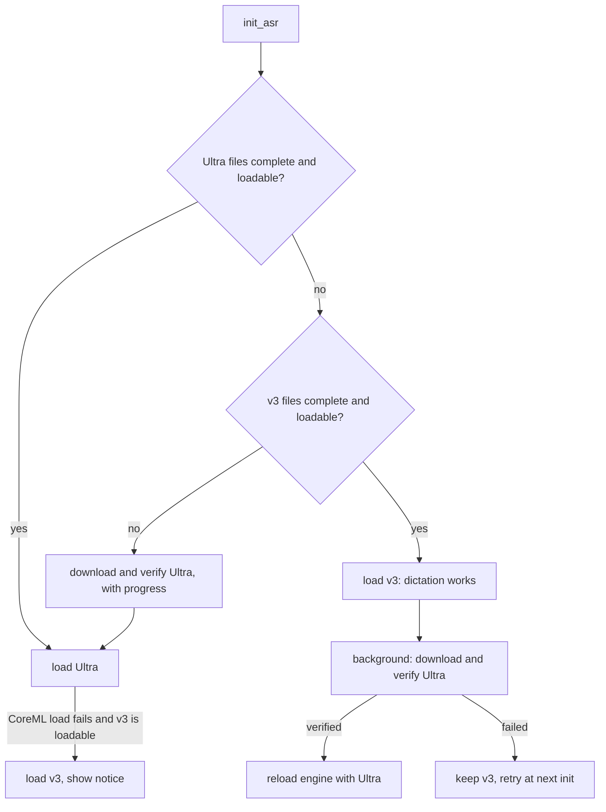

# Parakeet Ultra as the Default Speech Model

- **Version:** 1.1
- **Date:** 2026-11-19
- **Status:** Implemented

## Table of Contents

1. [Summary](#1-summary)
2. [Problem Statement](#2-problem-statement)
3. [Design Overview](#3-design-overview)
4. [Detailed Design](#4-detailed-design)
5. [Edge Cases](#5-edge-cases)
6. [File Changes](#6-file-changes)
7. [Testing Strategy](#7-testing-strategy)
8. [Migration Plan](#8-migration-plan)
9. [Security Considerations](#9-security-considerations)
10. [Cost Analysis](#10-cost-analysis)
11. [Implementation Tasks](#11-implementation-tasks)
12. [Implementation Status](#12-implementation-status)
13. [Review Log](#13-review-log)

## 1. Summary

SottoASR changes its default speech model from Parakeet TDT v3 to
[Parakeet Ultra](https://huggingface.co/moondream/parakeet-ultra), a
post-training of the same checkpoint with the same architecture, tokenizer,
25 languages and output conventions. Ultra needs FluidAudio 0.17.3 or later, so
the bridge moves from FluidAudio 0.15.6 to 0.18.3. An existing installation
keeps dictating with its verified v3 files while Ultra downloads, then switches.

Evidence is in the
[research note](../research/2026-11-19-parakeet-ultra.md). This spec builds on
the model pinning and verification of the
[review remediation](2026-11-19-review-remediation.md) (section 4.4).

## 2. Problem Statement

On the full LibriSpeech test-other set, measured on this project's M2 Pro with
FluidAudio 0.18.3, Ultra made 1,990 word errors against 2,156 for v3 (3.80% and
4.12%; paired bootstrap 95% interval for the difference −0.45 to −0.19
points). On SottoASR's own 88 synthetic clips the two are equal within noise
(58 and 62 errors in 828 words), with the same punctuation and number
formatting. Every dictation user benefits; no workflow changes.

Two things stand in the way:

- The pinned SDK (0.15.6) has no Ultra model version.
- A plain switch would break upgrades. `lib.rs` opens onboarding when
  `is_model_available()` is false, and that function looks only at the current
  model folder. Every existing user would see "Welcome to SottoASR" again and
  could not dictate until 632 MB finished downloading, or at all when offline.

## 3. Design Overview



- The bundled manifest gains a third entry. `speech` becomes Ultra,
  `previous_speech` keeps the v3 entry unchanged, `vocabulary` is unchanged.
- Preparation selects which verified model to load. The engine loads the
  selection. Nothing is deleted: v3 folders stay on disk.
- The SDK moves to 0.18.3. Its downloader behaves as in 0.15.6 as long as the
  SDK's own revision for a repository is `main` (section 4.1), so the
  remediation's cache guarantees hold without redesign.

## 4. Detailed Design

### 4.1 FluidAudio 0.18.3

`Package.swift` and `Package.resolved` pin `0.18.3`, commit
`c8b41f98eae668794dd0083bbe028fe7e6585051`. Its `Package.swift` has the same
tools version (6.0) and minimum macOS (14) as 0.15.6, so the build and the
bundle's minimum system version (14.0) are unaffected.

**Patches removed.** Both September patches are upstream in 0.18.3:

| Patch | Upstream replacement (read in the 0.18.3 source) |
| --- | --- |
| `alignment-stack.patch` | `alignBaseWordsToUTF8Ranges` is iterative ("Iterative backtracking", #961) |
| `ctc-tensor-access.patch` | Typed bulk reads of CTC output (#1039); `makePaddedAudioArray` clears the buffer with `reset(to: 0)` |

One difference remains: upstream still writes the CTC input one `NSNumber` at a
time. Task 3 measures the vocabulary step on a 16-minute recording before and
after. The rule was: if the step is more than 10% slower than the patched
0.15.6 build, keep a patch limited to that loop. The step is 72 to 77% slower
with the same weights, but that loop is not the cause: a typed copy in its
place changes the step by less than two runs of the same build differ
(section 12.2). So no patch is kept, and `check-alignment.py`,
`check-ctc-tensors.py`, `check-swift-regressions.py`, the two Swift probes and
their CI steps are deleted.

**Patches ported.** 0.18.3 passes a `revision` (default `main`) to
`ModelRegistry.resolveModel` and `HFTreeLister.listTree`. These are still the
only two places that build a model URL; `FileDownloader` differs from 0.15.6
only in handing that revision on. The two revision patches are rewritten for
the new sources and keep their purpose: when the revision is `main` and the
repository is in the pinned map, use the pinned commit. `build.rs` records the
new original and patched checksums.

**Why the SDK's own pinning is not used.** 0.18.3 has
`ModelRegistry.revisionOverrides`, but a non-`main` revision also switches on
cache management in `ModelCache`:

- `prepareForDownload` deletes the whole model folder when its
  `.fluidaudio-revision` marker does not match.
- `adoptLegacyCache` deletes every local file the remote listing does not
  contain, and every bundle with one mismatching file.

That would delete `.sotto-integrity.json`, the `.sotto-replaced-*` copies a
re-download depends on, and warned files that are in use. With `main` these
paths do nothing (`legacyCacheContents` returns `nil`; `matchesRevision` is
true without a marker), and `ModelHub.download` otherwise differs from 0.15.6
only in passing the revision through. `Repo.parakeetUltra`,
`Repo.parakeetCtc110m` and `Repo.parakeetV3` all have `revision == "main"` in
0.18.3. `AsrCacheProbe` asserts this, so an SDK update that pins them fails
the probe instead of deleting files.

### 4.2 Manifest

`model-manifest.json`:

| Entry | Repository | Commit | Folder | Files |
| --- | --- | --- | --- | --- |
| `speech` | `FluidInference/parakeet-ultra-coreml` | `95eaa59a39d4394f047a4dc5cce480388a60d1b6` | `parakeet-ultra` | 18 files, 632 MB |
| `previous_speech` | `FluidInference/parakeet-tdt-0.6b-v3-coreml` | `7dd20fe6b1797d35f5e3307e8b1732d9a178edfe` | `parakeet-tdt-0.6b-v3` | 21 files, 483 MB (unchanged) |
| `vocabulary` | `FluidInference/parakeet-ctc-110m-coreml` | `accdafd8cf8a2ff1cabe3c11e54416b405d409aa` | `parakeet-ctc-110m-coreml` | 12 files, 103 MB (unchanged) |

The Ultra commit is the repository head since 2026-09-24, the files measured
in the research. Both speech entries list the four bundles `Preprocessor`,
`Encoder`, `Decoder`, `JointDecisionv3.mlmodelc` and `parakeet_vocab.json`.
`check-model-manifest.py` gains `previous_speech`. The pinned map in the
registry patch holds `speech` and `vocabulary` only: v3 is never downloaded
again, only verified and loaded.

### 4.3 Bridge (Swift)

- `AsrCache.download(to:)` downloads Ultra: `ModelHub.download(.parakeetUltra,
  to: parent)`. The folder must be `Repo.parakeetUltra.folderName`.
- `AsrCache.load(at:)` takes the model version from the folder name:
  `parakeet-ultra` loads as `.ultra`, `parakeet-tdt-0.6b-v3` as `.v3`. Any
  other folder is an error. It loads through the SDK's local loader,
  `AsrModels.loadLocal`, which 0.18.3 adds: it reads the bundles directly
  through CoreML with the same compute-unit policy as before (CPU
  preprocessor; CPU and Neural Engine for the rest) and has no network or
  cache recovery. The bridge's own copy of that loader is deleted.
- No change to the C interface, to transcription or to vocabulary rescoring.

### 4.4 Model selection (Rust, `asr/model.rs`)

```rust
enum SpeechModel { Current, Previous }
```

A process-wide selection (beside the existing `MISMATCHES`) records which
model preparation chose, whether an upgrade is pending, and a notice for
Settings. `FluidAudioEngine::load` reads the selected folder. The decision
itself is a function of two folders, two manifests, a download closure and a
hasher, so tests run it on temporary folders without the selection.

"Loadable" means `Manifest::check` reports no missing file and no fresh
mismatch. A file that was present and differs still loads with the existing
integrity warning.

| Function | Behaviour |
| --- | --- |
| `prepare_speech_model()` | 1. Current loadable: select Current. 2. Else Previous loadable: select Previous, mark the upgrade pending. 3. Else download and verify Current (today's path): select Current, or return the error. Steps 1 and 2 use no network. |
| `prepare_current_speech_model()` | Download and verify Current. Changes no selection, so Settings keeps naming the model that is loaded. Used by the background upgrade. |
| `use_current_speech_model()` | Selects Current and clears the pending mark. Called when the engine is about to load it. |
| `fall_back_to_previous_speech_model(error)` | When Current is selected and Previous is loadable: select Previous, store the error for the notice, do not mark an upgrade pending. Returns whether it did. |
| `upgrade_pending()` | Previous is loaded because Current is not on disk yet. |
| `is_model_available()` | Artifacts of Current or of Previous are present. |
| `get_model_status()` | `name` is "Parakeet Ultra (CoreML)" or "Parakeet TDT v3 (CoreML)"; `path` is that model's folder. |
| `speech_notice(upgrading)` | The notice of section 4.6. |
| `replace_failing_models()` | Unchanged target (Current). Selects Current when it replaced files, so the reload loads Ultra. |
| `speech_download_progress()` | Unchanged target (Current). |

The speech mismatch flag comes from the report of the model that was selected.

### 4.5 Init and upgrade (`commands/setup.rs`)

`initialize` and `redownload` load through one helper:

```rust
fn load_selected(
    engine: &mut dyn AsrEngine,
    replace: bool,
    fall_back: impl FnOnce(&str) -> bool,
) -> Result<(), String>
```

It calls `engine.reload()` or `engine.init()`. If that fails and `fall_back`
(in production `model::fall_back_to_previous_speech_model`) returns true, it
calls `engine.reload()` once more.

`init_asr` and `complete_setup` share `initialize`. After it succeeds with
`upgrade_pending()`, `init_asr` starts `upgrade` on the async runtime and
returns; nobody waits for it.

`upgrade`:

1. Takes the preparation claim; if another preparation holds it, stops. The
   next `init_asr` starts it again.
2. Sets `UPGRADING`. Runs `prepare_current_speech_model` on a blocking worker.
   It sends no progress events: no window shows a bar for it.
3. On failure: logs a warning and stops. The previous model keeps serving, no
   error event is emitted, and the next `init_asr` tries again.
4. Waits until the app is Idle, checking twice a second for at most 10
   minutes, so a dictation in progress is not refused. If it never becomes
   Idle, stops: Ultra is on disk and loads at the next launch.
5. Loads: `load_prepared`, which first selects Current
   (`use_current_speech_model`) and then calls `load_selected(engine, true,
   …)`; then the existing `finished` notice (`asr-init-complete`, vocabulary
   restore).

`initialize`, `redownload` and `upgrade` take a `Models` value with two
function pointers, `use_current` and `fall_back`. The commands pass the
functions of `asr/model.rs`; tests pass their own, so they read no model
folder.

`get_model_status` reports `initializing` as `asr_initializing ||
(PREPARING && !UPGRADING)`, so Settings shows "Ready" while the previous model
serves and the upgrade downloads.

The reload holds the engine lock for one model load. On an M2 Pro the first
load of Ultra took 55 to 60 s (CoreML compiles it for the Neural Engine
once); later loads took 19 to 24 s. A dictation that starts
and ends in that window gets the existing "speech model is loading" message
and its recording is kept. This is the same path a confirmed re-download
already uses.

### 4.6 Status in the interface

`ModelStatus` (Rust and `tauri.ts`) gains `notice: Option<String>`:

| State | Notice |
| --- | --- |
| Previous loaded, upgrade downloading | "Parakeet Ultra is downloading in the background (632 MB). SottoASR switches to it automatically." |
| Previous loaded, upgrade not running (download failed, or the app was not Idle) | "Parakeet Ultra (632 MB) is not in use yet. SottoASR switches to it at its next start and uses Parakeet TDT v3 until then." |
| Fell back after a load failure | "Parakeet Ultra could not be loaded, so SottoASR is using Parakeet TDT v3. (error text)" |
| Otherwise | none |

`model-dashboard.svelte` shows the notice under the status line. Text that
names the model or its size changes: onboarding, Settings, About, website,
README, DEVELOPMENT, the release notes template in `build-release.yml`.

### 4.7 Old files

Nothing deletes `parakeet-tdt-0.6b-v3/` or the older
`parakeet-tdt-0.6b-v3-coreml/`. The first is the fallback of section 4.5. The
changelog and README say that both can be removed by hand once Settings shows
Parakeet Ultra.

### 4.8 Parakeet (ONNX) backend

Unchanged. `asr-parakeet` keeps the v3 ONNX model; no Ultra ONNX export was
evaluated.

## 5. Edge Cases

| Case | Handling |
| --- | --- |
| Upgrade while offline | v3 loads; the Ultra download fails quietly; retried at the next `init_asr` |
| Quit during the Ultra download | The integrity record already holds the start; the next run resumes and judges the files as fresh |
| Downloaded Ultra file fails the manifest | Fresh mismatch: Ultra is not loadable, v3 keeps serving; the next preparation deletes and fetches the file again (existing policy) |
| Ultra verified but CoreML cannot load it | v3 is loaded instead and Settings shows the notice; retried at next launch |
| Same, on a new installation (no v3) | The load error is shown, as today |
| v3 cache present but itself warned | Loads with the existing integrity warning; a confirmed re-download fetches Ultra |
| User confirms re-download while the upgrade runs | Refused by the preparation claim ("already loading"), as for any concurrent preparation |
| `init_asr` called again while the upgrade runs | Same refusal; the model in use is unaffected |
| Dictation in progress when the download finishes | The reload waits for Idle (4.5) |
| Dictation started during the reload | Existing loading message; recording kept |
| App never Idle within 10 minutes of the download | No reload; Ultra loads at the next launch |
| Only the legacy `-coreml` v3 folder exists | Not a manifest folder: treated as a new installation, as today |
| SDK later pins these repositories itself | `AsrCacheProbe` fails; the bridge must be revisited before that SDK is adopted |

## 6. File Changes

| File | Change |
| --- | --- |
| `src-tauri/vendor/fluidaudio-rs/Package.swift`, `Package.resolved`, `Cargo.toml`, `FluidAudio-LICENSE` | SDK 0.18.3 |
| `…/build.rs` | Two patch calls removed; two revision patches with new checksums |
| `…/patches/alignment-stack.patch`, `ctc-tensor-access.patch` | Deleted (see 4.1 for the one condition) |
| `…/patches/model-registry-revision.patch`, `tree-lister-revision.patch` | Rewritten for 0.18.3; Ultra and vocabulary commits |
| `…/model-manifest.json` | `speech` is Ultra; `previous_speech` added |
| `…/swift/AsrCache.swift` | Ultra download; version from folder |
| `…/tests/AsrCacheProbe.swift` | Ultra folder, pinned repositories, SDK revision guard |
| `…/tests/AlignmentProbe.swift`, `CtcTensorProbe.swift` | Deleted with their patches |
| `…/README.md` | SDK, patches, revisions, upgrade behaviour |
| `src-tauri/src/asr/model.rs` | Selection, preparation, status, tests |
| `src-tauri/src/asr/integrity.rs` | `previous_speech()`; manifest and patch test |
| `src-tauri/src/asr/fluidaudio_backend.rs` | Loads the selected folder; log text |
| `src-tauri/src/commands/setup.rs` | `load_selected`, `upgrade`, status flag, tests |
| `src-tauri/src/models.rs` | `ModelStatus.notice` |
| `src-tauri/examples/asr_fixture.rs` | Ultra folder |
| `scripts/check-model-manifest.py`, `check-asr-cache.py` | Ultra, `previous_speech` |
| `scripts/check-alignment.py`, `check-ctc-tensors.py`, `check-swift-regressions.py` | Deleted with their patches |
| `scripts/pre-release-check.sh`, `.github/workflows/ci.yml`, `build-release.yml` | Swift regression step removed; size text |
| `src-tauri/Cargo.lock` | Version of the vendored bridge crate |
| `src/lib/utils/tauri.ts`, `model-dashboard.svelte` (+ test), `onboarding-view.svelte`, `settings-advanced.svelte`, `about-view.svelte` | `notice`; model name and size |
| `website/index.html` | Model name and size |
| `README.md`, `DEVELOPMENT.md`, `AGENTS.md`, `.claude/CLAUDE.md`, `.claude/rules/project.md`, `.claude/rules/release.md`, `docs/designs/architecture.md`, `LICENSE`, `THIRD_PARTY_LICENSES`, `CHANGELOG.md` | Model, SDK, sizes, attribution |
| `docs/research/2026-11-19-parakeet-ultra.md`, `benchmarks/asr/model-probe/` (SwiftPM package), `score_models.py`, `score_librispeech.py`, `measurements-2026-11-19.json`, `README.md` | Evidence and how to reproduce it |

## 7. Testing Strategy

| Area | Tests |
| --- | --- |
| Selection | Current loadable selects Current without downloading; only Previous loadable selects Previous and marks the upgrade pending, without downloading; neither downloads Current; a fresh mismatch in Current falls to Previous; fallback after a load failure selects Previous and does not mark an upgrade pending |
| Availability | `is_model_available` is true with only the v3 folder, so an upgrade does not open onboarding |
| Setup | With an upgrade pending: the previous model loads first, then the current one is prepared and the engine reloads; a failed upgrade download leaves the model loaded with no error; a failed load of Current falls back and stays loaded |
| Manifest | Bundled manifest parses with three entries; pinned map equals `speech` and `vocabulary` |
| Bridge | `AsrCacheProbe`: Ultra folder accepted, other folders refused, pinned URLs, SDK revision guard, failures keep files |
| Frontend | Dashboard shows the notice and stays "Ready" |
| Real model | From the built bridge: download Ultra at the pinned commit into a scratch folder, verify against the manifest, transcribe the 88 clips and both long recordings, compare with the research outputs; confirm no `.fluidaudio-revision` file appears. The research decoded samples in memory; the bridge sends recordings above the SDK's streaming threshold through `transcribeDiskBacked`, so the long recordings are the check of that path |
| Vocabulary | The 48-clip holdout with its vocabulary through the bridge on Ultra: count target improvements and changed ordinary clips against the September evidence (4 and 0) |
| Vocabulary speed | 16-minute recording, with and without vocabulary, before and after the SDK change (4.1) |
| Suite | `scripts/pre-release-check.sh --auto-only` |

## 8. Migration Plan

- **New installation:** onboarding downloads Ultra (632 MB) and loads it.
- **Existing installation:** starts as before on v3. Ultra downloads in the
  background, is verified, and replaces v3 in memory. No user action. The
  first `init_asr` after the download failed tries again.
- **Rollback to an older app version:** the v3 folder is intact, so the older
  version works unchanged. The `parakeet-ultra` folder is ignored by it.
- **Vocabulary model:** same files and folder; verdicts in
  `.sotto-integrity.json` stay valid.

## 9. Security Considerations

- Ultra is pinned to a commit and every loaded file is checked against the
  bundled SHA-256 manifest before CoreML reads it, as for v3.
- The weights come from a third party (moondream) through FluidInference's
  CoreML conversion. Licence CC-BY-4.0, as v3. `LICENSE`,
  `THIRD_PARTY_LICENSES` and About name both.
- The SDK update brings no new network destination: downloads still go to
  `huggingface.co` at pinned commits. No telemetry is added.
- Two SDK patches remain, each bound to the exact upstream file by checksum.

## 10. Cost Analysis

| Item | v3 | Ultra | Source |
| --- | --- | --- | --- |
| Download | 483 MB | 632 MB | manifests |
| Peak resident memory | 487 MiB | 644 MiB | LibriSpeech run, M2 Pro |
| Median decode, short clip | 55.6 ms | 58.4 ms | 88 synthetic clips |
| Total decode, test-other | 225 s | 254 s | same run |
| Disk during the transition | 483 MB | 483 + 632 MB | v3 kept as fallback |

The SDK grows the static library; the size is recorded in section 12.

## 11. Implementation Tasks

1. Commit the remediation work as it stands (verified: 320 Rust tests, clippy,
   144 frontend tests, CI checks).
2. Measure the vocabulary step on the 16-minute control with the current
   build (0.15.6 with patches).
3. SDK 0.18.3: pins, patches, `build.rs`; build; measure the control again and
   settle the input-fill patch (4.1).
4. Manifest and scripts: Ultra, `previous_speech`.
5. Bridge: `AsrCache`, probe.
6. Rust: selection, engine folder, setup flow, status, tests.
7. Frontend: `notice`, strings, tests.
8. Real-model checks (section 7): accuracy, vocabulary, markers.
9. Documentation, research note, benchmark artifacts, changelog.
10. `scripts/pre-release-check.sh --auto-only`; update section 12.

## 12. Implementation Status

Implemented on 2026-11-19. Tasks 1 to 10 are done. The change ships in
version 0.12.0.

### 12.1 Checks

| Check | Result |
| --- | --- |
| `scripts/pre-release-check.sh --auto-only` | 13 of 14 automated checks passed, including the unsigned `.app` and `.dmg` build. The sidecar Python tests failed with the system Python (see the next row) |
| Sidecar Python tests, in a venv installed from the lock | 35 passed. This Mac has the cleanup model in its cache, so three tests load it and need the pinned MLX runtime. The system Python has other MLX versions. This is independent of this change |
| `cargo test --locked` | 328 passed |
| `npm test` | 145 passed |
| `scripts/check-model-manifest.py` | The manifest matches the pinned commits |
| `scripts/check-asr-cache.py` | 7 cache failure cases and 5 revision checks passed; existing files kept |
| `scripts/check-vocabulary-cache.py` | 7 offline repair and failure checks passed; weights kept |

### 12.2 Measurements

All on an Apple M2 Pro (32 GB, macOS 26.7.3) with synthetic speech.

**Upgrade of an installation.** A scratch home folder held only
`parakeet-tdt-0.6b-v3`. The library loaded v3 without a download and showed
the "downloading" notice. Ultra downloaded and verified in 42 s and loaded in
60 s. Both models gave the same text for the test clip. Afterwards
`parakeet-ultra` held `.sotto-integrity.json` and no `.fluidaudio-revision`,
the v3 folder was intact, and the next start selected Ultra with no upgrade
pending.

**Download.** A second download through the bridge of the final build took
57 s. All 18 files (632,162,964 bytes) match the manifest, and there is no
`.fluidaudio-revision`.

**Accuracy through the bridge.** The text of all 88 clips and of both long
recordings is identical to the research outputs (33, 25, 42 and 25 word
errors).

**Vocabulary step.** One 966.6 s recording, eight terms, median of three runs.
"Step" is the time that vocabulary adds to the transcription.

| Build | Weights | Plain | With vocabulary | Step |
| --- | --- | --- | --- | --- |
| 0.15.6 with the September patches | v3 | 3.93 s | 7.43 s | 3.28 s |
| 0.18.3, first session | v3 | 3.39 s | 9.40 s | 5.82 s |
| 0.18.3, second session | v3 | 3.33 s | 8.96 s | 5.64 s |
| 0.18.3, typed copy for the CTC input | v3 | not recorded | 8.87 s | 5.59 s |
| 0.18.3, mel spectrogram on CPU and Neural Engine | v3 | 3.30 s | 8.97 s | 5.72 s |
| 0.18.3 (shipped) | Ultra | 3.42 s | 9.09 s | 5.64 s |

The step is about 2.4 s slower than with the patched 0.15.6. The cause is not
found. The two sessions of the unchanged build differ by 0.18 s, and neither
experiment changed the step by more than that. So neither the input loop nor
the compute unit of the mel spectrogram explains it.

**Vocabulary holdout.** 48 clips, 24 with target terms and 24 ordinary, with
the unchanged policy of `asr/vocabulary.rs`.

| Evidence | Target clips changed | Ordinary clips changed | Word errors in 436 |
| --- | --- | --- | --- |
| September: v3, 0.15.6 (M4) | 4 | 0 | not scored here |
| v3, 0.18.3 | 1 | 0 | 27 to 25 |
| Ultra, 0.18.3 (shipped) | 2 | 0 | 25 to 22 |

No change made a clip worse. The lower count comes from the SDK, not from
Ultra. FluidAudio 0.18.3 runs the CTC mel spectrogram on the CPU (upstream
#1079: on some Macs the Neural Engine gave features that made the CTC model
emit blank on every frame). With CPU features the spoken words score higher:
for "mini CPM", −5.2 against −5.8 for "MiniCPM", so the policy keeps the
spoken form. With the mel spectrogram put back on the Neural Engine, the
scores are close to those of September (−11.0 against −10.3; in September
−10.9 against −10.2). The policy is not changed, because it was frozen
before this holdout was read and a change needs new evidence.
`vocabulary-holdout-evidence-2026-11-19.json` records the Ultra row and the
policy test covers it.

### 12.3 Deviations from the reviewed text

Sections 4 to 7 and 10 now describe the code. These points differ from
version 1.0:

- **Selection (4.4).** `prepare_current_speech_model` does not select.
  `use_current_speech_model` selects when the engine switches, so Settings
  names the model that is loaded while the download runs.
- **Notices (4.6).** The wording changed, and a third notice covers "Ultra is
  not in use yet" when no download runs.
- **CTC input patch (4.1).** The 10% rule was met (72 to 77% slower), but the
  patch it called for makes no measurable difference, so there is no patch.
- **Vocabulary (7).** The expected result was 4 changed target clips. The
  result is 2, for the reason in 12.2.
- **Loader (4.3).** `AsrModels.loadLocal` of the SDK replaces the bridge's
  own loader.
- **Reload time (4.5).** The first load of Ultra takes 55 to 60 s, not 22 to
  24 s.
- **Files (6).** The probe is a SwiftPM package (`model-probe/`), and
  `score_librispeech.py` and the November evidence file are added.
- **Release.** The version is 0.12.0, because a push to `main` needs a new
  version.

### 12.4 Not tested

- The upgrade in the packaged app. It ran through the library with a scratch
  home folder; the Settings notice is covered by a component test.
- Languages other than English, noisy or far-field speech, and real long
  recordings. All test speech is synthetic or read English.
- macOS 27 and Macs other than the M2 Pro.
- A load failure of Ultra in CoreML. The fallback is covered by unit tests
  with a scripted engine only.

## 13. Review Log

The owner asked for this change on 2026-11-19. The upgrade behaviour in
sections 4.4 to 4.7 was not specified in the request and is decided here.

### Pass 1: assumption validation (2026-11-19)

Checked against the FluidAudio 0.15.6 and 0.18.3 sources and the Hugging Face
API. Changes made:

- The SDK's own pinning (`revisionOverrides`) is not used: with a non-`main`
  revision `ModelCache` deletes unlisted files and mismatching bundles, which
  breaks the integrity record and the re-download's kept copies. The two
  revision patches are ported instead (4.1).
- Confirmed the same tools version and minimum macOS, that
  `AsrManager.transcribe(url)` is unchanged (the single-decode rule of the
  remediation still holds), and that only two places build model URLs.
- The Ultra commit, file count and size come from the tree API, not from the
  model card.
- The load time is from the SDK's loader in the research runs and is labelled
  so.

### Pass 2: completeness (2026-11-19)

Changes made:

- An upgrade must not open onboarding: `is_model_available` covers both
  folders, with a test.
- The reload waits for Idle, bounded, so a dictation in progress is not
  refused (4.5, 5).
- A verified Ultra that CoreML cannot load falls back to v3 where v3 exists.
- The background upgrade sends no progress events and no error events.
- `load_selected` takes the fallback as an argument so the setup tests do not
  touch real model folders; the selection decision is testable on temporary
  folders.
- Added the cases: claim held by another preparation, re-download during the
  upgrade, legacy `-coreml` folder only, rollback to an older version.
- The September benchmark probes stay as they are; the README says which
  commit reproduces them.

### Pass 3: clarity and actionability (2026-11-19)

Changes made:

- The condition for keeping a CTC input patch is a number (10% on the
  15-minute control), measured before and after in tasks 2 and 3.
- Real-model checks name the bridge path they cover: recordings above the
  streaming threshold use `transcribeDiskBacked`, which the research did not.
- Notices are quoted in full, and status `initializing` has an exact formula.
- Tasks are ordered so each one builds: remediation commit, baseline
  measurement, SDK, manifest, bridge, Rust, frontend, real checks, documents.
