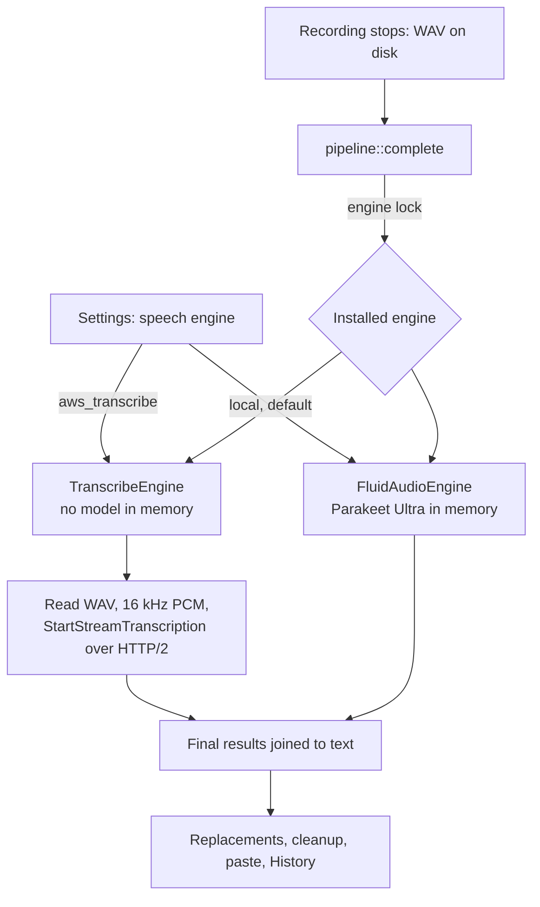

# AWS Transcribe as an Optional Cloud Speech Engine

- **Version:** 1.2
- **Date:** 2026-11-20
- **Status:** Implemented

## Table of Contents

1. [Summary](#1-summary)
2. [Problem Statement](#2-problem-statement)
3. [Design Overview](#3-design-overview)
4. [Detailed Design](#4-detailed-design)
5. [Edge Cases](#5-edge-cases)
6. [File Changes](#6-file-changes)
7. [Testing Strategy](#7-testing-strategy)
8. [Migration Plan](#8-migration-plan)
9. [Security Considerations](#9-security-considerations)
10. [Cost Analysis](#10-cost-analysis)
11. [Implementation Tasks](#11-implementation-tasks)
12. [Implementation Status](#12-implementation-status)
13. [Review Log](#13-review-log)

## 1. Summary

SottoASR transcribes on the Mac with Parakeet Ultra. This specification adds
a second speech engine, Amazon Transcribe, that the user can select in
Settings. The local engine stays the default. With Amazon Transcribe
selected, SottoASR loads no speech model, so it uses much less memory, and it
sends the audio of each dictation to AWS with an AWS profile of the user.

The project stays local-first and privacy-first. It is no longer local-only.
The documents, the application text and the website say so.

## 2. Problem Statement

While Parakeet Ultra is loaded and in use, the system holds about 600 MiB
more wired memory (section 12.3). During a first load, the resident memory of
the process has a peak of about 650 MiB. On a Mac with little free memory,
this is too much, and some users prefer a cloud service. Today the only
choice is the local model.

The requirements, from the maintainer:

1. Amazon Transcribe can replace Parakeet Ultra: a local mode and a cloud mode.
2. The user selects the mode in Settings. The default is local.
3. The user selects the AWS profile from the profiles on the Mac.
4. The user can do a connection test in Settings.
5. Settings show the options that are useful for the service.
6. With Amazon Transcribe selected, Parakeet Ultra is not in memory.
7. The website and the documents describe the change, and the project stays
   local-first.
8. The feature is proved against the real service.

## 3. Design Overview



The design has three parts:

- **One engine object at a time.** `AppState.asr_engine` holds a boxed
  `AsrEngine`. A change of the engine setting replaces the object. In cloud
  mode no `FluidAudioEngine` exists in the process, and only that type can
  load Parakeet Ultra. The rule of requirement 6 thus follows from the
  structure, not from checks at each call site.
- **The recorded file is the input.** The cloud engine implements the same
  `transcribe_file` as the local engine. The pipeline, the recovery of a
  recording and the deadline code do not change.
- **The AWS SDK for Rust does the AWS work.** It resolves the credentials of
  the profile (static keys, IAM Identity Center, `credential_process`,
  assumed roles), signs the request and speaks the event stream protocol.

## 4. Detailed Design

### 4.1 Evidence from the real service

All measurements: 2026-11-20, Apple M2 Pro, Region `us-west-2`, synthetic
`say` recordings, `aws-sdk-transcribestreaming` 1.129.0, a throwaway probe.

| Question | Result |
| --- | --- |
| Does a profile with `credential_process` work? | Yes. A 4.1 s clip returned the same text as Parakeet Ultra |
| Time for short clips (2.4 to 4.1 s), sent at once | 1.1 to 1.6 s in total, of which 0.5 to 0.6 s is credentials and connection |
| Time for a 149.7 s recording, sent at once | 34.4 and 34.6 s (two runs): 4.3 times real time |
| Does the event size change the speed? | No: 33.3 to 37.3 s for 50, 100, 200, 500 and 1000 ms events |
| Does less data change the speed? | No: 34.0 s at 8 kHz. The service limits the rate, not the network |
| Does the event size change the text? | 50 ms events changed one word. 100 to 1000 ms gave identical text |
| Language identification (`IdentifyLanguage`) | Three of six clips shorter than 3.1 s returned empty text. A 149.7 s recording took 150.3 s |
| Time for a 966.6 s recording, sent at once | 243.3 s: 4.0 times real time, with no error |
| Silence | 1 s: no text, 0.7 s in total. 20 s: no text, 1.8 s. No audio at all: no text, 1.1 s, no error |

Failures at the start of a request, with the SDK error for each:

| Cause | SDK error |
| --- | --- |
| Role without the permission | Service error `AccessDeniedException`, "... is not authorized to perform: transcribe:StartStreamTranscription ..." |
| Expired static credentials | Service error `UnrecognizedClientException`, "The security token included in the request is invalid" |
| `credential_process` fails | Dispatch failure, provider error with the exit code and the standard error text |
| Profile not in the files | Dispatch failure, `CredentialsNotLoaded`, "profile ... was not defined" |
| Region without access (`eu-north-1`) | Service error `NotAuthorizedException` |
| Unknown language code | Service error `BadRequestException` with the valid values |
| Custom vocabulary not found | Service error `BadRequestException`, "The specified vocabulary doesn't exist." |

Facts from the AWS documentation, read on 2026-11-20:

- `StartStreamTranscription` needs a language, a media encoding and a sample
  rate from 8,000 to 48,000 Hz. PCM is signed 16-bit little-endian. AWS
  recommends 16,000 Hz and events of 50 to 200 ms
  ([API reference](https://docs.aws.amazon.com/transcribe/latest/APIReference/API_streaming_StartStreamTranscription.html),
  [streaming guide](https://docs.aws.amazon.com/transcribe/latest/dg/streaming.html)).
- Streaming endpoints exist in 20 Regions
  ([endpoints](https://docs.aws.amazon.com/general/latest/gr/transcribe.html)).
- "By default, Amazon Transcribe stores and uses voice inputs that it has
  processed to develop the service". An AWS Organizations policy can opt out
  ([opt-out](https://docs.aws.amazon.com/transcribe/latest/dg/opt-out.html)).
- AWS bills each second of audio
  ([pricing](https://aws.amazon.com/transcribe/pricing/)).

### 4.2 Decisions that follow from the evidence

- **Send the file after the recording ends, not while the user speaks.** The
  wait is about a quarter of the length of the dictation, plus 0.6 s. A live
  stream gives a shorter wait, but it sends audio before the user finishes,
  also for a recording that the user then cancels. It also needs a second
  audio path with its own failures. For a privacy-first application, "audio
  leaves the Mac only when a dictation ends" is the better rule.
- **One language, selected by the user. No language identification.** It
  returns no text for short dictations and it is as slow as real time.
- **Events of 100 ms** at 16 kHz (3,200 bytes), inside the range that AWS
  recommends.
- **A cancelled recording is not sent.** In local mode, a cancelled recording
  is transcribed and History keeps the text. In cloud mode, that sends audio
  that the user cancelled. The recording is deleted and History keeps an entry
  without text (section 4.8).

### 4.3 Settings

`models.rs`:

```rust
#[derive(Default)] #[serde(rename_all = "snake_case")]
pub enum SpeechEngine { #[default] Local, AwsTranscribe }

pub struct AwsTranscribeSettings {
    pub profile: Option<String>,          // name in ~/.aws/config or ~/.aws/credentials
    pub region: Option<String>,           // None: the region of the profile
    pub language: String,                 // default "en-US"
    pub vocabulary_name: Option<String>,  // custom vocabulary in the AWS account
}

pub struct Settings {
    // ...
    #[serde(default)] pub speech_engine: SpeechEngine,
    #[serde(default)] pub aws_transcribe: AwsTranscribeSettings,
}
```

The AWS fields are in their own object. The settings file already has a
legacy key `language`, which older builds require, so a top-level `language`
is not possible.

`normalize` trims the three strings and turns an empty value into `None`.
`validate` rules:

| Rule | Error |
| --- | --- |
| Engine is `aws_transcribe` and no profile | "Choose an AWS profile for AWS Transcribe." |
| Profile longer than 128 characters or with a control character | "The AWS profile name is not valid." |
| Region not in the list of section 4.5 | "Choose a Region where Amazon Transcribe streaming is available." |
| Language not in the list of section 4.5 | "Choose a language that Amazon Transcribe streaming supports." |
| Vocabulary name does not match `^[0-9a-zA-Z._-]{1,200}$` | "The custom vocabulary name can have letters, digits, dots, hyphens and underscores only." |

The format rules apply in both modes. Only the first rule depends on the
engine.

**Options of the service that Settings does not show:**

| Option of `StartStreamTranscription` | Reason |
| --- | --- |
| `IdentifyLanguage`, `IdentifyMultipleLanguages` | Empty text for short dictations, and real-time speed (section 4.1) |
| `VocabularyFilterName` | It removes or masks words. A dictation tool writes what the user said |
| `LanguageModelName` | A custom language model needs training data in the AWS account. It was not tested |
| `ContentRedactionType`, `ContentIdentificationType` | They replace personal data in the text with a tag. A dictation needs the words |
| `ShowSpeakerLabel`, `EnableChannelIdentification` | A dictation has one speaker and one channel |
| `EnablePartialResultsStabilization` | SottoASR uses the final results only |

### 4.4 AWS profiles

`asr/aws_profiles.rs` loads the profile set with
`aws_config::profile::load`, the parser that the credential provider uses.
`list()` returns each profile name with its `region` value, `default`
first, then by name. The files are `~/.aws/config` and `~/.aws/credentials`,
or the files that `AWS_CONFIG_FILE` and `AWS_SHARED_CREDENTIALS_FILE` name.
If no file exists, the list is empty.

SottoASR never reads, shows or stores a credential value. The SDK reads them
when it signs a request.

A `credential_process` command runs through `/bin/sh` with the environment of
the application. An application that Finder starts has the `PATH`
`/usr/bin:/bin:/usr/sbin:/sbin`. A command without its full path can thus
fail. The error text of section 4.6 says so.

### 4.5 Regions and languages

- **Regions:** the 20 Regions of the streaming endpoint table, as a constant
  list of code and name in `asr/aws_transcribe.rs`.
- **Languages:** `LanguageCode::values()` of the SDK. The Settings window
  shows each code with the name from `Intl.DisplayNames`.
- **Region in use:** `aws_transcribe.region`, or the region of the profile.
  If both are absent, the request fails with "AWS profile (name) has no
  Region. Choose a Region in Settings."

### 4.6 The cloud engine

`asr/aws_transcribe.rs`, `pub struct TranscribeEngine`. It implements
`AsrEngine`:

| Method | Behaviour |
| --- | --- |
| `init`, `reload` | Return `Ok`. No network, no model |
| `is_ready`, `is_model_available` | `true` |
| `backend_name` | "AWS Transcribe" |
| `transcribe_file(path)` | Section "One request" that follows |
| `transcribe_samples` | The same request from samples in memory |
| `transcribe_file_with_vocabulary` | Ignores the local terms. The custom vocabulary of AWS applies |
| `install_vocabulary` | The default: an error. The local vocabulary model never attaches |

**Client.** The engine builds the SDK client at the first request and keeps
it after each request that succeeds. After a request that fails, the engine
drops the client, and the next request reads the AWS files again. Thus the
user can sign in or repair the files without a restart. The client caches
the credentials until they expire and keeps the
connection. The HTTP client is `aws-smithy-http-client` with rustls and the
`ring` provider, which the application already links. The credentials come
from `ProfileFileCredentialsProvider` for the selected profile only: no
environment variables, no instance metadata. SDK retries are off (see
"Retry").

**One request.**

1. Open the WAV with `hound`. Accept 32-bit float and 16, 24 or 32-bit
   integer samples. Mix the channels to mono.
2. Resample to 16 kHz with the streaming resampler (section 4.7) and convert
   to 16-bit PCM.
3. Send `StartStreamTranscription` with the language, 16,000 Hz, `pcm`, and
   the vocabulary name if one is set. The audio stream reads the file while
   the service accepts data: 100 ms per event. The file is never in memory
   as a whole.
4. Read the result stream. Keep the first alternative of each result that is
   not partial. Join the results with a space; with no separator for
   Japanese and Chinese.
5. Return `AsrResult` with the text, the audio duration and the elapsed time.

The engine blocks on the request with the handle of the current Tokio
runtime. `with_engine` already calls the engine on a blocking worker.

**Time limit.** 30 s plus half the audio duration, for the whole request.
This is shorter than the deadline of the pipeline (60 s plus half the
duration), so the request ends with its own error and releases the engine.
The connection time limit is 10 s.

**Retry.** If the request fails before the first result arrives, because of
a connection error or the time limit of the connection, the engine sends it
one more time. It does not retry service errors or credential errors.

**Errors.** One function maps each SDK error to a sentence for the user. A
credential error is the `CredentialsError` in the source chain of a dispatch
failure:

| Condition | Text |
| --- | --- |
| Profile not defined | "AWS profile (name) was not found in ~/.aws/config or ~/.aws/credentials." |
| Credential provider error | "Could not get credentials for AWS profile (name): (first line of the cause)." If the cause contains "command not found": "SottoASR runs the command without the PATH of your shell. Use the full path of the command in ~/.aws/config." |
| `UnrecognizedClientException`, `ExpiredTokenException`, `InvalidSignatureException` | "The credentials of AWS profile (name) are not valid or are expired. Sign in again." |
| `AccessDeniedException` | "AWS profile (name) cannot use Amazon Transcribe. It needs the permission transcribe:StartStreamTranscription." |
| `NotAuthorizedException` | "Amazon Transcribe is not available to this account in (region)." |
| `BadRequestException` | "Amazon Transcribe did not accept the request: (message)" |
| `LimitExceededException` | "Amazon Transcribe has too many requests for this account. Try again in a moment." |
| Other service error | "Amazon Transcribe had an error: (message)" |
| Connection error | "Could not connect to Amazon Transcribe in (region). Examine your internet connection." |
| Time limit | "Amazon Transcribe did not answer in time." |

The pipeline shows the text and keeps the recording, as for a local failure.

### 4.7 Streaming resampler

`audio/resample.rs` gets `pub struct Resampler16k` with `push(&[f32], &mut
Vec<f32>)` and `finish(&mut Vec<f32>)`. It holds the `rubato` resampler, the
samples that do not fill a block yet, and the delay that it must remove from
the start. `resample_to_16khz` becomes a call of `push` and `finish`, so its
tests cover the new type. The module and `rubato` become unconditional (they
were for the ONNX backend only).

### 4.8 Engine selection and memory

- `AppState` gets `cloud_speech: Arc<AtomicBool>`: the installed engine sends
  audio to a cloud service.
- `engine::create_engine(&Settings)` returns the `TranscribeEngine` for
  `aws_transcribe`, else the local engine as before. `AppState::new` calls it
  with the saved settings. At a start in cloud mode, no `FluidAudioEngine` is
  made.
- `AsrEngine` does not get an "unload" method. To release the model, the
  engine object is dropped: `FluidAudio::drop` releases the Swift bridge, and
  ARC frees the speech model and the vocabulary model.

**Start.** `init_asr` returns at once in cloud mode: it sets
`is_model_loaded` (the engine can transcribe), clears the error and emits
`asr-init-complete`. It does not prepare, download or load a model.
`lib.rs` opens onboarding only if the mode is local and no model is on disk.

**Change in Settings.** `update_settings` calls `speech::settings_saved`. If
`speech_engine` changed, or `aws_transcribe` changed while the cloud engine
is selected, it starts a task that calls `speech::install_engine`. Thus Save
does not wait:

1. Take the engine lock. A transcription or a model load that is running
   finishes first.
2. Make the engine for the settings that are current at this moment, and put
   it in place of the old one. Set `cloud_speech`.
3. Drop the old engine on a blocking worker.
4. Clear the load error and the loaded mark of the vocabulary model. Cloud
   mode: set `is_model_loaded`. Local mode: clear `is_model_loaded`.
5. Run `init_asr`. In cloud mode it returns at once and emits
   `asr-init-complete`. In local mode it verifies, downloads if necessary,
   and loads.

Each task reads the settings when it has the lock, so two fast changes end
in the state of the last one.

**Paths that load a local model, and how cloud mode closes each:**

| Path | In cloud mode |
| --- | --- |
| `init_asr` at start, from onboarding, from "Load speech recognition" | Returns before preparation |
| Background upgrade, re-download, `load_selected` | They call `init` or `reload` on the installed engine. The cloud engine does nothing |
| Vocabulary model: `start_preparation` (after a load, after Save, the Prepare command) | Returns at once. The load closure also examines `cloud_speech` immediately before the load. `install_vocabulary` on the cloud engine fails, so a model that a race loaded is dropped |
| `get_vocabulary_status` | Reports `supported: false` |

A model load that already runs when the user saves cloud mode cannot stop:
CoreML blocks. It finishes, then step 2 drops the model. This is the only
time when the setting says cloud and a local model is in memory.

**Status.** `ModelStatus` gets `engine: SpeechEngine`. In cloud mode
`get_model_status` returns `name: "AWS Transcribe"`, `loaded: true`, no
path, and the notice "SottoASR sends each dictation to Amazon Transcribe in
(region) with the AWS profile (name)." `get_asr_backend` reports the
installed engine, and `model_available: true` in cloud mode.

**Cancel.** In `pipeline::complete`, a cancelled job in cloud mode is not
transcribed. `save_cancelled` gets no transcription result and writes the
History entry without text. The WAV is deleted after History saved the
entry.

### 4.9 Commands

| Command | Result |
| --- | --- |
| `get_aws_transcribe_options` | `{ profiles: [{ name, region }], profiles_error, regions: [{ code, name }], languages: [code] }` |
| `test_aws_transcribe(options: AwsTranscribeSettings)` | Sends 1 s of silence with these options through a new client. Returns `{ region, seconds }` or the error text of section 4.6 |

The test uses the values in the window, before Save. It does not touch the
installed engine.

`open_url` also accepts `docs.aws.amazon.com` and `aws.amazon.com`, for the
two links of section 4.10.

### 4.10 Interface

**Settings, Dictation tab.** A new first card "Speech recognition"
(`settings-speech-engine.svelte`) with two radio buttons:

- "On this Mac": "Parakeet Ultra. Audio and text stay on this Mac."
- "AWS Transcribe": "A cloud service of Amazon Web Services. Uses less
  memory. Needs an AWS account and an internet connection."

With "AWS Transcribe" selected, the card also shows:

- **AWS profile** (select). Empty list: "No AWS profile was found in
  ~/.aws/config or ~/.aws/credentials."
- **Region** (select). First option "From the profile (code)" if the profile
  has a region.
- **Language** (select).
- **Custom vocabulary** (text, optional): "The name of a custom vocabulary
  in your AWS account, for the same Region and language."
- **Test connection** (button) and its result: "Amazon Transcribe answered in
  0.6 s (us-west-2)." or the error.
- The notice: "SottoASR sends the audio of each completed dictation to Amazon
  Transcribe, in this Region, with your AWS account. AWS bills your account
  for each second of audio. By default, AWS can keep this audio to improve
  its services. A cancelled recording is not sent." with the links "How AWS
  uses your audio" and "Pricing".

The settings apply at Save, as all settings do.

**Model dashboard.** With `engine: "aws_transcribe"`, the speech card shows
"AWS Transcribe", "Ready", "A cloud service. No speech model is in memory.",
and the notice. It hides the load, re-download and delete buttons.

**Other text.**

- Vocabulary tab: in cloud mode, "Vocabulary assistance works with the local
  speech model only. Exact replacements still apply. For AWS Transcribe, use
  a custom vocabulary (Dictation tab)."
- Advanced tab, "Local models" card: the sentence about speech recognition
  follows the mode.
- Onboarding and About: "local by default" in place of "audio never leaves".

### 4.11 Documents and website

Every statement of "local-only", "no cloud" or "never sends audio" changes to
this message: local by default; an optional cloud engine that the user turns
on; nothing leaves the Mac in the default configuration.

- `website/index.html`: title, description, hero, the "Completely Private"
  card (now "Private by default"), a new card "Cloud when you choose", the
  model size text and the dependency count.
- `README.md`, `SECURITY.md` (new row in the network table),
  `DEVELOPMENT.md`, `AGENTS.md`, `.claude/CLAUDE.md`,
  `.claude/rules/project.md`, `docs/designs/architecture.md` (non-goal
  removed, new section, settings table, privacy section).
- The hard rule "Local-only processing" in the three rule files becomes:
  "Local by default. Audio or text leaves the Mac only through a feature that
  the user turned on, and that the interface names."

### 4.12 Toolchain

`aws-config` 1.13 needs Rust 1.94.1. `rust-version` in `Cargo.toml` goes
from 1.80.0 to 1.94.1. The two workflows pin Rust 1.96.0
(`dtolnay/rust-toolchain@3cfd829add0beb9cf7406e52147d74ad3db19d01`), the
version of all local checks, in place of 1.94.0.

## 5. Edge Cases

| Case | Behaviour |
| --- | --- |
| Start in cloud mode, no local model on disk | No onboarding, no download. Dictation works |
| Start in cloud mode, offline | The application starts. A dictation fails with the connection error and the recording is kept |
| Credentials expire during the day | The next dictation fails with the credentials error. The recording is kept. After the user signs in, History recovers it |
| The profile is removed from the AWS files | "AWS profile (name) was not found ..." |
| Switch to cloud during a local transcription | The switch waits for the engine lock. The transcription ends locally |
| Switch to cloud during a model load | The load ends, then the model is dropped (section 4.8) |
| Switch to cloud during the background download of Parakeet Ultra | The download ends on disk. The load step calls the cloud engine and does nothing |
| Switch to local, model not on disk | `init_asr` downloads it. The dashboard shows "Loading…" |
| Switch to local, offline, no model | The load error shows in the dashboard with "Load speech recognition" |
| Only the AWS options change (profile, region, language) | A new cloud engine replaces the old one. No local work |
| Recording at 44.1, 48 or 96 kHz | Resampled to 16 kHz |
| Recording of 20 minutes (the limit) | About 5 minutes of service time. The time limit of the request is 630 s. Memory stays flat: the file is read as a stream |
| Silence or a very short recording | The service returns no result. The text is empty, as for the local engine |
| Cancelled recording | Not sent. History entry without text. WAV deleted |
| Recovery of a kept recording in cloud mode | Sends that recording. The user asked for it |
| Vocabulary words saved in cloud mode | Saved. No model download, no model load |
| Custom vocabulary of another language or missing | The service error text shows. The test finds it before a dictation |
| Language without spaces (Japanese, Chinese) | Results joined without a space |
| `asr-parakeet` build or no local backend | Cloud mode works the same. Local mode is as before |
| Settings file of this version read by an older version | Unknown keys are ignored. The older version runs the local model |
| A value of `speech_engine` that this version does not know | The settings file fails to load, as for all unknown enum values, and the reset flow applies |

## 6. File Changes

| File | Change |
| --- | --- |
| `src-tauri/Cargo.toml`, `Cargo.lock` | `aws-config`, `aws-sdk-transcribestreaming`, `aws-smithy-http-client`, `aws-credential-types`, `aws-types`; `rubato` and `futures-util` unconditional; `rust-version` 1.94.1 |
| `src-tauri/src/models.rs` | `SpeechEngine`, `AwsTranscribeSettings`, two settings fields, rules, `ModelStatus.engine`, tests |
| `src-tauri/src/asr/aws_profiles.rs` (new) | Profile list |
| `src-tauri/src/asr/aws_transcribe.rs` (new) | Engine, request, regions, languages, error text, connection test |
| `src-tauri/src/asr/mod.rs`, `asr/engine.rs` | Modules; `create_engine(&Settings)` |
| `src-tauri/src/audio/resample.rs`, `audio/mod.rs` | `Resampler16k`; module unconditional |
| `src-tauri/src/state.rs` | `cloud_speech`; engine from settings |
| `src-tauri/src/commands/speech.rs` (new) | `get_aws_transcribe_options`, `test_aws_transcribe`, `settings_saved`, `install_engine` |
| `src-tauri/src/commands/setup.rs` | Cloud branch of `init_asr`, `get_model_status`, `get_asr_backend` |
| `src-tauri/src/commands/settings.rs` | Calls `speech::settings_saved` |
| `src-tauri/src/commands/vocabulary.rs` | Cloud mode: no preparation, `supported: false` |
| `src-tauri/src/commands/permissions.rs` | Two AWS hosts for `open_url` |
| `src-tauri/src/asr/model.rs` | `ModelStatus.engine` in each constructor |
| `src-tauri/src/pipeline.rs` | Cancel in cloud mode |
| `src-tauri/src/lib.rs` | Commands registered; onboarding rule |
| `src/lib/utils/tauri.ts`, `src/lib/stores/settings.svelte.ts` | Types, defaults, two wrappers |
| `src/lib/components/settings-speech-engine.svelte` (new, + test) | The card of section 4.10 |
| `src/lib/components/settings-dictation.svelte`, `settings-vocabulary.svelte`, `settings-advanced.svelte`, `model-dashboard.svelte` (+ test), `onboarding-view.svelte`, `about-view.svelte` | Text and state for the two modes |
| `.github/workflows/ci.yml`, `build-release.yml` | Rust 1.96.0 |
| `website/index.html` | Section 4.11 |
| `README.md`, `SECURITY.md`, `DEVELOPMENT.md`, `AGENTS.md`, `.claude/CLAUDE.md`, `.claude/rules/project.md`, `docs/designs/architecture.md`, `LICENSE`, `THIRD_PARTY_LICENSES`, `CHANGELOG.md` | Section 4.11; new dependencies and their licenses |

## 7. Testing Strategy

| Area | Tests |
| --- | --- |
| Settings | Defaults are local; an old file without the keys loads as local; round trip; each rule of section 4.3; the written file still has the legacy keys |
| Profiles | Names and regions from sample config and credentials files; `default` first; no file gives an empty list |
| Resampler | The existing tests through the new type; block boundaries do not change the output |
| Audio source | A float WAV at 48 kHz and a 16-bit stereo WAV give the expected count of 16 kHz samples and events of 3,200 bytes |
| Error text | Each row of section 4.6 from a built SDK error |
| Engine selection | Cloud settings give the cloud engine; `init_asr` in cloud mode runs no preparation and no engine load; an engine change replaces the object and sets the flags; two fast changes end in the last one |
| Vocabulary | In cloud mode no preparation starts and the status is not supported |
| Pipeline | Cancel in cloud mode: no engine call, History entry without text, WAV deleted. Cancel in local mode: as before |
| Dashboard and card | Local default shows no AWS field; AWS mode shows the fields; the test button calls the command with the values in the window and shows the result and the error |
| Real service (throwaway, not in the repository) | Through `TranscribeEngine`: the 88 synthetic clips and the two long recordings; word errors against the references and against Parakeet Ultra; the connection test; each failure of section 4.1; a recording of 16 minutes |
| Memory (throwaway) | Process A starts in cloud mode and transcribes: resident memory stays far from the local value. Process B loads Parakeet Ultra, changes to cloud: memory returns near the start value |
| Suite | `scripts/pre-release-check.sh --auto-only` |

Real requests use the AWS profile `demerzel-sandbox` of the maintainer
(a sandbox account) with synthetic audio only.

## 8. Migration Plan

None for data. A settings file without the new keys loads with the local
engine. The cloud engine starts only after the user selects it and saves.

## 9. Security Considerations

- **What leaves the Mac, and when.** Only in cloud mode: the audio of a
  completed dictation, the audio of a recording that the user recovers, and
  one second of silence for a connection test. Never: a cancelled recording,
  History, the transcript after the service returned it.
- **Where it goes.** The Amazon Transcribe streaming endpoint of the selected
  Region, over TLS 1.2 or later, with the system root certificates.
- **Credentials.** SottoASR stores none. The SDK reads the AWS files of the
  user and can run a `credential_process` command from them, with the rights
  of the user, as the AWS CLI does. Logs name the profile and the Region,
  never a key or a token.
- **Data use by AWS.** AWS can keep the audio to improve its services unless
  the organization of the account opted out. The Settings notice says so.
- **Webviews.** The content security policy does not change. Only Rust code
  connects to AWS.
- **Dependencies.** 42 new crates, all from the AWS SDK for Rust and its
  HTTP stack. `cargo audit` covers them. No second TLS library: the SDK
  client uses `ring`.

## 10. Cost Analysis

| Item | Local | AWS Transcribe |
| --- | --- | --- |
| Memory for speech | About 600 MiB of system wired memory while the model is loaded and in use | No model. The physical footprint of a process that only used the cloud engine was 7 MB |
| Wait after a 10 s dictation | less than 1 s | about 3 s |
| Wait after a 60 s dictation | about 1 s | about 15 s |
| Disk | 632 MB | none |
| Money | none | AWS bills the account per second of audio |
| Network | none | 32 kB per second of audio |

Section 12.6 has the measured size of the application binary.

## 11. Implementation Tasks

1. Dependencies, `rust-version`, workflows.
2. `Resampler16k`.
3. Settings types and rules; TypeScript types and defaults.
4. `aws_profiles.rs`.
5. `aws_transcribe.rs`: source, request, errors, engine, test.
6. `cloud_speech`, `create_engine(&Settings)`, `init_asr`, status,
   `settings_saved` and `install_engine`, vocabulary rules, pipeline cancel, onboarding rule.
7. Commands and `open_url` hosts.
8. Interface: card, dashboard, other text; tests.
9. Real-service and memory checks.
10. Documents, website, licenses, changelog.
11. `scripts/pre-release-check.sh --auto-only`; section 12.

## 12. Implementation Status

Implemented on 2026-11-20. The change is not released.

### 12.1 Checks

| Check | Result |
| --- | --- |
| `cargo test --locked` | 365 passed |
| `cargo clippy --locked --all-targets -- -D warnings` | No finding |
| `cargo check` with `asr-parakeet`, and with no local backend | Pass |
| `npm test` | 160 passed in 20 files |
| `npm run check` | 0 errors in 223 files |
| `scripts/ci-checks.sh` and the script tests | Pass |
| `cargo tree` for `aarch64-apple-darwin` | rustls with `ring` only. No `native-tls`, `openssl` or `aws-lc` package is built |
| `scripts/pre-release-check.sh --auto-only` | 14 of 14 steps passed: 365 Rust tests, 160 frontend tests, 35 sidecar tests, `cargo audit`, `npm audit` and the unsigned packaging |
| `cargo audit` | No vulnerability. The 10 allowed warnings are about crates that the application had before. None is about a new crate |

### 12.2 The real service

Conditions: 2026-11-20, Apple M2 Pro, profile `demerzel-sandbox` (a
`credential_process` profile of a sandbox account), Region `us-west-2`,
synthetic `say` recordings. Each request went through the code of the
application: `pipeline::transcribe_with_deadline` with `TranscribeEngine`,
or the commands `test_aws_transcribe` and `get_aws_transcribe_options`. The
tests that made the requests were throwaway code. They are not in the
repository.

**Text.** All 88 clips and the two long recordings returned text. The table
shows the word errors against the references, from
`benchmarks/asr/score_models.py`:

| Set | Reference words | Parakeet TDT v3 | Parakeet Ultra | AWS Transcribe |
| --- | ---: | ---: | ---: | ---: |
| dev, 40 clips | 392 | 35 | 33 | 42 |
| holdout, 48 clips | 436 | 27 | 25 | 33 |
| long-dev, 149.7 s | 392 | 43 | 42 | 40 |
| long-holdout, 172.5 s | 436 | 22 | 25 | 31 |

The fixtures have many product names, such as "Qwen" and "SottoASR". Thus
these error counts are higher than those of ordinary speech.

**Time.**

| Audio | Time |
| --- | --- |
| 88 short clips | Median 0.86 s, 95th percentile 1.23 s, minimum 0.59 s, maximum 2.01 s |
| 149.7 s | 33.4 s |
| 172.5 s | 40.2 s |
| 966.6 s | 210 s, 2,510 words |

**Connection test.** `test_aws_transcribe` answered in 0.72 s (`us-west-2`,
`en-US`), 1.25 s (`ap-southeast-2`, `en-GB`) and 0.73 s (`ja-JP`). With a
profile that has no Region and `us-east-1` selected, it answered in 0.62 s.
`get_aws_transcribe_options` listed the profiles of the AWS files with their
Regions, 20 Regions and 99 languages.

**Failures.** Each text came from the command, with the real service or the
real SDK:

| Cause | Text |
| --- | --- |
| Role without the permission (two profiles) | "AWS profile "(name)" cannot use Amazon Transcribe. It needs the permission transcribe:StartStreamTranscription." |
| Expired static keys | "The credentials of AWS profile "(name)" are not valid or are expired. Sign in again." |
| `credential_process` command without a path, not in the `PATH` | "Could not get credentials for AWS profile "(name)": Error retrieving credentials: external process exited with code exit status: 127. Stderr: sh: aws-vault: command not found. SottoASR runs the command without the PATH of your shell. Use the full path of the command in ~/.aws/config." |
| `credential_process` command with a full path that does not exist | The same start, with "No such file or directory", and without the two `PATH` sentences |
| `credential_process` command that fails | The same start, with the exit code and the first line of the standard error text |
| Profile without a Region, and no Region selected | "AWS profile "(name)" has no Region. Choose a Region in Settings." |
| Profile not in the files | "AWS profile "(name)" was not found in ~/.aws/config or ~/.aws/credentials." |
| No profile | "Choose an AWS profile for AWS Transcribe in Settings." |
| Region `eu-north-1` | "Choose a Region where Amazon Transcribe streaming is available." |
| Language `xx-YY` | "Choose a language that Amazon Transcribe streaming supports." |
| Custom vocabulary that does not exist | "Amazon Transcribe did not accept the request: The specified vocabulary doesn't exist. Check the name and try your request again." |
| No connection (the endpoint was a closed local port) | "Could not connect to Amazon Transcribe in us-west-2. Examine your internet connection.", after the one retry |

**Custom vocabulary.** A temporary custom vocabulary in the sandbox account
had the phrases Qwen, Kubernetes, CRAN, MiniCPM, SottoASR, Mistral, Gemma and
Claude. With its name in the options, 5 of the 48 holdout texts changed.
"CRAN" was correct in 3 of 4 clips, against 0 of 4 without the vocabulary.
One "Jim" became the correct "Gemma". "Qwen", "Kubernetes", "MiniCPM" and
"SottoASR" stayed wrong. The vocabulary was deleted after the check.

**Repair without a restart.** An engine object that had no client failed
with the credentials text while the AWS file was broken. After the file was
repaired, the same engine object worked. A request on a new connection took
0.68 s, and the next request on the kept connection took 0.29 s.

### 12.3 Memory

The Neural Engine holds the loaded model in wired memory of the system. This
memory is not part of the resident memory of the SottoASR process. Thus the
measurement is the wired memory of the system: `vm_stat`, the median of five
samples. One process loaded Parakeet Ultra, transcribed one clip, and
changed to the cloud engine. It did this three times:

| Step | System wired memory | Change |
| --- | ---: | ---: |
| Cloud engine, no model loaded yet | 5,032 MiB | |
| Cycle 1: Parakeet Ultra loaded and used | 5,622 MiB | +590 MiB |
| Cycle 1: cloud engine installed | 5,048 MiB | -574 MiB |
| Cycle 2: Parakeet Ultra loaded and used | 5,746 MiB | +698 MiB |
| Cycle 2: cloud engine installed | 5,136 MiB | -610 MiB |
| Cycle 3: Parakeet Ultra loaded and used | 5,752 MiB | +616 MiB |
| Cycle 3: cloud engine installed | 5,123 MiB | -629 MiB |

Other programs ran on the Mac at the same time, so each value has an error
of about 100 MiB. In the same process, the resident memory was 88 to 101 MiB
with the model loaded, and 55 to 67 MiB after each change.

Other measurements:

- A process that started with the cloud engine transcribed the 88 clips and
  the two long recordings. Its peak physical footprint was 7 MB, and its
  maximum resident size was 30 MiB.
- `vmmap` showed no IOSurface region in a process that used the cloud engine
  only. It showed 54 such regions in a process with the model loaded.
- The first run that loaded Parakeet Ultra from a new folder had a peak
  resident size of 651 MiB in the process. A later run, after CoreML had the
  model in its cache, had a peak of 91 MiB.
- During the 966.6 s recording in cloud mode, the physical footprint of the
  process had a peak of 42 MiB. It was 41 MiB before the recording. That
  process had loaded and released the local model before.

### 12.4 Start of the application

The debug build of the application started three times with a scratch home
folder and shortcuts that no other program uses. Each start is one sample.

| Start | Log | System wired memory |
| --- | --- | --- |
| Cloud engine. Model files and a saved vocabulary word were on disk | "Cloud speech engine selected — no speech model to load" and "ASR engine ready: AWS Transcribe". No line about Parakeet Ultra or the vocabulary model | +84 MiB after 25 s |
| Local engine, same folder | "Loading Parakeet Ultra from ..." and "FluidAudio 0.18.3 ready (Parakeet Ultra, CoreML/ANE)" | +194 MiB after 45 s, before a dictation |
| Cloud engine, empty home folder | The same two lines as the first start. No onboarding window. The folder got `settings.json` and `recordings/session.state` only, and no model folder | +101 MiB after 20 s |

### 12.5 Settings window

The Settings window ran in a browser with a mocked backend (`mockIPC`):

- With the local engine, the card shows the two engines and no AWS field.
- With "AWS Transcribe" selected, the card shows the profile list, the
  Region "From the profile (us-west-2)", the language, the custom vocabulary
  field, the button and the notice with its two links.
- "Test connection" shows "Testing…", then "Amazon Transcribe answered in
  0.6 s (us-west-2)."
- After Save, the dashboard shows "AWS Transcribe", "Ready" and the notice.
  The Vocabulary tab shows the sentence about the local speech model.

### 12.6 Binary size

The release binary for `aarch64-apple-darwin` grew from 39,201,920 bytes to
48,940,624 bytes: 9.7 MB more, or 24.8%. The two values are from the same
Mac and Rust 1.96.0, for version 0.12.1 and for this change. `aws-config`
has the `sso` feature, so the binary includes the clients for IAM Identity
Center and for assumed roles.

### 12.7 Changes after approval

Version 1.1 changed these items of version 1.0:

- **Memory claim.** Version 1.0 said that Parakeet Ultra needs about 640 MiB
  of resident memory while it is loaded. That value was the peak of a first
  load. Sections 2 and 10 now give the measured values of section 12.3.
- **Names.** `apply_engine_change` is `settings_saved` and `install_engine`.
  `profiles()` is `aws_profiles::list()`. `save_short_cancellation` keeps its
  name, and `save_cancelled` takes an optional transcription result.
- **Client.** The engine drops the client after a request that fails
  (section 4.6). Version 1.0 kept it.
- **`PATH` sentences.** They show only if the cause contains "command not
  found". An exit code of 127 with a full path that does not exist is not a
  `PATH` problem.
- **Dashboard.** The sentence is "A cloud service. No speech model is in
  memory.", because the notice below it names Amazon Transcribe.
- **Options not shown.** The table at the end of section 4.3 is new.
- **Clippy.** `rust-version` 1.94.1 turns on two lints. `dictionary.rs` uses
  `is_none_or`, and `commands/keycapture.rs` uses `is_multiple_of`.
- **Text.** The About window, the setup window, the description in
  `Cargo.toml` and the three model card templates say "local-first".

### 12.8 Not tested

- A dictation in cloud mode with the hotkey, the real microphone and the
  paste into another application. Section 12.10 has the check of a recorded
  file in the running application, and the check of the dictation pipeline
  with the real engine.
- The Settings page in its own window, and the packaged build. In the check
  of section 12.10, the page ran in the History window of a development
  build.
- IAM Identity Center profiles and profiles that assume a role. No such
  profile was available.
- Text in languages other than `en-US`.
- Regions other than `us-west-2`, `us-east-1` and `ap-southeast-2`.
- Speech of a person, and noise. All audio was synthetic.
- `NotAuthorizedException`, `LimitExceededException` and the time limit of
  a request, with the real service. Unit tests cover the texts.
- A custom vocabulary in table format.
- Macs other than the M2 Pro.

### 12.9 Known limit

The setup window of a new installation has no engine choice. The default is
the local engine, so the setup downloads and loads Parakeet Ultra. The user
can select AWS Transcribe after the setup.

### 12.10 Check in the running application

Version 1.2 adds this check. A development build of the application
(`cargo build --no-default-features --features asr-fluidaudio,llm-cleanup`)
ran with a scratch home folder, shortcuts that no other program uses, and
two synthetic recordings in its recording folder. Its windows loaded the
pages from a Vite server that added a throwaway driver script. The script
clicked the real controls and read the page and the backend. Thus the pages
ran in the WKWebView of the application, with the real IPC, the real backend
and the real service.

Two limits apply. No program input can open the Settings window, so the
script loaded the Settings page in the History window. The build was the
development build, not the packaged one.

| Step | Result |
| --- | --- |
| Start with the local engine. Two recordings wait for recovery | History opens. Parakeet Ultra loads in 21 s |
| "Reprocess" in History, local engine | "A dark cloud covered the western side of the valley." after 0.2 s |
| Settings, Dictation tab | "On this Mac" is selected. No AWS field shows |
| "AWS Transcribe" selected | The profile list has the two profiles of the AWS files. "Test connection" is disabled until a profile is selected |
| Profile selected | The Region shows "From the profile (us-west-2)" |
| "Test connection" | "Amazon Transcribe answered in 0.9 s (us-west-2)." The installed engine is still the local one |
| "Save" | The backend reports the cloud engine after 0.2 s. The log has "ASR backend: AWS Transcribe (cloud); no local speech model is loaded" and "Speech engine changed: AWS Transcribe". The dashboard shows "AWS Transcribe", "Ready" and the notice. The vocabulary status is not supported and not loaded |
| Vocabulary tab | The sentence about the local speech model shows |
| "Reprocess" in History, cloud engine | "We are evaluating Quinn for local speech correction." after 1.4 s. The log has "AWS Transcribe: 2.8s of audio in 1.2s (us-west-2, profile sandbox)" |
| System wired memory, one sample each second | 4,592 to 4,717 MiB while the model loaded. 5,427 MiB one second after the local reprocess. 4,724 MiB one second after Save, then 4,593 to 4,635 MiB |
| Second start | The log has "Cloud speech engine selected — no speech model to load" and no line about Parakeet Ultra. The settings file has the cloud engine and the profile. History has the two entries. The wired memory stays between 4,537 and 4,668 MiB |

After this check, History got a minimum length of 15 seconds for recovery
(see the CHANGELOG). The two recordings of this check were 2.8 s and 2.6 s
long. The rows of section 5 that say that History recovers a failed
dictation now apply only to recordings of 15 seconds or more.

**Dictation pipeline.** A throwaway test ran `pipeline::start`,
`claim_and_finish` and `complete` with the real cloud engine. A stand-in for
the microphone gave the samples of a synthetic clip, and a stand-in recorded
the paste:

| Case | Result |
| --- | --- |
| Dictation of 2.6 s | Delivered after 1.5 s. The pasted text and the History entry were "A dark cloud covered the western side of the valley." The WAV was deleted after History saved the entry |
| Cancelled recording | Dismissed after 0.02 s, which is less than the time of a request. The History entry is cancelled and has no text. Nothing was pasted. The WAV was deleted |

## 13. Review Log

### Pass 1: assumptions

Each claim about the service comes from a real request or from the AWS
documentation of section 4.1. Claims about the code come from the files.

Changes made:

- The first draft kept the option of language identification. The
  measurements removed it: empty text for short clips, and real-time speed.
- The first draft sent a cancelled recording, as local mode transcribes it.
  `pipeline::cancel` documents that behaviour, so the cloud rule became
  explicit (section 4.2).
- `aws-config` 1.13 needs Rust 1.94.1 and CI used 1.94.0. Section 4.12 was
  added.
- The SDK default HTTPS client builds `aws-lc`. The lock file had only
  `ring`. The design selects `ring` and the lock file confirms that no
  `aws-lc` crate is present.
- A profile credentials provider without an HTTP client panics when it
  resolves (seen in the probe). The engine gives the provider the same HTTP
  client as the service client.
- The saved WAV has the sample rate of the device and 32-bit float samples
  (`audio/recovery.rs`), not 16 kHz PCM. Section 4.6 steps 1 and 2 were
  added.

### Pass 2: completeness

Changes made:

- Memory during a long recording: reading the file into memory needs about
  230 MB for 20 minutes at 48 kHz. The request reads the file as a stream,
  and section 4.7 was added.
- The vocabulary model is a second local model. Its five entry points are in
  the table of section 4.8.
- A settings Save must not wait for a model load of up to one minute. The
  engine change is a task (section 4.8).
- `credential_process` commands and the `PATH` of an application that Finder
  starts (section 4.4 and the error text).
- The legacy settings key `language` collides with a top-level AWS language.
  The AWS fields are in one object (section 4.3).
- Recovery of a kept recording, Japanese and Chinese text, an older version
  that reads the new file, and an unknown engine value were added to
  section 5.
- `SECURITY.md` has the network table that the other documents refer to. It
  was added to sections 4.11 and 6.

### Pass 3: clarity

Changes made:

- Every interface string and error text is quoted.
- Section 4.8 lists each path that can load a local model, with the reason
  why cloud mode closes it.
- The one period when the setting and the memory state differ (a load that
  already runs) is stated, not hidden.
- The tasks build in order: dependencies, resampler, settings, profiles,
  engine, selection, commands, interface, real checks, documents.
