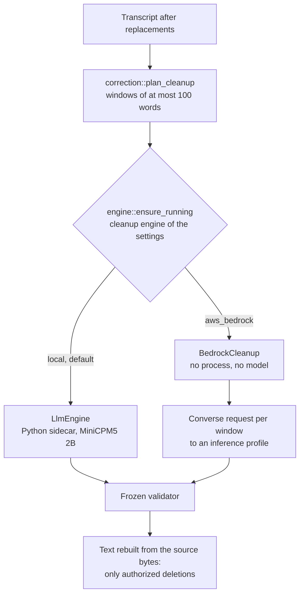

# AWS Bedrock as an Optional Cloud Cleanup Engine

- **Version:** 1.1
- **Date:** 2026-11-20
- **Status:** Implemented

## Table of Contents

1. [Summary](#1-summary)
2. [Problem Statement](#2-problem-statement)
3. [Design Overview](#3-design-overview)
4. [Detailed Design](#4-detailed-design)
5. [Edge Cases](#5-edge-cases)
6. [File Changes](#6-file-changes)
7. [Testing Strategy](#7-testing-strategy)
8. [Migration Plan](#8-migration-plan)
9. [Security Considerations](#9-security-considerations)
10. [Cost Analysis](#10-cost-analysis)
11. [Implementation Tasks](#11-implementation-tasks)
12. [Implementation Status](#12-implementation-status)
13. [Review Log](#13-review-log)

## 1. Summary

AI cleanup removes clear fillers and accidental repeats from a dictation. It
runs on the Mac with MiniCPM5 2B in a Python sidecar. This specification adds
a second cleanup engine, Amazon Bedrock, that the user can select in
Settings. The local engine stays the default. With Amazon Bedrock selected,
SottoASR starts no sidecar and loads no cleanup model, and it sends the text
of a dictation to a model in the AWS account of the user.

The feature follows the pattern of the optional speech engine
([AWS Transcribe specification](2026-11-20-aws-transcribe-cloud-mode.md)):
optional, off by default, named in the interface, with an AWS profile of the
user.

## 2. Problem Statement

The local cleanup model has a download of 1,427 MB and stays in memory while
cleanup is on. Some users prefer a cloud model, or have too little memory for
the local one. Today the only choice is the local model.

The requirements, from the maintainer:

1. AI cleanup can use an Amazon Bedrock inference in place of the local model.
2. The user selects the engine in Settings. Amazon Bedrock is not the default:
   if AI cleanup is on, the engine is local until the user selects Amazon
   Bedrock.
3. For Amazon Bedrock, the user selects an AWS profile, a Region and a model.
4. The model options are Haiku 5.5, Sonnet 5.5, Opus 5.5 and GPT-6.2 Sol.
5. Each of the four models is tested against the real service.

## 3. Design Overview



The design has three parts:

- **A second `LlmBackend`.** `BedrockCleanup` implements the trait that the
  sidecar implements. The planner, the windows, the validator, the deadlines
  and the status values do not change. The delivered text is always rebuilt
  from the source bytes, so a cloud model can only cause deletions that the
  validator authorizes, as the local model can.
- **One factory that reads the settings.** `engine::ensure_running` is the
  only place that makes a backend. It makes the backend of the saved cleanup
  engine. In Amazon Bedrock mode nothing starts the sidecar.
- **The same prompt.** The request uses the pinned prompt pair of the
  sidecar. A test proves that the Rust copy has the pinned hash.

## 4. Detailed Design

### 4.1 Evidence from the real service

All measurements: 2026-11-20, profile `demerzel-sandbox` (a sandbox
account), Region `us-west-2`, `boto3` 1.42.79 and the AWS CLI, with the
pinned prompt of the sidecar and the 40 fixture sentences of
`benchmarks/llm/release-smoke/cases.json` and
`benchmarks/llm/sparse-holdout.json`. The probe was throwaway code.

| Question | Result |
| --- | --- |
| Do the four models exist in the account? | Yes: `anthropic.claude-haiku-5-5`, `anthropic.claude-sonnet-5-5`, `anthropic.claude-opus-5-5` and `openai.gpt-6.2-sol`. Each has the inference type `INFERENCE_PROFILE` only: a request must name an inference profile |
| Does the Converse API serve all four? | Yes. Each returned text with the stop reason `end_turn` |
| `temperature` | All four reject it. Claude: "`temperature` is deprecated for this model." GPT-6.2 Sol: "This model doesn't support the temperature field." |
| Reasoning | Claude models can return a `reasoningContent` block before the text. Opus 5.5 rejects `thinking.type: disabled`. All three Claude models accept `output_config.effort: low`. GPT-6.2 Sol rejects the effort `none` and rejects the Claude fields |
| Time per sentence, retype mode, six requests at a time | Haiku 5.5: median 0.69 s, 95th percentile 1.28 s. Sonnet 5.5: 0.67 s and 1.45 s. Opus 5.5: 1.45 s and 2.58 s. GPT-6.2 Sol: 0.64 s and 0.73 s |
| Longest time | 3.7 s, 5.1 s, 8.8 s and 1.2 s, for inputs that are longer than a cleanup window |
| Input tokens of one request (prompt and a short sentence) | 949 for the Claude models, 577 for GPT-6.2 Sol |
| Replace mode | All four return edit lines or `<KEEP>` |

Inference profiles for the four models, from `ListInferenceProfiles` in each
Region that the account has enabled:

| Regions | Profiles |
| --- | --- |
| `us-east-1`, `us-east-2`, `us-west-1`, `us-west-2` | `us.` and `global.` for all four models |
| `ca-central-1` | `ca.` for Haiku and Sonnet; `us.` and `global.` for all four |
| `eu-central-1`, `eu-north-1`, `eu-west-1`, `eu-west-2`, `eu-west-3` | `eu.` for the three Claude models; `global.` for all four |
| `ap-northeast-1`, `ap-northeast-3` | `jp.` for Haiku and Opus; `global.` for all four |
| `ap-southeast-2` | `au.` for the three Claude models; `global.` for all four |
| `ap-northeast-2`, `ap-south-1`, `ap-southeast-1`, `sa-east-1` | `global.` only |

Destination Regions of each geographic profile: `us.` uses `us-east-1`,
`us-east-2`, `us-west-1` and `us-west-2`. `ca.` uses `ca-central-1` and
`ca-west-1`. `eu.` uses `eu-central-1`, `eu-north-1`, `eu-south-1`,
`eu-south-2`, `eu-west-1` and `eu-west-3`. `jp.` uses `ap-northeast-1` and
`ap-northeast-3`. `au.` uses `ap-southeast-2` and `ap-southeast-4`.

Facts from the AWS documentation, read on 2026-11-20:

- A geographic inference profile keeps the request inside its geography. A
  global profile lets Amazon Bedrock select a commercial Region worldwide.
  The data stays on the AWS network and is encrypted between Regions
  ([cross-Region inference](https://docs.aws.amazon.com/bedrock/latest/userguide/cross-region-inference.html)).
- Model providers have no access to prompts and completions
  ([data protection](https://docs.aws.amazon.com/bedrock/latest/userguide/data-protection.html)).
- For OpenAI models such as GPT-6.2 Sol, Amazon Bedrock keeps traffic that
  its classifier flags for up to 30 days, for automated abuse detection. The
  three Claude 5.5 models are not in the list of models with retention
  ([abuse detection](https://docs.aws.amazon.com/bedrock/latest/userguide/abuse-detection.html),
  [data retention](https://docs.aws.amazon.com/bedrock/latest/userguide/data-retention.html)).
- A role needs `bedrock:InvokeModel` on the inference profile and on the
  foundation model in each destination Region
  ([prerequisites](https://docs.aws.amazon.com/bedrock/latest/userguide/inference-profiles-prereq.html)).
- AWS bills the input and output tokens
  ([pricing](https://aws.amazon.com/bedrock/pricing/)).

### 4.2 Decisions that follow from the evidence

- **The Converse API for all four models.** One request shape serves the
  Claude models and GPT-6.2 Sol.
- **No `temperature`.** The request has `maxTokens` only. The Claude models
  also get `output_config.effort: low`, because cleanup needs no reasoning
  and reasoning adds time.
- **The geographic inference profile of the Region, else the global one.**
  The Region that the user selects thus decides where AWS processes the text,
  when AWS has a profile for that. The table of section 4.5 has only the rows
  that `ListInferenceProfiles` returned. The interface shows the profile and
  where AWS processes the text, before the user saves.
- **The pinned prompt, unchanged.** The validator decides what changes, not
  the model. One prompt keeps one behaviour to qualify.
- **One request per window, all windows of a batch at the same time.** A
  batch has at most 16 windows. Sixteen requests in sequence do not fit the
  10 s that a batch has.

### 4.3 Settings

`models.rs`:

```rust
#[derive(Default)] #[serde(rename_all = "snake_case")]
pub enum CleanupEngine { #[default] Local, AwsBedrock }

pub enum BedrockModel {            // serde names
    #[default] Haiku55,            // "haiku-5.5"
    Sonnet55,                      // "sonnet-5.5"
    Opus55,                        // "opus-5.5"
    Gpt62Sol,                      // "gpt-6.2-sol"
}

pub struct AwsBedrockSettings {
    pub profile: Option<String>,   // name in ~/.aws/config or ~/.aws/credentials
    pub region: Option<String>,    // None: the region of the profile
    pub model: BedrockModel,
}

pub struct Settings {
    // ...
    #[serde(default)] pub cleanup_engine: CleanupEngine,
    #[serde(default)] pub aws_bedrock: AwsBedrockSettings,
}
```

`llm_cleanup_enabled` keeps its meaning: AI cleanup is on or off. The engine
is a second choice. `normalize` trims the two strings and turns an empty
value into `None`. `validate` rules:

| Rule | Error |
| --- | --- |
| Cleanup is on, the engine is `aws_bedrock`, and no profile | "Choose an AWS profile for AWS Bedrock." |
| Profile longer than 128 characters or with a control character | "The AWS profile name is not valid." |
| Region not in the list of section 4.5 | "Choose a Region where Amazon Bedrock has the cleanup models." |

The format rules apply in both modes. An unknown model name fails to load, as
all unknown enum values do.

### 4.4 Shared AWS code

AWS Transcribe and Amazon Bedrock need the same profile list, the same
credentials provider and the same reading of an SDK error. A new module
`aws` holds them:

| Item | Content |
| --- | --- |
| `aws/profiles.rs` | The file `asr/aws_profiles.rs`, moved. `AwsProfile`, `list()` |
| `aws::resolve(profile, region, profiles, service)` | The selected profile must be in the AWS files. The Region is the one of the settings, else the one of the profile. The errors name the service |
| `aws::sdk_config(profile, region, retry)` | The SDK configuration: rustls with `ring`, `ProfileFileCredentialsProvider` for the selected profile only, a connection time limit of 10 s |
| `aws::Cause` and `aws::cause(error)` | What an `SdkError` means: a service error with its code and message, a credentials error, a connection error, or another error |
| `aws::credentials_text`, `aws::shortened` | The sentences that AWS Transcribe has today |

`asr/aws_transcribe.rs` uses these items. Its texts and its tests do not
change.

### 4.5 Regions, models and inference profiles

`llm/bedrock.rs` has these constants:

- **Regions:** the 17 Regions of section 4.1, with code and name.
- **Models:** the four models with the setting name, the display name
  ("Claude Haiku 5.5", "Claude Sonnet 5.5", "Claude Opus 5.5", "GPT-6.2
  Sol") and the Amazon Bedrock model identifier.
- **Geographies:** the table that follows. `route(region, model)` returns the
  inference profile and the geography.

| Geography | Prefix | Regions | Models |
| --- | --- | --- | --- |
| United States | `us.` | `us-east-1`, `us-east-2`, `us-west-1`, `us-west-2` | All four |
| Canada | `ca.` | `ca-central-1` | Haiku 5.5, Sonnet 5.5 |
| European Union | `eu.` | `eu-central-1`, `eu-north-1`, `eu-west-1`, `eu-west-2`, `eu-west-3` | Haiku 5.5, Sonnet 5.5, Opus 5.5 |
| Japan | `jp.` | `ap-northeast-1`, `ap-northeast-3` | Haiku 5.5, Opus 5.5 |
| Australia | `au.` | `ap-southeast-2` | Haiku 5.5, Sonnet 5.5, Opus 5.5 |

Each other combination uses `global.`. The inference profile identifier is
the prefix and the model identifier, for example
`us.anthropic.claude-haiku-5-5`.

The sentence for a geography is "AWS processes the text in (the United
States, Canada, the European Union, Japan, Australia)." The sentence for the
global profile is "AWS can process the text in any commercial AWS Region."

### 4.6 The Bedrock backend

`llm/bedrock.rs`, `pub struct BedrockCleanup`. It implements `LlmBackend`:

| Method | Behaviour |
| --- | --- |
| `is_alive` | `true` |
| `cleanup_batch(texts, mode)` | Section "One batch" that follows |
| `request_raw` | An error. Only the load of the local model calls it |
| `shutdown` | Nothing to stop |
| `bedrock_options` (new trait method, default `None`) | The options that the backend was made for |

**Prompt.** `llm/cleanup-prompts.json` holds the prompt pair of the sidecar:
`system`, `fewshot`, `user_prefix` and `user_suffix` for `retype` and
`replace`. A test computes the canonical hash of the file, as the sidecar
does, and compares it with `engine::PROMPT_SHA256`. The request text is the
text that `build_prompt` of the sidecar makes: the system text and the
examples in the `system` field, and the window between the prefix and the
suffix as the one user message.

**One batch.**

1. Make one Converse request for each text, and run them at the same time.
2. Each request has the inference profile, the system text, the user
   message and `maxTokens` 4,096. For a Claude model it also has
   `additionalModelRequestFields` `{"output_config": {"effort": "low"}}`.
3. Each request has a time limit of 10 s, the limit of a local batch.
4. Join the `text` blocks of the answer. Ignore `reasoningContent` blocks.
5. Map each answer to a `BatchItem`:

| Answer | `BatchItem` |
| --- | --- |
| Text, stop reason `end_turn` or `stop_sequence` | `Proposal(Some(text))`, without one trailing line break |
| Stop reason `max_tokens` | `Failed("incomplete_generation")` |
| Other stop reason, or no text block | `Failed("no_text")` |
| Text longer than 32,000 bytes | `Failed("proposal_limit")` |
| Time limit | `TimedOut` |
| Throttling or a model error for this request | `Failed` with the code of the service |

6. If a request fails because of the credentials, the permission, the
   request itself or the connection, the batch returns `Err` with a sentence
   for the user. Each other request of the batch would fail in the same way.

The engine blocks on the requests with the handle of the current Tokio
runtime. The planner already calls a backend on a blocking worker.

**Client.** The backend builds the SDK client when it is made and keeps it.
The SDK retries a request one time. `ensure_running` makes a new backend
after an error that drops the handle, and after a change of the options.

**Errors.** One function maps each cause to a sentence. No sentence contains
the words that `is_zombie_error` looks for.

| Condition | Text |
| --- | --- |
| No profile | "Choose an AWS profile for AWS Bedrock in Settings." |
| Profile not defined | "AWS profile (name) was not found in ~/.aws/config or ~/.aws/credentials." |
| No Region | "AWS profile (name) has no Region. Choose a Region in Settings." |
| Region of the profile not in the list | "Amazon Bedrock has no cleanup model in (region). Choose a Region in Settings." |
| Credential provider error | The text of AWS Transcribe (section 4.4) |
| `UnrecognizedClientException`, `ExpiredTokenException`, `InvalidSignatureException` | "The credentials of AWS profile (name) are not valid or are expired. Sign in again." |
| `AccessDeniedException` | "AWS profile (name) cannot use (model) in Amazon Bedrock. It needs the permission bedrock:InvokeModel and access to the model." |
| `ResourceNotFoundException` | "Amazon Bedrock does not have (model) in (region) for this account." |
| `ValidationException` | "Amazon Bedrock did not accept the request: (message)" |
| `ThrottlingException`, `ServiceQuotaExceededException` | "Amazon Bedrock has too many requests for this account. Try again in a moment." |
| Other service error | "Amazon Bedrock had an error: (message)" |
| Connection error | "Could not connect to Amazon Bedrock in (region). Examine your internet connection." |

### 4.7 Engine selection and memory

`engine::ensure_running` reads the cleanup engine and the Bedrock options of
the saved settings:

| Saved engine | Resident handle | Result |
| --- | --- | --- |
| Local | Local and alive | Use it, as today |
| Local | None, dead, or a Bedrock backend | Drop it. Start the sidecar, as today |
| Amazon Bedrock | A Bedrock backend with the same options | Use it |
| Amazon Bedrock | A Bedrock backend with other options | Drop it. Make a new one |
| Amazon Bedrock | The local sidecar | Stop the sidecar. Make a Bedrock backend |

The load of the local model (`load_locked`, for Settings and app start) calls
`ensure_local`, the local half of the factory. It never gets a Bedrock
backend.

**Paths that start the local sidecar, and how Amazon Bedrock mode closes
each:**

| Path | In Amazon Bedrock mode |
| --- | --- |
| App start preload (`lib.rs`) | Returns before preparation |
| Stop-path cleanup and History reprocess (`ensure_running`) | Makes the Bedrock backend |
| Recording-start prewarm (`prewarm_sidecar`) | Sends nothing. If a local sidecar is resident and no operation runs, it stops the sidecar |
| Settings preparation (`prepare_llm_model`, `repair_llm_runtime`) | Still runs when the user asks for the local engine in the window. Section "Change in Settings" covers the result |

**Change in Settings.** `update_settings` calls
`llm::cleanup_settings_saved(app, previous, current)`. It replaces
`notify_on_cleanup_preference_saved`. It starts a task if cleanup went off,
or the engine or the Bedrock options changed. The task takes
`llm_operation` and reads the settings again:

| Saved state | Action |
| --- | --- |
| Cleanup off | Stop the resident backend, as today |
| Amazon Bedrock | Stop the resident backend. The next cleanup makes the Bedrock backend |
| Local, and the previous engine was Amazon Bedrock | Drop the Bedrock backend. Start the preparation of the local model in the background, as app start does |

The task emits `llm-preparation-changed`, so that open windows read the
status again.

A user can prepare the local model in the window while Amazon Bedrock is
saved, and then not save. The local sidecar is then resident in Amazon
Bedrock mode. The next recording start or the next cleanup stops it. This is
the only time when the setting says Amazon Bedrock and a local cleanup model
is in memory.

**Status.** `LlmStatus` keeps its fields. They describe the local model in
both modes, because the Settings window prepares and removes the local model
in both modes. It gets three fields:

| Field | Value |
| --- | --- |
| `engine` | The saved cleanup engine |
| `notice` | Amazon Bedrock only: "SottoASR sends dictation text to Amazon Bedrock in (region) with the AWS profile (name). The model is (model)." |
| `cloud_error` | Amazon Bedrock only: why no request can be made (the first four rows of the error table) |

### 4.8 Commands

| Command | Result |
| --- | --- |
| `get_bedrock_cleanup_options` | `{ profiles: [{ name, region }], profiles_error, regions: [{ code, name, routes: [{ model, inference_profile, processed_in }] }], models: [{ id, name }] }` |
| `test_bedrock_cleanup(options: AwsBedrockSettings)` | Sends the fixed sentence "Please um keep this readiness check short." through a new backend, in retype mode. Returns `{ region, model, inference_profile, seconds }` or the error text of section 4.6 |

The test uses the values in the window, before Save. It does not touch the
resident backend. The test passes if the model returns a proposal.

### 4.9 Interface

**Settings, Dictation tab, card "Transcript cleanup".** The toggle stays. The
sentence below it becomes "Accepted cleanup is applied automatically. The
original remains in History. Off by default." Then a new part
(`settings-cleanup-engine.svelte`) with two radio buttons, "Cleanup engine":

- "On this Mac": "MiniCPM5 2B. The text stays on this Mac."
- "AWS Bedrock": "A cloud service of Amazon Web Services. No cleanup model is
  in memory. Needs an AWS account and an internet connection."

With "AWS Bedrock" selected, the part also shows:

- **AWS profile** (select). Empty list: "No AWS profile was found in
  ~/.aws/config or ~/.aws/credentials."
- **Region** (select). First option "From the profile (code)" if the profile
  has a Region of the list.
- **Model** (select): the four models.
- The route: "Inference profile (identifier). (sentence of section 4.5)"
- **Test connection** (button) and its result: "Amazon Bedrock answered in
  0.7 s (Claude Haiku 5.5, us-west-2)." or the error.
- The notice: "SottoASR sends the text of a dictation to Amazon Bedrock, with
  your AWS account, when the text has something to clean. AWS bills your
  account for the tokens. Amazon Bedrock does not give the text to the model
  provider. SottoASR examines each change that the model proposes, and it
  can only remove words." For GPT-6.2 Sol, one more sentence: "For this
  model, AWS can keep text that its abuse classifier flags for up to 30
  days." Then the links "How Amazon Bedrock protects your data" and
  "Pricing".

**Toggle and engine.**

| Action | Result |
| --- | --- |
| Turn cleanup on, engine "On this Mac" | The preparation of today (`cleanup.enable`) |
| Turn cleanup on, engine "AWS Bedrock" | The draft changes at once. No preparation |
| Select "AWS Bedrock" | The draft changes. A local preparation in flight is cancelled |
| Select "On this Mac" while cleanup is on, and the local model is not loaded | The preparation runs. The draft changes to the local engine only after it succeeds |
| Select "On this Mac" in each other case | The draft changes |

The messages about the download and the local setup show only for the local
engine. Save is blocked with "Choose an AWS profile for AWS Bedrock." when
cleanup is on with Amazon Bedrock and no profile.

**Model dashboard.** With `engine: "aws_bedrock"`, the cleanup card shows
"AWS Bedrock" as the name. The state is "Off" when cleanup is off, "Needs
attention" with `cloud_error`, else "Ready" with "A cloud service. No cleanup
model is in memory." and the notice. It hides "Repair cleanup runtime".

**Advanced tab, "Local models".** "Remove cleanup model" is disabled only
while cleanup is on with the local engine, in the draft or in the saved
settings. Thus a user of Amazon Bedrock can remove the local model.

**Other text.** The speech engine card says "Parakeet Ultra. The audio stays
on this Mac." The setup window says "Audio and text stay on your Mac unless
you choose a cloud engine". The About window lists Amazon Bedrock with the
AWS SDK.

### 4.10 Documents and website

- `website/index.html`: the "Cloud When You Choose" card names both cloud
  engines. The cleanup card says that the local model is the default.
- `README.md` (new section "AWS Bedrock (optional)"), `SECURITY.md` (new row
  in the network table: dictation text to Amazon Bedrock),
  `DEVELOPMENT.md`, `AGENTS.md`, `.claude/CLAUDE.md`,
  `.claude/rules/project.md`, `docs/designs/architecture.md`,
  `THIRD_PARTY_LICENSES`, `LICENSE`, `CHANGELOG.md`.

## 5. Edge Cases

| Case | Behaviour |
| --- | --- |
| Start with Amazon Bedrock saved | No sidecar, no model load. The first cleanup makes the client |
| Start with Amazon Bedrock saved, offline | The application starts. A cleanup fails with the connection text, and the dictation is pasted without cleanup |
| Credentials expire | The cleanup fails with the credentials text. The dictation is pasted without cleanup. The next cleanup makes a new backend, so a new sign-in works without a restart |
| The profile is removed from the AWS files | Status "Unavailable" with "AWS profile (name) was not found ...". The dashboard shows "Needs attention" |
| The profile has a Region that is not in the list, and no Region is selected | "Amazon Bedrock has no cleanup model in (region). Choose a Region in Settings." |
| One window fails or passes its time limit | Only that window stays raw. The other windows apply, as with the local engine |
| The model rewrites words, or adds words | The validator rejects the proposal. The text stays as it was |
| The model returns a `reasoningContent` block | Ignored |
| A dictation with nothing to clean | No window is sent. Nothing goes to AWS |
| A dictation in another language | "Cleanup supports English ...", as today. Nothing goes to AWS |
| Cancelled recording | Cleanup does not run for a cancelled recording, as today |
| Reprocess of a kept recording | Cleanup runs with the saved engine. With Amazon Bedrock, the text goes to AWS |
| Switch to Amazon Bedrock while the local sidecar is resident | The save task stops the sidecar |
| Switch to Amazon Bedrock during a local cleanup | The save task waits for `llm_operation`. The cleanup ends locally |
| Switch to local, model not downloaded | The window ran the preparation before the draft changed. If the settings come from a file, the background preparation downloads the model |
| Only the Bedrock options change | The save task drops the backend. The next cleanup makes one for the new options |
| Cleanup off, engine Amazon Bedrock, no profile | Valid. Nothing runs |
| Replace mode with Amazon Bedrock | The model returns edit lines. The parser and the validator of today apply them |
| Throttling | The windows that AWS refused stay raw. Status "Failed" with the text about too many requests |
| Settings file of this version read by an older version | Unknown keys are ignored. The older version uses the local model |

## 6. File Changes

| File | Change |
| --- | --- |
| `src-tauri/Cargo.toml`, `Cargo.lock` | `aws-sdk-bedrockruntime` 1.157 (`default-features = false`, `rt-tokio`) |
| `src-tauri/src/aws/mod.rs`, `aws/profiles.rs` (new; moved from `asr/aws_profiles.rs`) | Section 4.4 |
| `src-tauri/src/asr/aws_transcribe.rs`, `asr/mod.rs`, `commands/speech.rs`, `commands/setup.rs` | Use the `aws` module |
| `src-tauri/src/llm/bedrock.rs` (new), `llm/cleanup-prompts.json` (new), `llm/mod.rs` | Sections 4.5 and 4.6 |
| `src-tauri/src/llm/engine.rs` | `LlmBackend::bedrock_options`; `ensure_running` by engine; `ensure_local` |
| `src-tauri/src/llm/cleanup.rs` | Prewarm in Amazon Bedrock mode |
| `src-tauri/src/models.rs` | `CleanupEngine`, `BedrockModel`, `AwsBedrockSettings`, two settings fields, rules, three `LlmStatus` fields, tests |
| `src-tauri/src/commands/llm.rs` | Two commands, `cleanup_settings_saved`, status |
| `src-tauri/src/commands/settings.rs`, `lib.rs` | The save hook; commands registered; app start preload |
| `src/lib/utils/tauri.ts`, `src/lib/stores/settings.svelte.ts` | Types, defaults, two wrappers |
| `src/lib/components/settings-cleanup-engine.svelte` (new, + test) | The part of section 4.9 |
| `src/lib/components/settings-dictation.svelte`, `model-dashboard.svelte` (+ test), `settings-advanced.svelte`, `settings-panel.svelte`, `settings-speech-engine.svelte` (+ test), `onboarding-view.svelte`, `about-view.svelte` | Text and state for the two engines |
| `website/index.html` and the documents of section 4.10 | Section 4.10 |

## 7. Testing Strategy

| Area | Tests |
| --- | --- |
| Settings | Defaults are local and Haiku 5.5; an old file loads as local; round trip with the serde names; each rule of section 4.3 |
| Routes | Each row of the table of section 4.5; a model without a geographic profile gets `global.`; each Region of the list has a route for each model |
| Prompt | The hash of `cleanup-prompts.json` is `PROMPT_SHA256`; the request text for a sentence equals the text that `build_prompt` makes |
| Answers | Each row of the `BatchItem` table from a built Converse output |
| Error text | Each row of the error table from a built SDK error; no text matches `is_zombie_error` |
| Engine selection | Each row of the table of section 4.7 with stand-in backends; the load of the local model never gets a Bedrock backend |
| Save hook | Each row of the "Change in Settings" table |
| Interface | Local default shows no AWS field; AWS Bedrock shows the fields and the route; the toggle with each engine; the test button calls the command with the values in the window |
| AWS Transcribe | Its tests pass without a change of an assertion, after the move to the `aws` module |
| Real service (throwaway, not in the repository) | Through `cleanup::run_cleanup` and `BedrockCleanup`: the 40 fixture sentences with each of the four models, in retype mode, and with one model in replace mode. For each: the status, and whether the text is the target, the source, or another text. A must-keep sentence must stay as it is. Also the connection test for each model, and each failure of the error table that the account can make |
| Running application (throwaway) | The Settings page in the WKWebView of a development build: select Amazon Bedrock, test, save; the log shows no sidecar; a reprocess cleans a text through Amazon Bedrock |
| Suite | `scripts/pre-release-check.sh --auto-only` |

Real requests use the AWS profile `demerzel-sandbox` of the maintainer (a
sandbox account) with fixture sentences and synthetic audio only.

## 8. Migration Plan

None for data. A settings file without the new keys loads with the local
engine. Amazon Bedrock is used only after the user selects it and saves.

## 9. Security Considerations

- **What leaves the Mac, and when.** Only with cleanup on and Amazon Bedrock
  selected: the windows of a dictation text that can change, after the
  dictation ends; the same for a recording that the user reprocesses; and one
  fixed sentence for a connection test. Never: audio, History, vocabulary
  words, replacement rules, a cancelled recording, text with nothing to
  clean.
- **Where it goes.** The Amazon Bedrock runtime endpoint of the selected
  Region, over TLS with the system root certificates. AWS processes it in
  the geography of the inference profile, or in any commercial Region for a
  global profile. The interface shows which.
- **What comes back.** A proposal. The validator authorizes deletions only,
  and the delivered text is rebuilt from the source bytes. A model that
  follows an instruction in the dictation cannot put its answer into the
  text.
- **Credentials.** As for AWS Transcribe: SottoASR stores none, and the SDK
  reads the AWS files of the user.
- **Data use by AWS.** Section 4.1. The notice gives the retention for
  GPT-6.2 Sol.
- **Logs.** Logs name the profile, the Region and the model, never a key, a
  token or dictation text.
- **Dependencies.** One new crate, `aws-sdk-bedrockruntime` (Apache-2.0). No
  new TLS library.

## 10. Cost Analysis

| Item | Local | Amazon Bedrock |
| --- | --- | --- |
| Memory for cleanup | The sidecar with the model; measured in section 12 | No process and no model |
| Disk | 1,427 MB for the model, plus the Python runtime | None |
| Time for one window | Measured in section 12 | About 0.7 s for Haiku 5.5, Sonnet 5.5 and GPT-6.2 Sol; about 1.5 s for Opus 5.5 |
| Money | None | AWS bills the tokens: about 950 input tokens per window for a Claude model, about 580 for GPT-6.2 Sol |
| Network | None | One request per window that can change |

Section 12 has the measured size of the application binary.

## 11. Implementation Tasks

1. Dependency.
2. The `aws` module; AWS Transcribe on it.
3. Settings types and rules; TypeScript types and defaults.
4. `cleanup-prompts.json` and its hash test.
5. `bedrock.rs`: regions, routes, request, answers, errors, backend, test.
6. `ensure_running` by engine, `ensure_local`, prewarm, app start, the save
   hook, status.
7. Commands.
8. Interface; tests.
9. Real-service checks for each model; the check in the running application.
10. Documents, website, licenses, changelog.
11. `scripts/pre-release-check.sh --auto-only`; section 12.

## 12. Implementation Status

Implemented on 2026-11-20. All tasks of section 11 are done.

### 12.1 Checks

| Check | Result |
| --- | --- |
| `cargo test --locked` | 387 passed |
| `cargo clippy --locked --all-targets -- -D warnings` | No finding |
| `cargo check` with `asr-parakeet` | Pass |
| `npm test` | 182 passed in 21 files |
| `npm run check` | 0 errors in 225 files |
| `scripts/ci-checks.sh` and the script tests | Pass |
| `cargo tree` for `aarch64-apple-darwin` | rustls with `ring` only. No `native-tls`, `openssl` or `aws-lc` package is built |
| `scripts/pre-release-check.sh --auto-only` | 14 of 14 steps passed: 387 Rust tests, 182 frontend tests, 35 sidecar tests, `cargo audit`, `npm audit` and the unsigned packaging |
| `cargo audit` | No vulnerability in 686 packages. The 10 allowed warnings are about crates that the application had before |
| AWS Transcribe tests | Pass after the move to the `aws` module. The test of the credentials text moved to `aws/mod.rs` with its assertions |

### 12.2 The real service

Conditions: 2026-11-20, Apple M2 Pro, profile `demerzel-sandbox` (a
`credential_process` profile of a sandbox account), Region `us-west-2`
unless the text gives another Region. Each request went through the code of
the application: `cleanup::run_cleanup` with the real planner, the real
validator and `BedrockCleanup`, or `bedrock::test_connection`. The tests
that made the requests were throwaway code. They are not in the repository.

**Connection test.** Each of the four models answered: Claude Haiku 5.5 in
1.0 s, Claude Sonnet 5.5 in 0.9 s, Claude Opus 5.5 in 1.7 s and GPT-6.2 Sol
in 0.9 s. Then the test ran for each model in each of the 17 Regions: 68 of
68 answered, in a median of 1.6 s and at most 4.4 s. Each answer came
through the inference profile of the table of section 4.5. A second
account answered for Claude Haiku 5.5 and GPT-6.2 Sol.

**Fixture sentences.** The 40 sentences of
`benchmarks/llm/release-smoke/cases.json` and
`benchmarks/llm/sparse-holdout.json`, one cleanup for each sentence. "Target"
is the expected text or an accepted text. "Source" is the text as it was.
The times are for one sentence.

| Engine, retype mode | Target | Source | Other text | Median | 95th percentile |
| --- | ---: | ---: | ---: | ---: | ---: |
| Local MiniCPM5 2B | 33 | 3 | 4 | 0.22 s | 0.39 s |
| Claude Haiku 5.5 | 32 | 4 | 4 | 0.64 s | 0.85 s |
| Claude Sonnet 5.5 | 34 | 2 | 4 | 0.61 s | 0.86 s |
| Claude Opus 5.5 | 33 | 3 | 4 | 1.16 s | 3.43 s |
| GPT-6.2 Sol | 35 | 3 | 2 | 0.61 s | 0.90 s |

| Engine, replace mode | Target | Source | Other text | Median | 95th percentile |
| --- | ---: | ---: | ---: | ---: | ---: |
| Claude Haiku 5.5 | 33 | 5 | 2 | 0.66 s | 1.36 s |
| Claude Sonnet 5.5 | 32 | 5 | 3 | 0.89 s | 1.23 s |
| Claude Opus 5.5 | 34 | 3 | 3 | 1.39 s | 2.97 s |
| GPT-6.2 Sol | 35 | 3 | 2 | 0.57 s | 0.79 s |

- No sentence got a word that was not in the source. Each "other text" is
  the source with fewer words.
- In replace mode, three answers of Claude Haiku 5.5 and one of Claude
  Sonnet 5.5 were not a valid edit script. Those sentences stayed as they
  were.
- Two sentences were detected as not English. No request was made for them.
- No local sidecar started in a run with a cloud model.

**The must-keep sentences.** Section 7 said that a must-keep sentence must
stay as it is. This did not hold, for the cloud models and for the local
model. Of the 16 sentences where the expected text is the source, three
changed with the local model and with each Claude model, and two changed
with GPT-6.2 Sol: "Um, Kim, and Lee joined ..." lost "Um," (not with GPT-6.2
Sol), "um, hello there" lost "um," and "The final code is 8472, um." lost
", um". The validator authorizes these deletions for each engine. This
specification does not change the validator. Thus the cloud engine does
what the local engine does for these sentences.

**Long dictation.** The 15 sentences of the smoke set, repeated. One
cleanup for the whole text.

| Model | 403 words | 1,508 words |
| --- | --- | --- |
| Claude Haiku 5.5 | 1.9 s | 1.7 s |
| Claude Sonnet 5.5 | 1.6 s | 1.9 s |
| Claude Opus 5.5 | 4.9 s | 5.8 s |
| GPT-6.2 Sol | 1.6 s | 1.5 s |

Each cleanup ended with the status "Applied". AWS did not throttle the
requests, which go 16 at a time.

**Failures.** The connection test and the cleanup gave these texts:

| Condition | Result |
| --- | --- |
| No profile | "Choose an AWS profile for AWS Bedrock in Settings." |
| A profile that the AWS files do not have | "AWS profile "not-a-profile" was not found in ~/.aws/config or ~/.aws/credentials." |
| A Region that is not in the list | "Choose a Region where Amazon Bedrock has the cleanup models." |
| A profile with the Region `me-central-1`, and no Region selected | "Amazon Bedrock has no cleanup model in me-central-1. Choose a Region in Settings." |
| A profile without a Region, and no Region selected | "AWS profile "no-region" has no Region. Choose a Region in Settings." |
| A `credential_process` file that does not exist | "Could not get credentials for AWS profile ...: ... No such file or directory." |
| A `credential_process` command without its path | The same text with "command not found", and the sentence about the PATH |
| Expired keys in `~/.aws/credentials` | "The credentials of AWS profile "default" are not valid or are expired. Sign in again." |
| A role without the Amazon Bedrock permission | "AWS profile ... cannot use Claude Sonnet 5.5 in Amazon Bedrock. It needs the permission bedrock:InvokeModel and access to the model." |
| A closed endpoint (`AWS_ENDPOINT_URL`) | "Could not connect to Amazon Bedrock in us-west-2. Examine your internet connection.", after 0.1 s |

A cleanup that failed returned the text as it was, with the status
"Failed" and the sentence.

**A repaired sign-in.** A cleanup failed because the `credential_process`
of the profile did not exist. Then the AWS file got a command that works.
The next cleanup in the same process applied in 1.0 s. Section 12.7 has the
change that this needed.

### 12.3 Memory and processes

- **Local engine.** After the 40 sentences, the sidecar had a physical
  footprint of 1.7 GB, with a peak of 2.3 GB (`vmmap --summary`).
- **Amazon Bedrock.** There is no sidecar process. In the running
  application (section 12.4), a sample each second found no sidecar from
  the Save of Amazon Bedrock until the user selected "On this Mac" again,
  and none after a start with Amazon Bedrock saved.

### 12.4 Check in the running application

A development build of the real application ran in a scratch home folder,
with the real backend, the WKWebView and the real service. A throwaway
script in the pages clicked the real controls. The recordings were
synthetic speech with fillers and repeated words. The speech engine was the
local one. The script is not in the repository.

| Step | Result |
| --- | --- |
| Start with cleanup on and the local engine | The sidecar started. The dashboard showed "Ready", "MiniCPM5 2B (official, 4-bit)" |
| Reprocess a recording | "AI cleaned" in 1.3 s with the local model |
| Settings, Dictation: select "AWS Bedrock" | The fields showed: 6 profiles, 17 Regions, 4 models. "Test connection" was disabled without a profile |
| Select the profile | Region "From the profile (us-west-2)". "Inference profile us.anthropic.claude-haiku-5-5. AWS processes the text in the United States." |
| "Test connection" for each model | "Amazon Bedrock answered in 1.0 s (Claude Sonnet 5.5, us-west-2).", 2.5 s (Claude Opus 5.5), 0.9 s (GPT-6.2 Sol), 1.0 s (Claude Haiku 5.5). The saved engine stayed local |
| Save | In less than 0.3 s: engine `aws_bedrock`, no local model loaded. The sidecar process ended in the same second. The dashboard showed "Ready", "AWS Bedrock", "A cloud service. No cleanup model is in memory." and the notice |
| Reprocess one recording with each model, with a Save of the model between | Each cleanup applied: Claude Haiku 5.5 in 1.1 s, Claude Sonnet 5.5 in 1.2 s, Claude Opus 5.5 in 2.2 s, GPT-6.2 Sol in 1.1 s. Each text lost fillers and repeated words only. History kept the original |
| Select "On this Mac" | "Preparing local cleanup…" with "Cancel setup". The AWS fields went away. The saved engine stayed Amazon Bedrock. After 5.7 s: "Ready. Save to enable AI cleanup." |
| Save | Engine `local`, model loaded, one sidecar process |
| Start again with Amazon Bedrock saved | The log has "Cloud cleanup engine selected — no cleanup model to load". No sidecar process. A reprocess applied the cleanup in 1.3 s: "AWS Bedrock cleanup: 4 window(s) in 1.3s (us.anthropic.claude-sonnet-5-5, us-west-2, profile sandbox)" |

**Layout.** The Settings page ran in a browser at 640 by 760 points, with
the answers that the real backend gave in the check above. The card, the
AWS fields, the route, the result of the connection test, the notice, the
dashboard and the Advanced tab had no clipped text and no horizontal
scroll. This look found the missing space of section 12.7.

### 12.5 Cost

The numbers of section 10 stay. One request has about 950 input tokens with
a Claude model and about 580 with GPT-6.2 Sol (section 4.1). A dictation of
1,508 words made requests for each of its windows, 16 at a time. The cost
in money was not measured.

### 12.6 Binary size

On this Mac, with Rust 1.96.0, the release binary for `aarch64-apple-darwin`
is 50,890,720 bytes, and its copy in the application bundle is 50,614,048
bytes. The AWS Transcribe specification gives 48,940,624 bytes for version
0.13.0, and it does not say for which of the two files. Thus the Amazon
Bedrock client adds between 1.7 MB and 2.0 MB (3.4% to 4.0%).

### 12.7 Changes after approval

- **A failed batch drops the backend.** The first implementation kept the
  Bedrock backend after a batch failed. A real test showed the result: after
  the AWS file was repaired, each cleanup still failed until a restart,
  because the SDK client reads the AWS files one time. Now
  `cleanup::sidecar_batch_request` drops a Bedrock backend that failed as a
  whole. The next cleanup makes a new client. This is what sections 4.6 and
  5 say.
- **One refused request does not fail the batch.** The first implementation
  failed the whole batch for throttling and for an error of the model. Now
  such a request gives `Failed` with the sentence for its window only, as
  the table of section 4.6 says. The `Failed` item has the sentence, not the
  code of the service, because the status shows it to the user.
- **Log text.** The log of a failed request has the causes of the error
  only (`aws::causes`). The `DisplayErrorContext` of the SDK adds a debug
  text that can contain the body of an answer. AWS Transcribe uses the same
  function now.
- **Advanced tab.** The first sentence of "Local models" said "Recordings
  and transcripts stay on your Mac." also with Amazon Bedrock in use. Now it
  says "AI cleanup uses AWS Bedrock. SottoASR sends dictation text to AWS.
  History and kept recordings stay on your Mac." when cleanup is on with
  Amazon Bedrock in the saved settings.
- **The change to "On this Mac" is in the store.** `CleanupSetup` got
  `selectLocal`, `selectingLocal` and `selectError`
  (`cleanup-setup.svelte.ts`, not in section 6). Thus the preparation
  continues when the user changes the tab. While it runs, the window shows
  "On this Mac" as selected, hides the AWS fields and shows the progress
  with "Cancel setup". The draft changes only after it succeeds. If it
  fails, the selection goes back to "AWS Bedrock" and the error shows below
  the two options.
- **Texts that section 4.9 does not have.** The close dialog says "AWS
  Bedrock needs an AWS profile. Choose one in Dictation to save, or discard
  this draft." The fields use "Choose a profile", "(not found)", "Try
  again" and "Testing…" of the speech engine card.
- **A missing space.** The notice for GPT-6.2 Sol had no space before "For
  this model". The component test now examines the two sentences together.
- **Dependencies.** `aws-smithy-types` is a direct dependency, for the
  model-specific fields of a request. `sha2` is a development dependency,
  for the hash test of the prompts. The lock file got one package,
  `aws-sdk-bedrockruntime`.
- **Replace mode** was tested with each of the four models, not with one.
- **Test stand-ins.** `test_support.rs` (not in section 6) has
  `CloudCleanupStandIn` and `StoppableSidecar`.

### 12.8 Not tested

- A dictation with the hotkey, the real microphone and the paste into
  another application, with Amazon Bedrock. Section 12.4 has the cleanup of
  recorded files in the running application.
- The Settings page in its own window, and the packaged build. In the check
  of section 12.4, the page ran in the History window of a development
  build.
- Throttling, an error of the model, the stop reason `max_tokens` and the
  10 s limit of a request, with the real service. Unit tests cover them.
- `ResourceNotFoundException`, for an account without access to a model.
- IAM Identity Center profiles, profiles that assume a role, and a profile
  with static keys that are valid.
- The fixture sentences in Regions other than `us-west-2`. The other 16
  Regions had the connection test only.
- Text of a person. All text came from fixture sentences and from synthetic
  speech.
- The cost in money.
- Macs other than the M2 Pro.

### 12.9 Known limits

- The model list and the inference profile table are fixed in the
  application. If AWS removes a model or changes a profile, the connection
  test and the cleanup show the error of AWS, and a new version of SottoASR
  is necessary.
- A user can prepare the local model in the window while Amazon Bedrock is
  saved, and then not save. The sidecar then stays until the next recording
  start or the next cleanup (section 4.7).
- With many windows at the same time, an account with a low quota can get
  throttled. The windows that AWS refused then stay as they were.

## 13. Review Log

### Pass 1: assumptions

Each claim about the service comes from a real request or from the AWS
documentation of section 4.1. Claims about the code come from the files.

Changes made:

- The first draft sent `temperature: 0`, as the sidecar samples without
  randomness. All four models reject the field, so the request has none.
- The first draft turned reasoning off with `thinking.type: disabled`. Opus
  5.5 rejects that value. `output_config.effort: low` works for the three
  Claude models. GPT-6.2 Sol gets no reasoning field.
- The first draft named the foundation model in the request. The four models
  have the inference type `INFERENCE_PROFILE` only, so the request names an
  inference profile.
- The first draft used the `us.` profile in `ca-central-1` for the two
  models that have no `ca.` profile. That sends text of a Canadian Region to
  the United States without a statement. Those two models use `global.`
  there, and the interface says so.
- `eu-west-2` can call the `eu.` profiles, but it is not one of their
  destination Regions. The sentence says "the European Union", which is true
  for the six destination Regions.
- `LlmStatus.loaded` is true only for a registered sidecar process. The
  first draft set it for Amazon Bedrock. The Settings window uses it to
  decide that a local preparation succeeded, so it stays a fact about the
  local model.

### Pass 2: completeness

Changes made:

- `load_locked` calls the factory and then sends the `load` request of the
  sidecar. With the factory by engine, it could get a Bedrock backend.
  `ensure_local` was added (section 4.7).
- The recording-start prewarm sends a sentence through the resident backend
  at each recording. With Amazon Bedrock that is a network request for each
  recording. The prewarm sends nothing in that mode.
- A local preparation in the window while Amazon Bedrock is saved leaves a
  sidecar in memory if the user does not save. Section 4.7 states it and
  closes it at the next recording start.
- "Remove cleanup model" was disabled while cleanup is on. A user of Amazon
  Bedrock must be able to remove 1,427 MB. The rule now names the local
  engine (section 4.9).
- "Repair cleanup runtime" shows for the status "Unavailable". Amazon
  Bedrock gives that status for a missing profile, and a repair of the local
  runtime does not help. The dashboard hides the button in that mode.
- The texts of the speech engine card and of the setup window said that text
  stays on the Mac. Section 4.9 changes them.
- Throttling, replace mode, a text with nothing to clean, another language
  and an older version that reads the new file were added to section 5.

### Pass 3: clarity

Changes made:

- Every interface string and error text is quoted.
- Section 4.7 lists each path that can start the local sidecar, with the
  reason why Amazon Bedrock mode closes it.
- The one period when the setting and the memory state differ is stated.
- The `BatchItem` table gives the result for each kind of answer, so that
  the per-window and the whole-batch failures are not mixed.
- The tasks build in order: dependency, shared AWS code, settings, prompt,
  backend, selection, commands, interface, real checks, documents.
